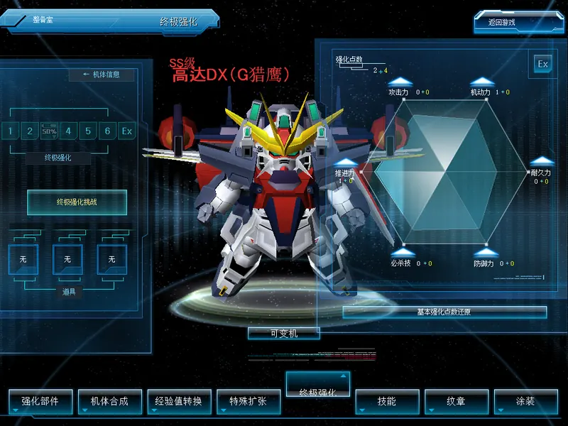
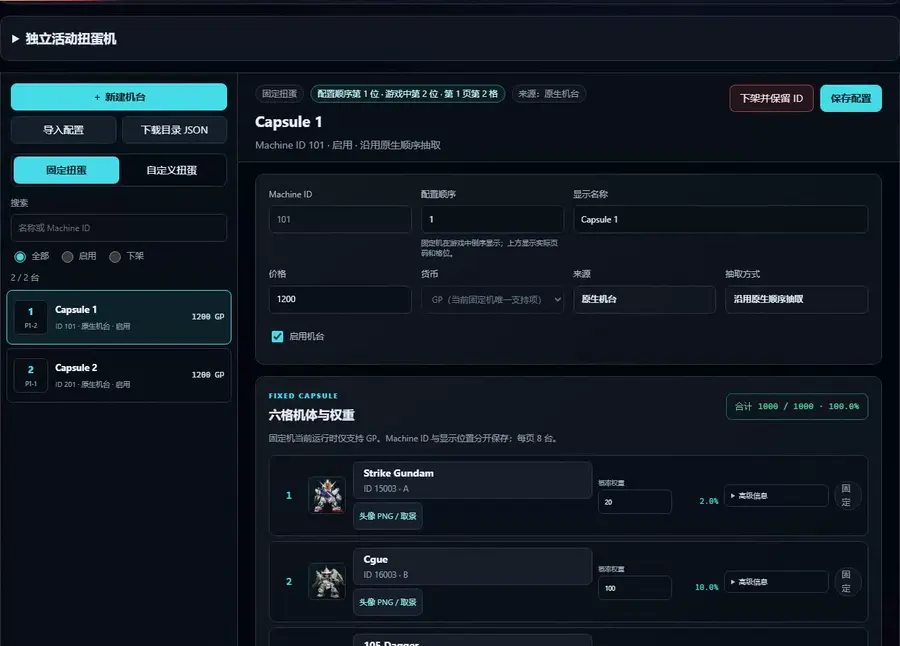
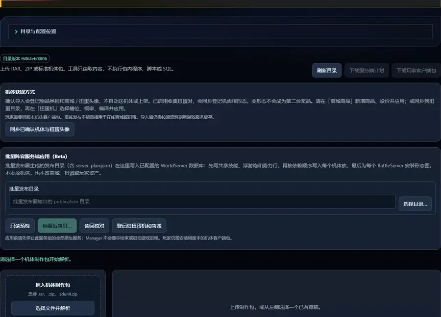
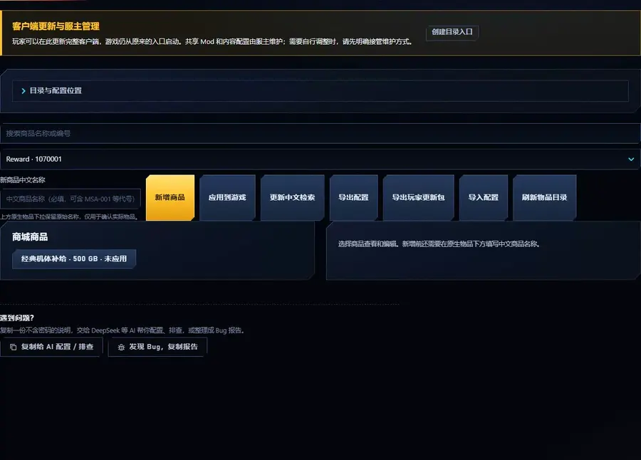
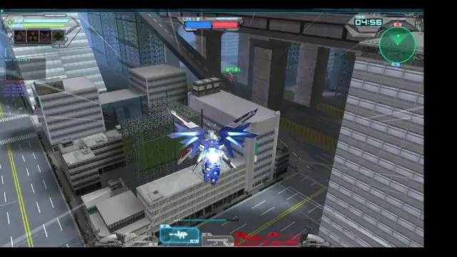
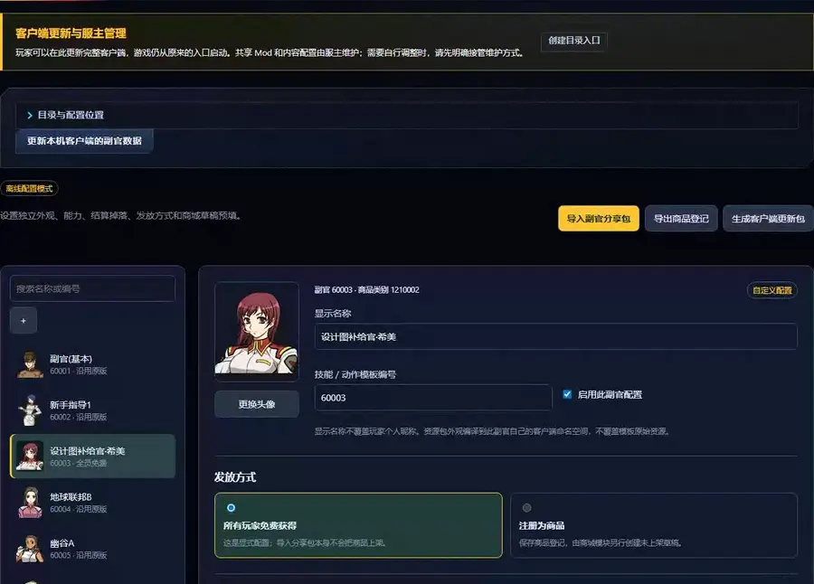
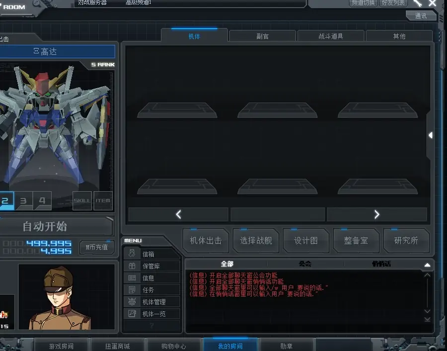

# SDGO mod framework

Core fixes, gameplay extensions and management tools for SD Gundam Online clients and private servers.
Unofficial fan project; no game files are included. [简体中文](README.zh-CN.md)

[Installation](docs/setup.md) · [SDGO Mod Manager](docs/mod-manager.md) · [Latest release](https://github.com/crabsatellite/SDGO-Mod-Framework/releases/latest)

## Feature highlights

| [Three enhancement systems, one client](docs/over-custom.md) | [Capsule machine editor](docs/capsule-catalog.md) |
|:---:|:---:|
|  |  |
| OC, G改 1.0 and G改 2.0 coexist, selected per room. G改 1.0 requires owner rules. | Edit machine names, prices and pool weights; preview cards and save configuration. |

| [Unit import](docs/unit-import.md) | [Shop catalog management](docs/shop-catalog.md) |
|:---:|:---:|
|  |  |
| Parse authoring packages, check forms and dependencies, and review shop and capsule icons. | Create offers from native items, adjust prices and sale options, and save drafts. |

| [PvP AI](docs/pvp-ai.md) | [Mission AI wingmen](docs/coop-wingmen.md) |
|:---:|:---:|
|  |  |
| AI opponents and teammates in native battles. | Cooperate with AI wingmen in missions. |

| [Operator and ability management](docs/operator-assistant.md) | [Hangar management](docs/hangar-manager.md) |
|:---:|:---:|
|  |  |
| Configure operator appearance, abilities, supply drops and delivery. | Sort the hangar and preview duplicate-unit exchange on the unit-management page. |

[Gameplay](#gameplay-extensions) · [Player assistance](#player-assistance-and-interface) · [Owner content tools](#owner-management-and-content-editing) · [Networking and updates](#networking-and-updates) · [Core fixes](#core-fixes) · [Developer tools](#developer-tools)

## Get started

**Players:** obtain a compatible original client, install the framework in Manager and import the server owner's profile to receive its selected Mods, shared settings and assets.
Then open `GOnline.exe` as usual: Manager shows update progress, verifies the installation and starts the game.
Updates preserve personal settings. See [installation and updates before launch](docs/owner-updates.md).
Launches remain queued during background checks and support redirected Manager workspaces; outdated running backends are identified explicitly.

**Server owners:** open **0_更新与管理** at the top of the client folder or **SDGO Mod Manager.exe** from the framework package.
The official starter pack is the default; choose DIY to take over configuration, content and compatibility.
[Owner programme packages](docs/owner-programmes.md) and [owner profiles](docs/owner-updates.md) maintain programmes and content separately while players follow one configuration address.
Local-only addons stay on the owner's machine and are never packaged for players.

Compatibility is based on the **SD Gundam Online Ultimate Repack** published by Bilibili uploader 屮仔丿
([video BV1Qa4y1z7eW](https://www.bilibili.com/video/BV1Qa4y1z7eW/)). See [supported game builds](docs/setup.md#supported-game-builds) for executable versions.
This project does not distribute the original client or server.

Unlabeled features are **Stable**, the default Manager update channel. **Beta** means the basic workflow is still under development and requires the Beta update channel.
**Experimental** tools are developer diagnostics and are excluded from normal updates. Each guide covers settings, compatibility and troubleshooting.

## Gameplay extensions

Battle rules, AI, progression, rewards and interactions between players.

| Feature | Overview |
|---|---|
| [PvP AI](docs/pvp-ai.md) <!-- catalog: `pvp_ai`, `match_ai` --> | `!ai` adds AI opponents and teammates with live TAB stats and remaining lives; group humans, fill either side or add exact counts |
| [Mission AI wingmen](docs/coop-wingmen.md) <!-- catalog: `coop_ai`, `mission_ai` --> | `!ai hard` selects Hard wingmen with the player life allowance; `!ai3 inf` allows unlimited AI respawns |
| [Battle AI difficulty](docs/battle-ai.md) <!-- catalog: `battle_ai`, `battle_ai_server` --> | Choose Easy, Medium or Hard PvP AI in the room title |
| [Ace AI pilots](docs/ace-ai.md) <!-- catalog: `ace_ai`, `ace_ai_server` --> | Give PvP AI and friendly mission wingmen a configurable chance to become named Ace pilots with server-authoritative difficulty, HP and ordinary-attack settings |
| [Mission behavior profiles](docs/mission-behavior.md) <!-- catalog: `mission_behavior`, `mission_behavior_server` --> | Choose original OC or current mission AI and spawn behavior, applied together to the client and every Battle channel |
| [AI pilot dialogue (optional)](docs/ai-dialogue.md) <!-- catalog: `ai_dialogue` --> | AI pilots speak lines and suggest tactics based on the battle and their character; your own DeepSeek key, off by default |
| [Per-round random loadouts](docs/room-random.md) <!-- catalog: `room_random`, `room_random_client` --> | Use `!rand` in the room title to draw each player’s sortie unit or deck from their own hangar every round |
| [Complete PvP All Map](docs/all-maps.md) <!-- catalog: `all_maps` --> | Make the room's All Map choice draw from the complete native PvP map catalog while keeping mission-only maps in missions |
| [Three enhancement systems, one client](docs/over-custom.md) <!-- catalog: `oc_custom_client`, `oc_custom_server`, `oc_custom_battle` --> | OC stat allocation (all six stats apply in OC battles, special included), challenges and resets; rooms choose OC, G改 2.0 or owner-provided G改 1.0 while existing custom-parts data is preserved separately |
| [Newcomer protection](docs/newcomer-protection.md) <!-- catalog: `newcomer_protection` --> | Server-selected players receive configurable HP and ordinary weapon damage multipliers in missions and PvP; special attacks stay native and the roster stays private |
| [Friend unit gifts (optional)](docs/friend-unit-gift.md) <!-- catalog: `friend_unit_gift_client`, `friend_unit_gift_server` --> | Right-click a friend (online or offline), pick a unit in unit management, and the friend accepts or returns it in Storage. Off until the owner enables it |
| [Collection capsule](docs/collection-capsule.md) <!-- catalog: `collection_capsule` --> | Missing-unit activity machine with configurable price and limits, an owner exclusion list, and encyclopedia acquisition hints that follow the live pool; 15 per week by default |
| [Battle contribution rewards](docs/battle-rewards.md) <!-- catalog: `battle_rewards` --> | Contribution GB/MB, configurable human multipliers and optional per-account gathering rewards |
| [Daily double rewards](docs/daily-rewards.md) <!-- catalog: `daily_rewards` --> | Double battle GB and EXP in a daily window (default 18:00–22:00) |

Combine gameplay and AI options in the room title; see [room-title commands](docs/room-commands.md).

## Player assistance and interface

Everyday frame-rate, display, hangar and claim controls.

| Feature | Overview |
|---|---|
| [FPS cap](docs/fps-limit.md) <!-- catalog: `fps_limit` --> | Raise the rendering ceiling while keeping native gameplay speed |
| [Hangar manager](docs/hangar-manager.md) <!-- catalog: `hangar_manager` --> | Sort the hangar, preview and exchange duplicate units on the unit-management page; results appear at once without a re-login; imported units included |
| [Storage claim all](docs/storage-claim.md) <!-- catalog: `storage_claim` --> | Claim every item or gift in the current storage tab at once with one confirmation |
| [Automatic hangar capacity](docs/hangar-capacity.md) <!-- catalog: `hangar_capacity` --> | Raise every account to at least 1200 hangar slots at login (WorldServer) |
| [Chinese shop localization and search](docs/shop-localization.md) <!-- catalog: `shop_localization` --> | Translate shop names, descriptions, options and paint-page unit previews; search by Chinese name combined with rank and payment filters |
| [Chinese native interface text](docs/ui-localization.md) <!-- catalog: `ui_localization` --> | Translate stock Thai/Korean controls, acquisition descriptions and longer system messages; retain simple English and original artwork; custom text stays in content packages |
| [Unit acquisition sources](docs/acquisition-sources.md) <!-- catalog: `acquisition_sources` --> | Combine applied capsule, shop and adjutant sources with blueprint synthesis and acquisition; integrations are optional |
| [Extended room titles](docs/room-titles.md) <!-- catalog: `room_titles`, `room_titles_agent`, `room_titles_server` --> | Enter up to 128 characters in normal, AI, team and mission room creation, settings and rename controls |
| [Login unit showcase](docs/login-showcase.md) <!-- catalog: `login_showcase` --> | Choose which units appear on the login screen: by grade, all, recently registered or a chosen list; SS/SR/SU by default |

## Owner management and content editing

Edit and publish server content in SDGO Mod Manager for players to install.

| Feature | Overview |
|---|---|
| [Shop catalog manager](docs/shop-catalog.md) <!-- catalog: `shop_catalog` --> | List, price and retire the owner's own shop offers from the Manager (WorldServer) |
| [Capsule catalog editor](docs/capsule-catalog.md) <!-- catalog: `capsule_catalog` --> | Manage machines, pools, prices and weights; automatically show active acquisition routes and native machine numbers in the encyclopedia |
| [Unit family import](docs/unit-import.md) <!-- catalog: `unit_catalog`, `unit_catalog_server` --> | Import protocol unit packages or whole rosters in Mod Manager, combine [custom skills and icons](docs/unit-skill-import.md), and generate paired data, encyclopedia and shop/capsule resources |
| [Map and mission import](docs/map-import.md) <!-- catalog: `map_catalog`, `map_catalog_server` --> | Register map packages and phased PvE missions in Mod Manager: native unit strips, named gates with collision visibility, real NPC bombardment targets, dialogue, cutscenes, loading posters, boundary lines and drops. Retain authored mission names and generate paired client content and server definitions. Includes an example map and eight-phase mission |
| [Operator and ability management](docs/operator-assistant.md) <!-- catalog: `operator_catalog`, `operator_catalog_server` --> | Edit operator appearance, abilities, supply drops and shop drafts in Manager; import shareable packs and publish matching content |
| [AI mech catalog (optional)](docs/ai-catalog.md) <!-- catalog: `ai_catalog` --> | Add the server's sortie-ready units to the AI unit pools |
| [Announcements](docs/announcements.md) <!-- catalog: `announcements` --> | Show a news digest once at login; optional in-game owner notices by time and event |
| [New-account starter settings](docs/new-account-profile.md) <!-- catalog: `new_account_profile` --> | Set starting currency, rank and unit gifts for new accounts |
| [Holiday and birthday gifts](docs/calendar-gifts.md) | Configure unit and item gifts for holidays, birthdays or chosen dates in Manager, delivered to eligible players through Storage |

## Networking and updates

Connect to a server, install programmes and follow the owner’s selected settings and content.

| Feature | Overview |
|---|---|
| [FRP connectivity](docs/frp-distribution.md) <!-- catalog: `net_route`, `agent_udp_pool` --> | Connect through the owner's Sakura FRP or other TCP/UDP forwarding |
| [Mod installation and updates](docs/mod-manager.md) | Install, enable and configure official or imported Mods in Manager; choose Stable or Beta updates |
| [Owner profiles and automatic updates](docs/owner-updates.md) | Import an owner configuration address for shared settings and custom content; launch only after update progress and verification finish |
| [Owner programme packages](docs/owner-programmes.md) | Lock the official baseline and owner patch versions, then deliver them with the owner’s content |

## Core fixes

Repairs for crashes, freezes, disconnected sessions and incorrect displays in existing features.

| Feature | Overview |
|---|---|
| [IME candidates and commit fix](docs/ime-fix.md) <!-- catalog: `ime_fix` --> | Restore Chinese candidates and replace the old preedit range without residual letters |
| [Input method freeze fix](docs/findwindow-fix.md) <!-- catalog: `findwindow_fix` --> | Stop input methods such as iFlytek from freezing or crashing the repack client |
| [Startup crash fix](docs/startup-crash-fix.md) <!-- catalog: `startup_crash_fix` --> | Stop random crashes on the loading screen at game start |
| [Wait-room window initialization guard](docs/waitroom-window-fix.md) <!-- catalog: `waitroom_window_fix` --> | Fix the client sometimes closing right after a room is created |
| [Native data and lifecycle guards](docs/native-data-guard.md) <!-- catalog: `native_data_guard` --> | Fix crashes when unit data is missing or unit management is still waiting for data; keep crash logs accurate |
| [Hangar preview loading guard](docs/hangar-preview-guard.md) <!-- catalog: `hangar_preview_guard` --> | Fall back to the native thumbnail when a unit-list model or GPU buffer cannot load |
| [Special-target selection guard](docs/special-target-guard.md) <!-- catalog: `special_target_guard` --> | Reject an invalid random target count through the existing native failure result |
| [Scene registration lifecycle fix](docs/scene-lifecycle-fix.md) <!-- catalog: `scene_lifecycle_fix` --> | Fix an occasional cleanup crash after a scene object moves to another area |
| [Multiplayer loading synchronization](docs/loading-sync-fix.md) <!-- catalog: `loading_sync_fix` --> | Fix multiplayer starts that occasionally hang on the loading screen (BattleServer) |
| [Native login recovery](docs/login-recovery.md) <!-- catalog: `login_recovery`, `login_recovery_client` --> | When a reconnect after a dropped connection is refused or stalls, clear the old session and retry a limited number of times |
| [Friend list fix](docs/friend-list-fix.md) <!-- catalog: `friend_list_fix`, `friend_list_client_fix` --> | Keep offline friends, current names and ranks; Chinese actions in the home USER LIST and the built-in messenger |
| [Apsalus III transform input fix](docs/transform-input-fix.md) <!-- catalog: `transform_input_fix` --> | Release the native transform lock when a form has no transform animation |
| [Battle rank regression fix](docs/rank-progression-fix.md) <!-- catalog: `rank_progression_fix` --> | Stop battle settlement from lowering a pilot's rank (WorldServer) |
| [First login lobby music](docs/lobby-music-fix.md) <!-- catalog: `lobby_music_fix` --> | Restore the lobby music on first login |
| [Activity capsule currency](docs/capsule-currency-fix.md) <!-- catalog: `capsule_currency_fix` --> | Show machine 9301 as 99 coins in the list and purchase confirmation |
| [Shop rental and Unicode labels](docs/shop-labels.md) <!-- catalog: `shop_labels` --> | Readable rental/permanent labels, numeric quantities and Chinese shop options |
| [Chinese shop artwork labels](docs/shop-art-localization.md) <!-- catalog: `shop_art_localization` --> | Translate rank text baked into supported paint artwork |
| [Agent relay log fix](docs/agent-relay-log-fix.md) <!-- catalog: `agent_relay_log_fix` --> | Fix an Agent relay log that reads invalid memory |
| [Agent room-view error forwarding](docs/agent-room-view-error-fix.md) <!-- catalog: `agent_room_view_error_fix` --> | Fix unrelated error pop-ups during room actions (AgentServer) |

## Developer tools

Protocol analysis, troubleshooting and native automated tests for developers.

| Feature | Overview |
|---|---|
| [Packet logger](docs/net-probe.md) <!-- catalog: `net_probe` --> | Log the client's outgoing packets for protocol work |
| [Capsule price probe (Experimental)](docs/capsule-price-probe.md) <!-- catalog: `capsule_price_probe` --> | Read-only log of capsule list price label refreshes |
| [Native GameTest (Experimental)](docs/game-test.md) <!-- catalog: `game_test_client`, `game_test_server` --> | Native login, room entry, Ready, single-client and coordinated multiplayer battles, and page checks |

## Project documentation

[Build and developer API](docs/framework.md) · [Contribution and AI disclosure rules](docs/contributing.zh-CN.md) · [Setup and troubleshooting](docs/setup.md)

MIT: [LICENSE](LICENSE). Third-party notices: [THIRD_PARTY_NOTICES.md](THIRD_PARTY_NOTICES.md).

See [content ownership](docs/content-boundaries.md) for framework SQL, owner definitions and private/runtime data boundaries.
