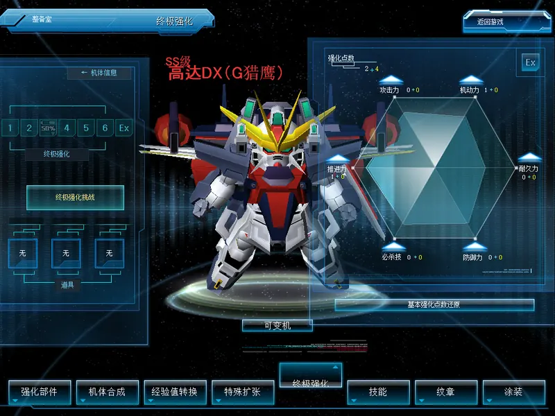
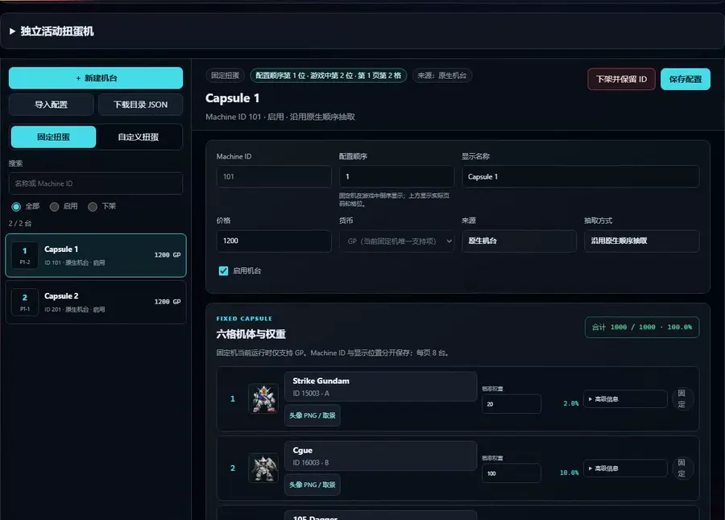
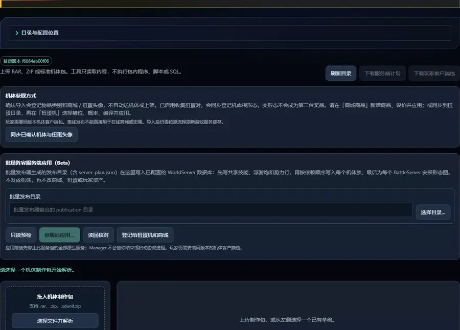
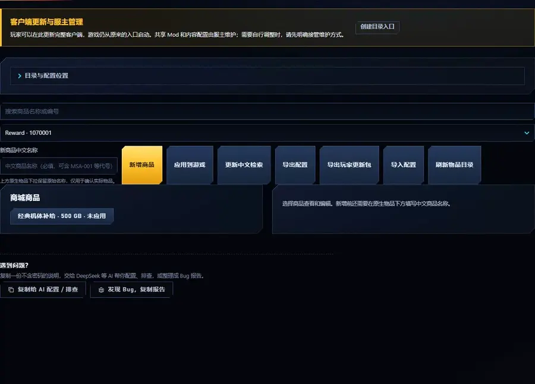
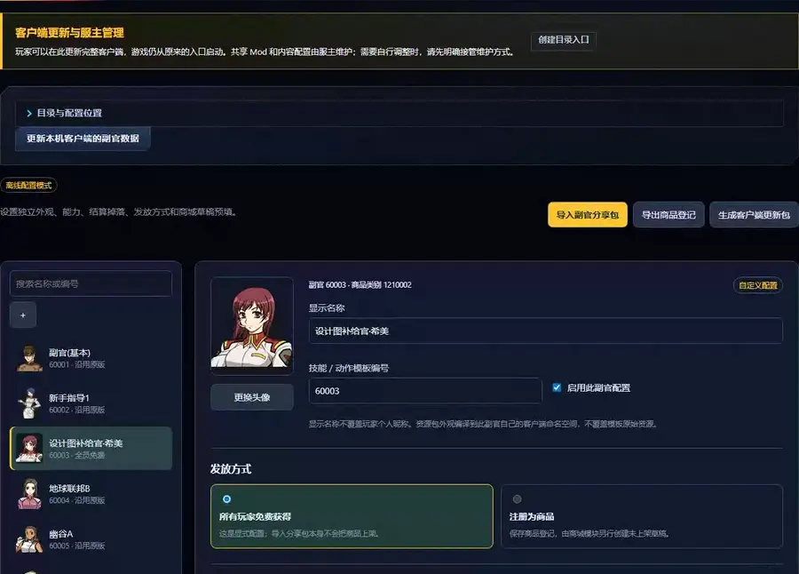
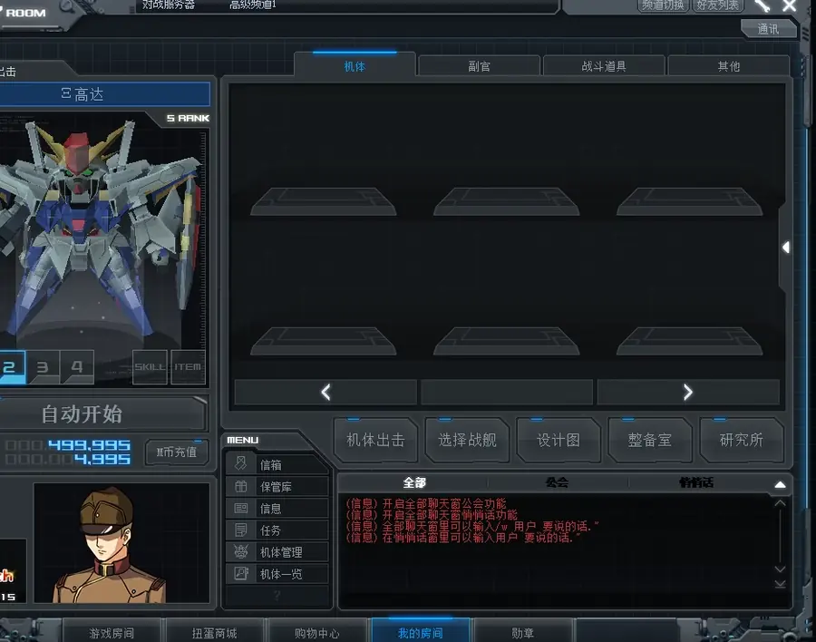

# SDGO Mod 框架

为 SD敢达 Online 客户端和私服提供基础修复、玩法扩展和管理工具。
非官方爱好者项目，不包含游戏文件。[English](README.md)

[安装说明](docs/setup.zh-CN.md) · [SDGO Mod Manager](docs/mod-manager.zh-CN.md) · [最新发布](https://github.com/crabsatellite/SDGO-Mod-Framework/releases/latest)

## 重点功能

| [三种强化体系，一个客户端](docs/over-custom.zh-CN.md) | [扭蛋机编辑器](docs/capsule-catalog.zh-CN.md) |
|:---:|:---:|
|  |  |
| 同一客户端共存 OC、G改 1.0 与 G改 2.0，按房间选择体系。G改 1.0 需配套规则。 | 编辑机台名称、价格与奖池权重，预览卡面并保存配置。 |

| [机体导入](docs/unit-import.zh-CN.md) | [商城商品管理](docs/shop-catalog.zh-CN.md) |
|:---:|:---:|
|  |  |
| 解析机体制作包，核对形态与依赖，预览商城和扭蛋图标。 | 内置五个可编辑商品预设，首次绑定空工作区自动上架；也可新增商品。 |

| [对战 AI](docs/pvp-ai.zh-CN.md) | [任务 AI 僚机](docs/coop-wingmen.zh-CN.md) |
|:---:|:---:|
|  |  |
| AI 对手与队友，在原生对战中交战。 | 任务中与 AI 僚机协同作战。 |

| [副官与能力管理](docs/operator-assistant.zh-CN.md) | [机库管理](docs/hangar-manager.zh-CN.md) |
|:---:|:---:|
|  |  |
| 配置副官显示、能力、补给掉落与发放方式。 | 在机体管理页整理机库，预览并兑换重复机体。 |

[玩法扩展](#玩法扩展) · [玩家辅助与界面](#玩家辅助与界面) · [服主管理与内容编辑](#服主管理与内容编辑) · [联机与更新](#联机与更新) · [基础修复](#基础修复) · [开发诊断](#开发诊断)

## 开始使用

**玩家：** 先取得兼容的原版客户端，在 Manager 安装框架并导入服主配置档，取得服主选定的 Mod、共享配置和素材。
绑定后照常双击 `GOnline.exe`，Manager 显示更新进度，校验完成后启动游戏。更新保留个人设置，详见[安装与启动前更新](docs/owner-updates.zh-CN.md)。
后台检查期间的新启动请求会正常入队，支持重定向的 Manager 工作区，并明确识别尚未退出的旧版后台。

**服主：** 从客户端目录顶部的「0_更新与管理」或包内的 **SDGO Mod Manager.exe** 打开管理界面。
默认跟随基础整合包；选择「服主 DIY」后自行维护配置、内容和兼容性。
[本服程序包](docs/owner-programmes.zh-CN.md)与[服主配置档](docs/owner-updates.zh-CN.md)分别维护程序和内容，玩家只需跟随一个配置地址。
「仅本地」扩展留在服主本机，不会打包分发。

兼容性基于 B 站 UP 主屮仔丿发布的 **SD敢达 Ultimate Repack**（[视频 BV1Qa4y1z7eW](https://www.bilibili.com/video/BV1Qa4y1z7eW/)），
具体程序版本见[支持的游戏版本](docs/setup.zh-CN.md#支持的游戏版本)。本项目不提供原版客户端或服务端。

未标注阶段的功能为 **Stable**，Manager 默认安装 Stable。**Beta** 表示基本流程仍在开发，需在 Manager 切换到 Beta 通道；
**Experimental** 为开发诊断工具，不随常规更新安装。具体设置、兼容性与排错见各功能介绍页。

## 玩法扩展

新增战斗规则、AI、成长与奖励，以及玩家之间的互动。

| 功能 | 简介 |
|---|---|
| [对战 AI](docs/pvp-ai.zh-CN.md) <!-- catalog: `pvp_ai`、`match_ai` --> | 房名写 `!ai` 加入 AI 对手和队友，TAB 战绩与剩余生命随对局更新；可让真人同队、双方或对面补位、指定数量 |
| [任务 AI 僚机](docs/coop-wingmen.zh-CN.md) <!-- catalog: `coop_ai`、`mission_ai` --> | 任务房名写 `!ai hard` 可选 Hard，AI 按玩家生命额度复活；`!ai3 inf` 开启 AI 无限复活 |
| [PvE AI TAB 队友列表](docs/pve-ai-scoreboard.zh-CN.md) <!-- catalog: `pve_ai_scoreboard` --> | 自动把已注册的 AI 队友加入原生 PvE TAB 列表；存活或等待复活时都显示名字、机体、击破、助攻和分数 |
| [战斗 AI 难度](docs/battle-ai.zh-CN.md) <!-- catalog: `battle_ai`、`battle_ai_server` --> | 在房名中选择 Easy／Medium／Hard 三档对战 AI 难度 |
| [王牌驾驶员 AI](docs/ace-ai.zh-CN.md) <!-- catalog: `ace_ai`、`ace_ai_server` --> | 对战 AI 与我方任务僚机可按服主配置成为有姓名的王牌驾驶员，难度、HP 与普通攻击倍率由服务端统一决定 |
| [任务行为版本](docs/mission-behavior.zh-CN.md) <!-- catalog: `mission_behavior`、`mission_behavior_server` --> | 统一选择任务 AI 与刷怪使用 OC 原版行为或现有行为，客户端与全部 Battle 频道同步 |
| [新手保护](docs/newcomer-protection.zh-CN.md) <!-- catalog: `newcomer_protection` --> | 为服主指定玩家配置任务和对战的生命、普通武器伤害倍率；必杀维持原规则，名单仅留服务端 |
| [AI 机师互动台词（可选）](docs/ai-dialogue.zh-CN.md) <!-- catalog: `ai_dialogue` --> | AI 机师按战况和机体人设说台词、给队友建议；需自填 DeepSeek 密钥，默认关闭 |
| [每局随机机体](docs/room-random.zh-CN.md) <!-- catalog: `room_random`、`room_random_client` --> | 房名写 `!rand`，每局从各自机库随机选择出击机体或卡组 |
| [完整对战 All Map](docs/all-maps.zh-CN.md) <!-- catalog: `all_maps` --> | 房间选择 All Map 时从完整原生对战地图目录抽取，任务专用图仍留在任务模式 |
| [三种强化体系，一个客户端](docs/over-custom.zh-CN.md) <!-- catalog: `oc_custom_client`、`oc_custom_server`、`oc_custom_battle` --> | OC 六维加点（OC 房间战斗中六项都生效，含必杀）、挑战与洗点，房间可选择 OC、G改 2.0 或服主提供的 G改 1.0；原改造数据独立保留 |
| [好友机体赠送（可选）](docs/friend-unit-gift.zh-CN.md) <!-- catalog: `friend_unit_gift_client`、`friend_unit_gift_server` --> | 右键好友（在线或离线均可），在机体管理中选机赠送，对方在保管库接受或退还；默认关闭，由服主开启 |
| [收藏扭蛋](docs/collection-capsule.zh-CN.md) <!-- catalog: `collection_capsule` --> | 优先补图鉴的活动机台；服主可设除外名单，图鉴获取说明随实际奖池自动更新；价格和次数可配置，默认每周 15 次 |
| [战斗贡献奖励](docs/battle-rewards.zh-CN.md) <!-- catalog: `battle_rewards` --> | 按贡献发放 GB/MB，可配置人数倍率与按账号去重的聚会奖励 |
| [每日双倍时间](docs/daily-rewards.zh-CN.md) <!-- catalog: `daily_rewards` --> | 每天固定时段（默认 18:00–22:00）战斗 GB 和经验翻倍 |

房名里的玩法与 AI 参数可组合使用，见[房名指令](docs/room-commands.zh-CN.md)。

## 玩家辅助与界面

帧率、显示、机库与领取操作等日常使用功能。

| 功能 | 简介 |
|---|---|
| [FPS 上限](docs/fps-limit.zh-CN.md) <!-- catalog: `fps_limit` --> | 提高渲染帧率上限，保留原生游戏速度 |
| [机库管理](docs/hangar-manager.zh-CN.md) <!-- catalog: `hangar_manager` --> | 在机体管理页整理机库、预览并兑换重复机体，结果当场刷新、无需重新登录，支持导入机体 |
| [保管库一键领取](docs/storage-claim.zh-CN.md) <!-- catalog: `storage_claim` --> | 保管库页内确认一次，一次领取当前页签全部分页的物品或礼物 |
| [自动机库容量](docs/hangar-capacity.zh-CN.md) <!-- catalog: `hangar_capacity` --> | 登录时把每个账号的机库保障到至少 1200 格（WorldServer） |
| [商城汉化与中文检索](docs/shop-localization.zh-CN.md) <!-- catalog: `shop_localization` --> | 汉化商品名称、说明和机体预览，修复详情面板闪退；可按中文名称、等级与币种检索 |
| [原生界面中文汉化](docs/ui-localization.zh-CN.md) <!-- catalog: `ui_localization` --> | 汉化原版泰文／韩文按钮、活动获得说明与较长系统提示，保留简单英语和原版图片；自定义内容随内容包分发 |
| [机体获得方式](docs/acquisition-sources.zh-CN.md) <!-- catalog: `acquisition_sources` --> | 汇总已应用的扭蛋、商城和副官来源，以及设计图合成与取得方式；各功能可选联动 |
| [长房名](docs/room-titles.zh-CN.md) <!-- catalog: `room_titles`、`room_titles_agent`、`room_titles_server` --> | 普通、AI、队伍及任务房的建房、设置和改名入口支持最长 128 字 |
| [登录机体展示](docs/login-showcase.zh-CN.md) <!-- catalog: `login_showcase` --> | 选择登录页面展示哪些机体：按等级、全部、最近注册或指定名单，默认 SS/SR/SU |

## 服主管理与内容编辑

自定义内容从[入口对照与隐私边界](docs/content-boundaries.zh-CN.md#自定义文件的导入入口)开始。
副官、地图、机体／技能、设计图、商城和扭蛋说明均提供虚构案例，区分作者输入、配置草稿和玩家运行包。

在 SDGO Mod Manager 编辑和发布服务器内容，供玩家安装使用。

| 功能 | 简介 |
|---|---|
| [商城商品管理](docs/shop-catalog.zh-CN.md) <!-- catalog: `shop_catalog` --> | 内置五类可编辑预设；大目录分页与搜索、空闲编号分配及共享记录冲突保护（WorldServer） |
| [扭蛋机编辑器](docs/capsule-catalog.zh-CN.md) <!-- catalog: `capsule_catalog` --> | 自带 35 台可编辑默认奖池；配套安装两端，管理机台、价格、概率和获取途径 |
| [机体族导入](docs/unit-import.zh-CN.md) <!-- catalog: `unit_catalog`, `unit_catalog_server` --> | 导入单形态、双形态、三阶段与有向多形态协议包，生成同版服务端形态图，组合[自定义技能、图标及配套效果参数](docs/unit-skill-import.zh-CN.md)，检查参数与武器回调资源；随附公开AR成长机、BR爆甲演示预设 |
| [地图与任务导入](docs/map-import.zh-CN.md) <!-- catalog: `map_catalog`, `map_catalog_server` --> | 在 Manager 导入地图与分阶段任务：原生队伍行进过场、机体横幅和指挥官提醒，守卫保护目标与友军成功撤离，敌友一致的活动范围、触边受击与非致命 HP 同步，门板碰撞开合、NPC 炮击、地面标线、加载海报与掉落；保留任务原名并生成配对的客户端内容与服务端定义；默认附 OPEN 示例地图与 8 阶段任务源码，可查看输入文件及生成脚本 |
| [副官与能力管理](docs/operator-assistant.zh-CN.md) <!-- catalog: `operator_catalog`、`operator_catalog_server` --> | 在 Manager 编辑副官外观、能力、补给掉落和商城草稿，导入分享包并发布配套内容 |
| [AI 机体目录（可选）](docs/ai-catalog.zh-CN.md) <!-- catalog: `ai_catalog` --> | 把服务器可出击的机体加入 AI 机体池 |
| [公告与展示规则](docs/announcements.zh-CN.md) <!-- catalog: `announcements` --> | 登录时显示一次资讯简报；可选在游戏内按时段和事件展示服主公告 |
| [新账号起始配置](docs/new-account-profile.zh-CN.md) <!-- catalog: `new_account_profile` --> | 设置新账号的起始货币、军衔和赠送机体 |
| [节日与生日赠礼](docs/calendar-gifts.zh-CN.md) | 在 Manager 配置节日、生日或指定日期的机体与道具赠礼，发到符合条件玩家的保管库 |

## 联机与更新

连接服务器、安装程序，以及同步服主选定的配置与内容。

| 功能 | 简介 |
|---|---|
| [FRP 联机](docs/frp-distribution.zh-CN.md) <!-- catalog: `net_route`、`agent_udp_pool` --> | 通过服主的 Sakura FRP 等 TCP/UDP 转发连接服务器 |
| [Mod 安装与更新](docs/mod-manager.zh-CN.md) | 在 Manager 安装、启停和配置官方或导入的模组，选择 Stable／Beta 更新通道 |
| [服主配置与自动更新](docs/owner-updates.zh-CN.md) | 导入服主配置地址，同步共享设置和自定义内容；启动前显示进度并完成校验 |
| [本服程序包](docs/owner-programmes.zh-CN.md) | 服主选定官方基线与本服补丁版本，和内容一起交付给玩家 |

## 基础修复

修复已有功能的崩溃、卡死、断线与显示错误。

| 功能 | 简介 |
|---|---|
| [中文输入法候选与提交修复](docs/ime-fix.zh-CN.md) <!-- catalog: `ime_fix` --> | 恢复候选窗请求，按旧拼音范围提交中文，保留英文和数字前后缀 |
| [输入法卡死修复](docs/findwindow-fix.zh-CN.md) <!-- catalog: `findwindow_fix` --> | 防止讯飞等输入法让整合包客户端卡死或崩溃 |
| [启动崩溃修复](docs/startup-crash-fix.zh-CN.md) <!-- catalog: `startup_crash_fix` --> | 修复开游戏时读取界面随机闪退 |
| [房间窗口初始化保护](docs/waitroom-window-fix.zh-CN.md) <!-- catalog: `waitroom_window_fix` --> | 修复建房成功后客户端偶尔直接退出 |
| [原生数据与生命周期修复](docs/native-data-guard.zh-CN.md) <!-- catalog: `native_data_guard` --> | 保护缺失机体数据、库存等待及多目标光束伤害边界，并记录正确的闪退现场 |
| [机库三维预览加载保护](docs/hangar-preview-guard.zh-CN.md) <!-- catalog: `hangar_preview_guard` --> | 列表及主展示的图形加载失败时安全清理，沿用原生缩略图或空模型分支 |
| [特殊攻击目标选择保护](docs/special-target-guard.zh-CN.md) <!-- catalog: `special_target_guard` --> | 随机目标数量非法时，使用已有原生失败结果阻止越界读取 |
| [场景登记生命周期修复](docs/scene-lifecycle-fix.zh-CN.md) <!-- catalog: `scene_lifecycle_fix` --> | 修复场景对象切换区域后偶发的清理闪退 |
| [多人加载同步修复](docs/loading-sync-fix.zh-CN.md) <!-- catalog: `loading_sync_fix` --> | 修复多人开局时偶发卡在加载画面（BattleServer） |
| [异常断线登录恢复](docs/login-recovery.zh-CN.md) <!-- catalog: `login_recovery`, `login_recovery_client` --> | 异常断线后重新登录被拒或卡在等待时，清理旧会话并自动有限重试 |
| [好友列表修复](docs/friend-list-fix.zh-CN.md) <!-- catalog: `friend_list_fix`、`friend_list_client_fix` --> | 保留离线好友、当前名字和军衔，恢复主页面 USER LIST 的中文菜单及原生聊天界面 |
| [缺失动画的变形卡死修复](docs/transform-input-fix.zh-CN.md) <!-- catalog: `transform_input_fix` --> | 阿普萨拉斯 III 或已登记导入形态链缺少过渡动画时，恢复原生状态退出，解除移动与攻击锁定 |
| [军衔回退修复](docs/rank-progression-fix.zh-CN.md) <!-- catalog: `rank_progression_fix` --> | 防止战斗结算降低已有军衔（WorldServer） |
| [首次登录大厅音乐](docs/lobby-music-fix.zh-CN.md) <!-- catalog: `lobby_music_fix` --> | 恢复首次登录时的大厅音乐 |
| [活动扭蛋币种显示](docs/capsule-currency-fix.zh-CN.md) <!-- catalog: `capsule_currency_fix` --> | 9301 号机在列表和购买确认框中显示为 99 代币 |
| [商城租赁与中文选项修复](docs/shop-labels.zh-CN.md) <!-- catalog: `shop_labels` --> | 显示租赁/永久、实际数量和中文选项名 |
| [商城图片文字汉化](docs/shop-art-localization.zh-CN.md) <!-- catalog: `shop_art_localization` --> | 汉化受支持涂料图片内的军衔文字 |
| [Agent 中继日志修复](docs/agent-relay-log-fix.zh-CN.md) <!-- catalog: `agent_relay_log_fix` --> | 修复 Agent 中继日志读取无效内存 |
| [Agent 房间视图错误转发修复](docs/agent-room-view-error-fix.zh-CN.md) <!-- catalog: `agent_room_view_error_fix` --> | 修复房间操作时弹出与实际情况无关的错误（AgentServer） |

## 开发诊断

供开发者分析协议、定位问题和执行原生自动化测试。

| 功能 | 简介 |
|---|---|
| [发包日志](docs/net-probe.md) <!-- catalog: `net_probe` --> | 记录客户端发出的封包，用于分析协议 |
| [扭蛋价格探针（Experimental）](docs/capsule-price-probe.md) <!-- catalog: `capsule_price_probe` --> | 只读记录扭蛋列表价格标签的刷新 |
| [GameTest（Experimental）](docs/game-test.zh-CN.md) <!-- catalog: `game_test_client`、`game_test_server` --> | 原生登录、入房、Ready、单客户端与多客户端协同对战，以及页面检查 |

## 项目文档

[构建与开发接口](docs/framework.md) · [贡献与 AI 披露规则](docs/contributing.zh-CN.md) · [配置与排错](docs/setup.zh-CN.md)

MIT，见 [LICENSE](LICENSE)。第三方许可见 [THIRD_PARTY_NOTICES.md](THIRD_PARTY_NOTICES.md)。

框架、SQL、服主内容和个人数据的归属见[内容边界](docs/content-boundaries.zh-CN.md)。
