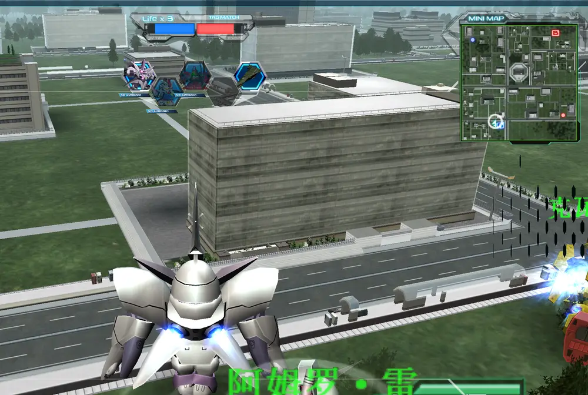
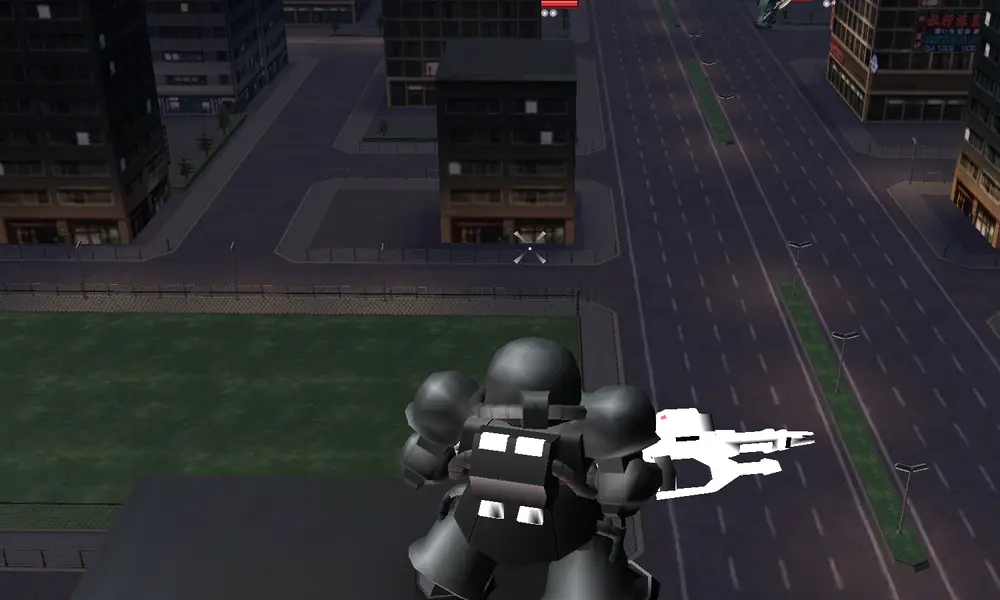

# 王牌驾驶员 AI

[English](ace-ai.md) · [返回功能目录](../README.zh-CN.md)

王牌驾驶员 AI 为两类符合条件的 AI 提供人工编写的驾驶员身份：

- 双方 PvP 房间中创建的 AI 玩家。
- 人类一方在任务中创建的友方僚机。

敌方任务 NPC 不属于本功能，真人玩家也不会被选为王牌。





原生头顶名称牌和 TAB 名单都显示选定的驾驶员。名称牌沿用游戏自己的字体、队伍颜色与渲染器；
原生复活流程重建名称牌时，也继续使用同一驾驶员名。

## 安装

完整框架包包含公开的客户端和 BattleServer 两部分。玩家通过服主提供的客户端包或更新获得客户端部分。

| Mod | 安装位置 | 职责 |
|---|---|---|
| `ace_ai` | 每个参战客户端 | 驾驶员目录、游戏内驾驶员显示名和固定提示 |
| `ace_ai_server` | 每个参战 BattleServer | 权威概率、实际 AI 难度、生命和普通攻击规则 |

客户端与服务端安装同一框架版本的配套部分，再重启受影响的游戏和 BattleServer。客户端不能自行重抽概率，
也不能自行决定属性倍率。

王牌客户端需要启用随包提供的 `match_ai` 共享开战／复活桥接和 `battle_ai` 控制器；Manager 会校验这些依赖。
任务王牌也使用这条共享桥接，它本身不会让未请求 AI 的对战房间增加 AI。关闭王牌后，普通任务僚机仍可独立使用。
生命值显示读取服务端提供的数值，不在客户端另设倍率。

开战提示使用游戏现有的战斗聊天栏，与 AI 对话使用同一原生条目路径；无需启用 AI 对话服务或填写 API 配置。

## 玩家看到的内容

服务端选中王牌后，实际游戏显示名从进入战斗起就由机体名替换为人工编写的驾驶员名；死亡、复活和换机后
继续恢复同一个身份。这是游戏用于战斗单位的显示名，不是受击伤害弹字。

每次开局，PvP 按原生分队完成后实际显示的颜色，每种有王牌的颜色最多显示一次固定提示：

- `红队出现了王牌驾驶员！`
- `蓝队出现了王牌驾驶员！`

提示不包含驾驶员名、机体、数量或难度。任务友方僚机只使用：

- `我方出现了王牌驾驶员！`

敌方任务 NPC 不会触发王牌任务提示。

## 服主设置

在 SDGO Mod Manager 中打开“王牌驾驶员 · 服务端”。每个基础难度都能分别设置四项参数。
所有改动都要重启对应 BattleServer 后生效。

| 基础难度 | 王牌概率 | 王牌实际 AI | 生命 | 普通攻击 |
|---|---:|---|---:|---:|
| Easy | 5% | Normal（`Medium`） | 100% | 100% |
| Normal（`Medium`） | 5% | Hard | 100% | 100% |
| Hard | 5% | Hard | 120% | 100% |

把某档概率设为 `0%`，只关闭该基础难度的王牌抽取。`Same` 表示保持基础 AI 难度。
原生解析器也接受 `Normal` 作为 `Medium` 的别名，Manager 保存 `Medium`。
生命和普通攻击都是百分比，`100%=1倍`。普通攻击百分比只作用于普通武器伤害；必杀沿用原规则，
不会获得王牌专属伤害倍率。

## 驾驶员关联与服主内容

程序随框架发布公开基础表 `sdgo/mods/ace_ai/base-pilots.json`，为当前原版机体提供人工编写的关联层。
通用框架程序不包含个人名单或服主自定义机体的驾驶员条目。

客户端使用 `sdgo/mods/ace_ai/base-pilots.json`；BattleServer 使用同一公开来源生成的镜像
`sdgo/mods/ace_ai_server/base-pilots.json`。服务端以这份关联决定机体是否有资格成为王牌。

服主增加自定义机体时，要为每个自定义机体及其形态提供人工编写的条目。普通内容更新把字节相同、版本锁定的可选覆盖表放到
`sdgo/mods/ace_ai/owner-pilots.json` 和 `sdgo/mods/ace_ai_server/owner-pilots.json`。覆盖表不属于公开 Release，
也不能放在 `sdgo/local-mods/`。服主条目与公开表使用相同机体编号时覆盖公开关联。服务端缺少符合条件的机体关联，
或基础表／覆盖表无效时会失败关闭，不会猜测驾驶员名或继续抽取该项。

公开表和服主表使用同一个有界 JSON 结构：

```json
{
  "schema_version": 1,
  "pilots": [
    {"unit_id": 10001, "display_name": "人工编写的驾驶员", "kind": "named"},
    {"unit_id": 90001, "display_name": "服主测试驾驶员", "kind": "role"}
  ]
}
```

`unit_id` 是战斗条目使用的机体编号，`display_name` 是实际游戏驾驶员显示名；`kind` 为 `named` 时表示
有名角色，为 `role` 时表示人工编写的角色称呼。服主美术、个人名单和其他私有元数据继续放在服主内容中，
不要加入通用程序。

## 排错

| 现象 | 检查 |
|---|---|
| 没有出现王牌 | 对应基础难度的概率可能为 `0%`；改完规则后重启 BattleServer |
| 没有驾驶员名 | 确认该机体／形态在公开基础表或服主覆盖表中有有效条目 |
| 不同客户端显示不一致 | 安装配套客户端与服务端部分；客户端必须使用服务端选定的身份 |
| 任务敌人没有变化 | 符合预期：本功能只覆盖友方僚机 |

## 开发者说明

权威规则位于 BattleServer 的 `sdgo/mods/ace_ai_server/config.ini` `[settings]`：
`AceChanceEasy|Medium|Hard`、`AceDifficultyEasy|Medium|Hard`、`AceHpPercentEasy|Medium|Hard`、
`AceAttackPercentEasy|Medium|Hard`。概率范围为 `0..100`；生命和普通攻击范围为 `1..1000`。
难度可选 `Easy`、`Medium`、`Hard`、`Same`；运行时大小写不敏感，并把 `Normal` 作为 `Medium` 的别名。
无效难度回退到对应基础难度；越界概率回退到 5，越界生命回退到 100／100／120，越界普通攻击回退到 100。

客户端和服务端的 `owner-pilots.json` 都是已声明的配置／内容输入，所以 Manager 会在文件存在时核验其实际字节，
也会区分覆盖表缺失的状态。两个公开基础表是由同一来源生成的有版本程序文件。任何驾驶员表都不能独立决定概率或属性规则。

共享开战桥接提供服务端权威生命上限。客户端在原生复活和技能初始化完成后的模式更新边界同步该上限，
保留当前生命值，也不会再次相乘。
