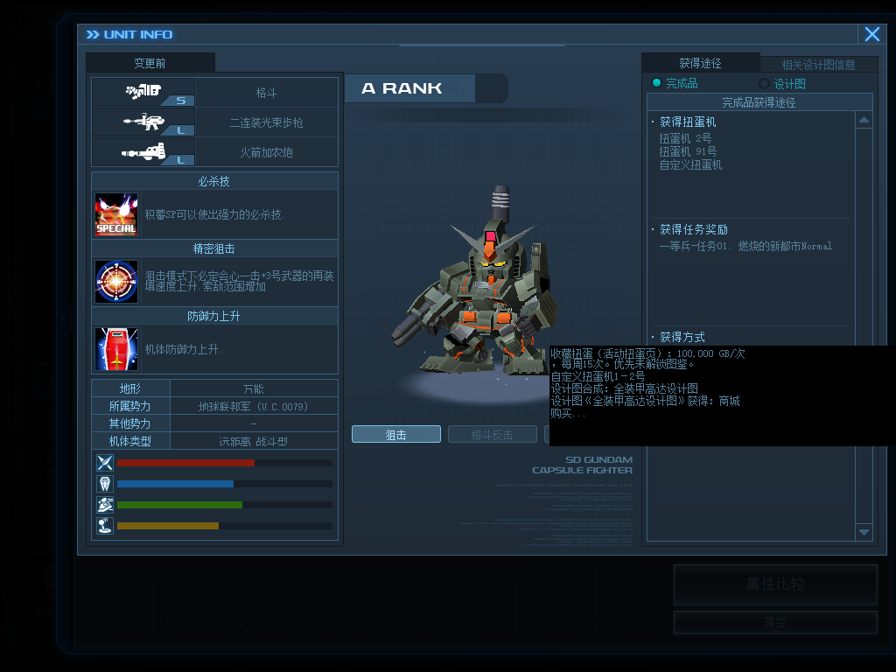

# Unit acquisition sources

[简体中文](acquisition-sources.zh-CN.md) · [Back to the feature index](../README.md)

Combines currently applied unit and blueprint sources in the original unit encyclopedia. Capsule sources use the numbers actually displayed in game. Blueprint information covers both synthesis and where to obtain the blueprint itself.

## Use

Install through the server owner's client package or update. Enable **机体获得方式** in SDGO Mod Manager and restart as directed by the update.

Each feature supplies its applied content. Activity and custom capsule sources follow capsule catalog publication. Shop sources describe currently visible unit and blueprint products, distinguishing rentals from purchases. Adjutant sources describe enabled blueprint drop rules. Saving a draft alone does not change the player-facing sources.

For longer descriptions, hover over the acquisition text to read the full explanation in the game's native tooltip.

All integrations are optional. Missing or disabled providers leave the native page usable and omit only their own information. Native interface localization can be enabled independently; custom content text remains part of its content package.

## Developer notes

Providers synchronously emit copied text through the versioned `SdgoAcquisitionSourcesV1` interface. The consumer calls optional exports only from already loaded modules and validates their version, bounds and completion status. An incomplete batch is discarded as a whole.

The existing native text control displays the original explanation and additional sources. Contributions reach the control after the native short-buffer conversion has completed. Original resource archives, unit records, prices and drop rules retain their data.
