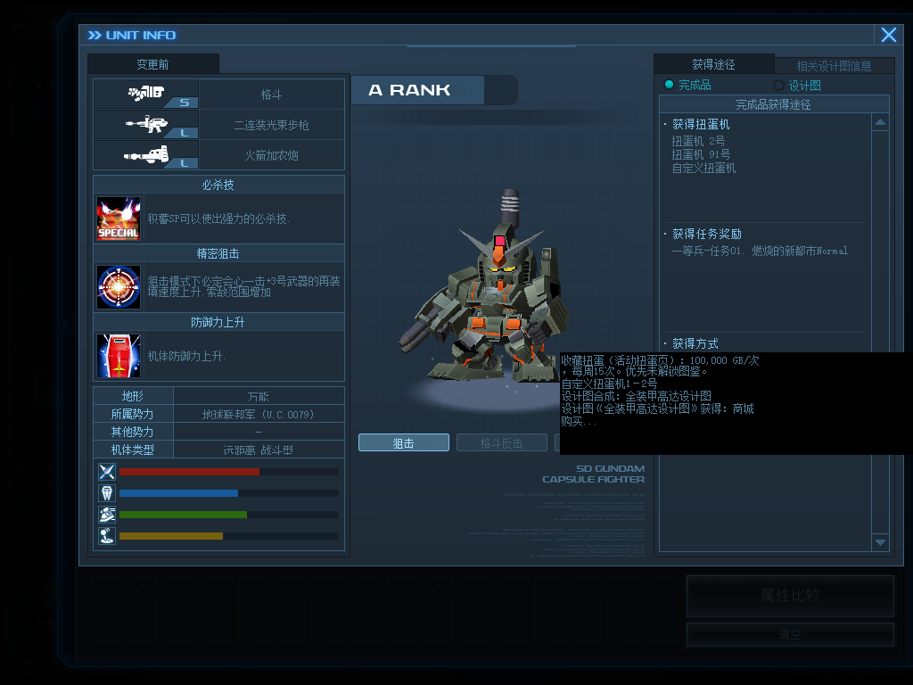

# 机体获得方式

[English](acquisition-sources.md) · [返回功能目录](../README.zh-CN.md)

在原生机体一览的获得途径中汇总当前生效的机体和设计图来源。扭蛋机使用游戏中实际显示的号码；设计图信息同时说明合成关系和设计图的取得方式。

## 使用

通过服主提供的客户端包或更新安装。在 SDGO Mod Manager 中启用「机体获得方式」，按更新提示重启游戏。

来源由对应功能的已应用内容提供。活动与自定义扭蛋随扭蛋目录发布；商城提供当前可见的机体和设计图商品，并区分租用与购买；副官提供当前启用的设计图掉落规则。仅保存草稿不会改变玩家看到的来源。

说明较长时，将鼠标移到获得方式文字上，通过游戏原有的提示查看全文。

各项联动均为可选：缺少或停用某个来源功能时，保留原生页面，只省略该功能提供的信息。原生界面中文汉化可独立启停；自定义内容的文字继续由内容包提供。

## 开发者说明

提供者通过版本化的 `SdgoAcquisitionSourcesV1` 同步输出来源文字。消费者只调用已加载模块中的可选接口，验证版本、长度和完整状态后复制结果；不完整的一批结果整体略过。

原版说明和追加来源显示在原生文字控件中。追加文字在原生短缓冲区转换完成后送入控件，原版资源归档、机体记录、价格和掉落规则保持原样。
