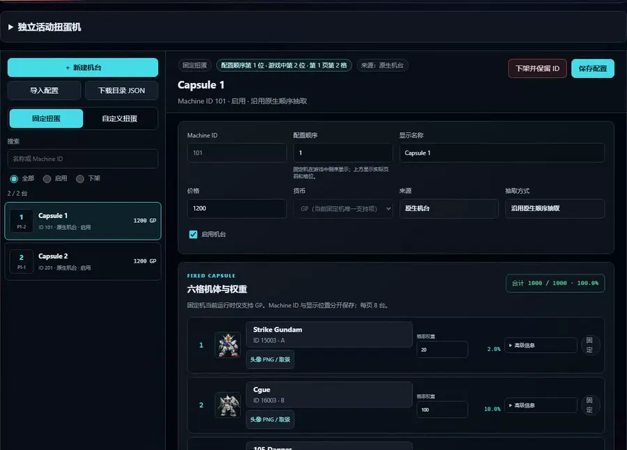

# Capsule catalog editor

[简体中文](capsule-catalog.zh-CN.md) · [Back to the feature index](../README.md)

Change a machine’s name, price and pool weights, then save the configuration.



Owners manage fixed and custom capsule machines through the capsule panel in SDGO Mod Manager.
Create, inspect, edit, retire, restore and reorder machines; choose native six-slot
templates; set prices and weights; add or remove custom candidates; preview unit
portraits; export and compile configuration; apply matching client and server data.
Players keep the game's native capsule screens and normal launcher.

## Built-in fixed-pool defaults

The Mod includes 35 editable acquisition pools. For a first owner installation,
select the matching client directory and server INI in Manager, leave the existing
catalog JSON field blank, then save. Manager verifies the target definitions,
retains the original 78 fixed pools, adds pools 79–113 and automatically compiles
and applies the paired client display and server prices, prizes and weights.
Players never run SQL. Imported custom units and activity machines are excluded.

The default prices are 1200×8, 1400×2, 1600×18, 7500×2 and 14800×5. Each pool has
six positive weights totaling 1000. Owners can edit the units, prices and weights,
or export their configuration as an authoring template. Restore defaults resets
only these 35 pools; native pools, custom capsules and unrelated author content
remain. Apply the paired configuration after restoring. Programme upgrades never
reset authored pools or re-enable retired ones.

The bundled template contains numeric references and configuration, with no game
artwork or original archives. First installation requires the matching 78-pool
native baseline and registered, usable units with matching grades. Incompatible
targets fail as a whole. A server with an existing Mod catalog must use its existing
authoring JSON instead of first installation. Close the target game and server first.
Installing player programmes alone cannot configure an owner's server; players
continue to receive the server owner's client package or update.

Publishing a catalog also derives the encyclopedia's activity and custom-capsule
acquisition sources from active pools. Every positive unit reward in an activity
machine and every active custom candidate is included. Recompile and publish after
adding, disabling, retiring or renumbering a machine; units do not need to be
imported again. Player-facing numbers follow the native UI: internal ID `15401` is
activity machine 154, while custom machine ID `2` is shown as custom machine 2.
Special machines retain their names. Ordinary-machine sources remain native. The
shared acquisition display combines contributions from whichever provider Mods are
available; its absence never prevents the capsule runtime from loading. Existing
sources and blueprint fields are preserved, and unapplied activity drafts are not
advertised as available sources.

## Example: a fictional Training Pool and configuration exchange

Use six eligible sortie roots with complete resources in your own target catalog, and choose a six-slot template
matching their grades. Another importer registers unit/weapon/model data; capsule JSON does not create those assets.

1. Create a fixed machine named “训练机池” in Manager. Let the tool allocate its identity and display position.
2. Select the six target units and enter illustrative weights `50, 150, 200, 200, 200, 200`, totaling `1000`.
   Keep the template's grade constraints and set your own price. Do not edit native draw sequences directly.
3. For new portraits, upload your own PNG, crop and confirm in the native card preview. Exported semantic JSON
   carries image/crop data, not a local absolute image path.
4. Save and export the complete configuration. Reimport in the same source workspace without changing
   `source_identity`, unit metadata or candidate policy. For another source/database, establish its own catalog
   and choose matching units instead of changing the source identity to force an old pool through validation.
5. Compile/preview the client, then **导入到游戏** applies paired client/server data with the same `catalog_revision`.
   Players receive the generated `player/` package or owner content update; authors exchange semantic JSON.

Custom-machine candidate count is separate from rare-slot count. Approved, same-database C/B/A imported roots can
enter ordinary slots under `slot_rules`, eligibility and import-registration checks; never relabel them as SR.
Rare S-grade candidates still follow the SR/SS-without-a-blueprint policies. Nothing adds a unit to a machine
without the owner's selection.

Activity machines use a separate 10000-entry frequency scale, poster, currency and reward categories. Do not use
the fixed machine's 1000-weight fragment as activity JSON. Collection capsule uses the live catalog and root
declarations; see the [fictional two-form example](collection-capsule.md#example-register-a-fictional-two-form-training-unit).

## Data and installation

`capsule_catalog` ships disabled until the owner supplies a complete generated
runtime. No game assets, player data, database credentials or machine-specific
paths are checked into this repository. Owners provide their own supported client
and server configuration. The packaged Manager includes its owner-tool dependencies. Source development uses
Python 3.10+, Pillow and pyodbc; SQL operations require an installed SQL Server ODBC
driver. Player installation does not require Python.

See the [owner walkthrough](capsule-authoring.zh-CN.md) for commands, source
inspection and initialization. All configuration uses the existing Manager session,
provider API and workspace; there is no separate capsule server or launcher.

The configuration is shared by two consumers:

| Consumer | Output and behavior |
|---|---|
| Client runtime | Verified overlays for six shared capsule GDTs, card sprites/textures and the exact capsule list price UI resource |
| Server adapter | Configuration SQL and Mod-owned prize selection; native charging, delivery and refund routes remain in use |

The same `catalog_revision` must reach both sides. An exported JSON alone is not
an installation. Applying checks the target, creates backups, installs client
files and commits server configuration; failures restore client files and roll
back SQL. Existing Mods and player history are preserved. Close the target game
before installation. The tool does not restart unrelated servers.
Applying a complete capsule package enables this feature's own switches, including
a disabled stub from an earlier framework installation; other Mod switches are retained.
The package also carries the framework loader, core and capsule programme so that a
client without the framework can run the catalog. A client that already runs the same
or a newer framework version keeps its own programmes (and the capsule symbol
definitions that belong to them) and receives only the catalog data; the apply result
and the backup receipt list them under `kept_programmes`. Older programmes are updated
as before.

For an A/B/C portrait, upload a finished PNG, drag the fixed-aspect crop frame,
resize its corners or use the zoom slider, and preview the native card. Save
either pose separately or share one image across both. Reset restores a pose's
original artwork. PNG bytes, hashes and crop coordinates travel inside the
catalog, so they do not reference a path on the owner's computer. The default
catalog has no uploaded overrides and uses original local client artwork. No
restored game artwork, game archives or AI models are published by this feature.

Give players the complete generated `player` directory, including its manifest
and `Install-Client.cmd`. Every catalog change requires matching generated client
data; updating only the framework DLL does not update prize pictures or slots.
If you ship players a complete client through your own updater, include that data
and its updated file manifest.
Read back the published payload, installed client `runtime.ini` and server
`sdgo_mod_CapsuleRuntimeState.CatalogRevision`: all must have the same
`catalog_revision`. Keep the owner workspace on that catalog too. Check first,
then install:

```powershell
.\Install-Client.cmd -GameDir "D:\Game" -CheckOnly
.\Install-Client.cmd -GameDir "D:\Game"
```

New fixed pools use independent weighted selection with six positive integer
weights totaling 1000. Existing unedited pools retain native sequence behavior.
Native templates carry both their grade order and price; an all-A machine is not
priced as a cheap mixed pool merely because it was newly generated.
Independent selection has no early-draw penalty, pity counter or consecutive
duplicate suppression. Native sequence behavior includes duplicate suppression;
copying its weights does not reproduce its draw order. See the
[distribution investigation](investigations/capsule-weighted-distribution.zh-CN.md).

Custom candidates preserve the source-bound native whitelist. Additional high-rank
candidates may be SR, or SS with no blueprint recipe record. Ordinary S and
recipe-bearing SS are excluded. The six base slots and two extension slots keep
their native selection constraints; adding candidates does not add SR slots.

Other Mods should use the [integration contract](capsule-integration.md). Native
card, list-position and price-display details are in the
[developer notes (Chinese)](capsule-display-fix.zh-CN.md).

New dedicated activity drafts follow the displayed numbers of existing ordinary
activity machines. Pinned numbers from 9900 upward are excluded from automatic
allocation. After saving an activity configuration, choose a displayed number
from 1 to 9899 in the Manager and save it, then compile and apply both sides.
Renumbering preserves the poster, price, rewards and native draw sequence;
it does not create a second machine or reset player progress. A machine with
existing player draw state cannot be renumbered, so choose its number before
making it available to players.
When the collection capsule is installed, its own resource adapter keeps that
machine pinned above authenticated imported activities. Unknown-provider rows
are preserved; compilation refuses to move a pinned row across them.
