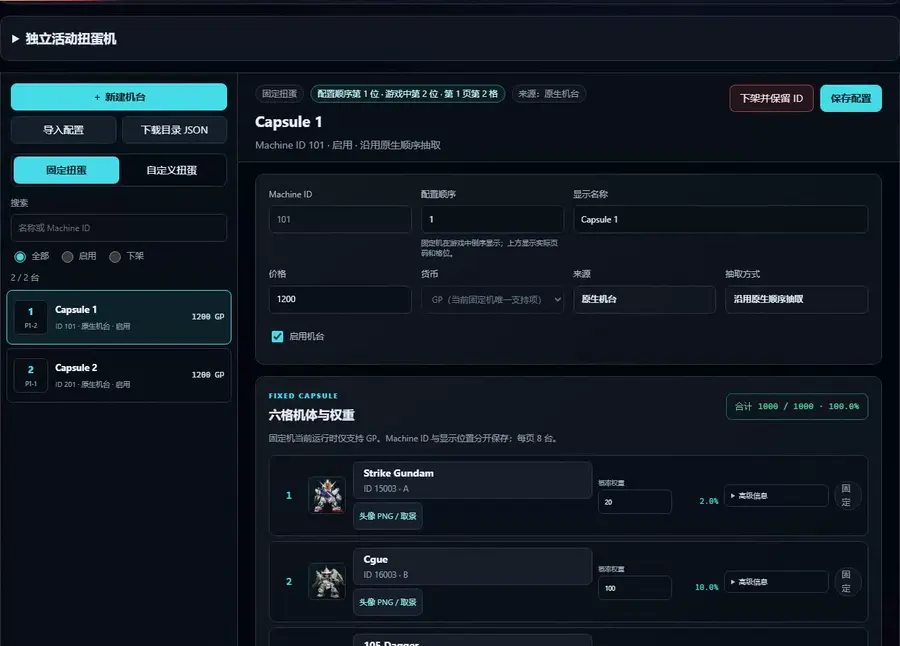

# 扭蛋机编辑器

[English](capsule-catalog.md) · [返回功能目录](../README.zh-CN.md)

修改机台名称、价格和奖池权重，保存到配置。

服主用 SDGO Mod Manager 的扭蛋面板管理固定和自定义扭蛋机：新增、查询、修改、下架、恢复、排序、选择原生六格模板、
设置价格与权重、增删自定义候选、查看头像、导出、编译和导入配套配置。玩家仍在游戏原生扭蛋界面操作。

发布配置时，会从当前有效的活动奖池和自定义扭蛋候选自动生成机体图鉴的成品获取方式：活动机台中的所有有效机体奖品，
以及已启用自定义机台中的全部正权重候选都会登记。新增、禁用、下架或改号后重新编译并发布即可更新，不需要重新导入机体。
图鉴使用玩家实际看到的机台号，例如内部 ID `15401` 显示为“活动扭蛋机154号”，自定义机台 ID `2` 显示为“自定义扭蛋机2号”；
收藏等特殊机台保留名称，普通扭蛋机继续使用原生来源。共享获得方式显示会合并当前已安装提供者的贡献；该显示模块缺失时，
扭蛋运行时本身仍可正常加载。已有获取方式与设计图字段继续保留，尚未应用的活动草稿不列为可获得来源。

## 新增训练机池并交换配置

这个例子不使用任何现成奖池或机体图。先在自己的目标目录中准备六台合法、可出击且素材齐全的机体，
选用与它们等级排列匹配的六格模板。机体由其他导入工具登记，扭蛋 JSON 不会生成机体、武器或模型。

1. 在 Manager 的“扭蛋机”中新增固定机，名称填“训练机池”，让工具分配机台身份和显示位置。
2. 从当前目录选择六台机体，权重按槽位填 `50, 150, 200, 200, 200, 200`，合计 `1000`。
   这些是虚构的配置值；槽位仍须符合模板等级，价格另按服主设定。不要直接改数据库序列。
3. 需要自己的头像时上传自绘 PNG，在原生卡面预览中裁切并确认；图片与裁切数据随语义 JSON 导出，
   不能只把本机图片绝对路径给另一位作者。
4. 保存，导出完整配置 JSON。在同一来源工作区导入时保留 `source_identity`、机体元数据与候选策略；
   另一个数据库／来源应先建立自己的目录，再选择对应机体，不能强行改来源身份来套用旧奖池。
5. 编译并预览客户端，再用“导入到游戏”配套应用客户端和服务端，核对同一 `catalog_revision`。
   给玩家的是生成的 `player/` 包或服主内容更新，给作者的是语义 JSON；二者不是同一种输入。

自定义机台的候选条目数不是稀有槽位数。已在同一数据库确认的 C/B/A 导入根形态可按普通槽位规则加入候选，
仍受 `slot_rules`、可出击标记和已校验导入登记约束；不要为了加入候选把它伪装成 SR。
稀有 S 级候选继续按 SR／无设计图 SS 等策略判断。所有机体都只在服主明确选择后加入机台。

活动机另用 10000 格整数频率，并使用自己的海报、货币和奖品类别；不能把上述固定机的 1000 格权重直接当作活动机 JSON。
收藏扭蛋按当前目录动态计算候选及家族入口，见[新增机体族的登记例子](collection-capsule.zh-CN.md#登记一个虚构双形态训练机)。

## 数据和安装

仓库只提供功能和工具；游戏素材、数据库、玩家数据和连接凭据由服主本地提供。
`capsule_catalog` 默认关闭，服主生成完整运行时后才启用。路径和服务器配置不绑定开发者电脑。
发行版 Manager 自带工具依赖，SQL 操作需本机 ODBC 驱动；源码开发使用 Python 3.10+、Pillow 与 pyodbc。玩家安装器不需要 Python。

按[配置与初始化教程](capsule-authoring.zh-CN.md)导出只读快照、初始化目录，在 Manager 扭蛋面板配置安装目标。
扭蛋功能复用 Manager 的会话、接口与工作区，不再启动独立编辑器。导出 JSON 只是配置，实际导入会编译客户端覆盖资源、生成服务端 SQL，
检查两端 `catalog_revision`、备份文件并提交数据库。SQL 失败会回滚并恢复客户端文件。
原生扣费、发货和失败补偿仍由游戏执行；工具不清空玩家历史，也不重启其他开发线的服务。
导入完整包会启用扭蛋机自己的全局与模块开关，包括框架预装的关闭状态；其他 Mod 的开关保留。
扭蛋包同时带有框架加载器、核心和扭蛋程序，供还没装框架的客户端运行奖池。客户端已经是相同或更新的框架版本时，
导入保留客户端自己的程序（以及与之配套的扭蛋符号定义），只写入奖池数据；导入结果和备份回执在 `kept_programmes`
中列出保留的文件。客户端程序比扭蛋包旧时照常更新。

A/B/C 机体可上传处理好的 PNG，拖动取景框、拉角或滑杆缩放，预览原生扭蛋卡。两姿态可分别设置或共用，
也能恢复原图。PNG、哈希与取景坐标保存在配置内，换电脑不依赖原图片路径。
默认不设置图片覆盖，使用玩家本地原版素材。此功能不发布高清化游戏图片、原始游戏包或 AI 模型。

安装前关闭目标游戏。服主向玩家分发生成的整个 `player` 目录，玩家运行其中的
`Install-Client.cmd -GameDir "D:\Game"`，以后照常用原启动器进入游戏，无需额外的“开始联机”按钮。
每次修改奖池都要同步配套客户端数据；只更新框架 DLL 不会同步奖池图片和槽位。
若服主用自己的更新方式分发完整客户端，把这些数据和更新后的文件 manifest 一并放进去即可。服主核对已发布的 manifest、客户端 `runtime.ini` 和服务端
`sdgo_mod_CapsuleRuntimeState.CatalogRevision` 的 `catalog_revision` 完全一致，
Manager 工作区也应指向同一份目录配置。

固定新池六格权重必须是正整数且合计 1000；使用原生模板时继承等级排列、概率和价格。
既有未修改奖池继续走原生序列，新池使用独立权重抽样。自定义机保留原生候选白名单，新增高等级候选只接受
SR，或没有任何设计图配方记录的 SS；普通 S 与有配方 SS 不进入。增加候选不增加 SR 可选槽位。
独立抽样没有前期压低、保底或连续同机体保护；原生序列包含防连续重复处理。
权重一致不代表出奖顺序与原版完全一致，见[分布核对记录](investigations/capsule-weighted-distribution.zh-CN.md)。

其他 Mod 请参考[共用接口与资源边界](capsule-integration.md)，通过同一目录编译两端，避免重复覆盖同一份资源。
卡面、列表位置和价格显示的原生细节见[开发者说明](capsule-display-fix.zh-CN.md)。

独立活动机在 Manager 中生成草稿时，按当前普通活动机的显示编号继续顺延；9900 及以上的置顶号段不参与普通编号分配。
保存活动机配置后，可在「显示编号」中填写 1..9899 的编号并选择「保存编号」，再编译、应用配套两端。
工具会同步更新原生机台编号，保留海报、价格、奖励和抽取序列，不会另外复制一台机或重置玩家进度。
已经产生玩家抽取状态的机台会拒绝改号；应在上架供玩家使用前确定编号。
安装了收藏扭蛋时，编译器会由其自己的资源适配器保持收藏机置顶；只调整已认证机台的内部显示顺序，
不改变其他提供者的机台。若置顶需要跨越未认证的机台，会拒绝编译并保留原数据。
