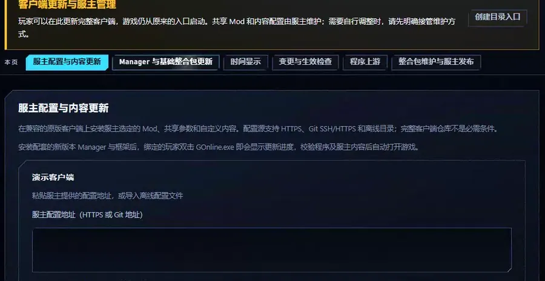
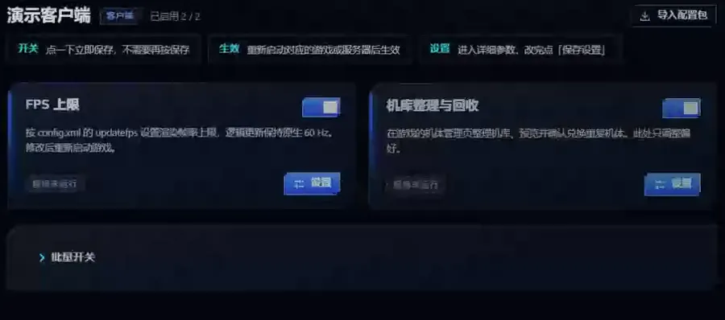
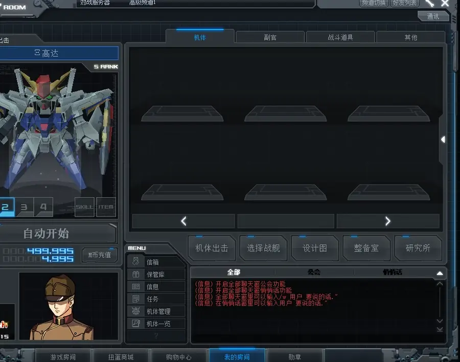

# Feature demonstrations

[简体中文](demonstrations.zh-CN.md) · [Back to the feature index](../README.md)

These animated WebP clips show common workflows and in-game effects. Each guide explains installation, settings and activation.

## Manager programme updates

This clip uses starter-pack mode: check the Stable release, download and verify its programmes, then apply them to the selected client. Bound players update the combination locked by their owner profile.

[Manager guide](mod-manager.md)

## Manager settings

Change and save the FPS limit. The interface explains that the setting takes effect after restarting the game.

[FPS settings](fps-limit.md) · [Manager guide](mod-manager.md)

## Hangar exchange preview

Review duplicate units and retention rules on the native unit-management page. The preview can be cancelled; exchanging units requires separate confirmation.

[Hangar management](hangar-manager.md)

## PvP AI

AI teammates and opponents move and fight on a PvP map.

[PvP AI guide](pvp-ai.md)

## Mission AI wingmen

AI wingmen join the team in cooperative missions.

[Mission wingmen guide](coop-wingmen.md)

The relevant guides describe background, protocol and crash fixes. Fixes without visible interaction do not receive simulated demonstrations.
