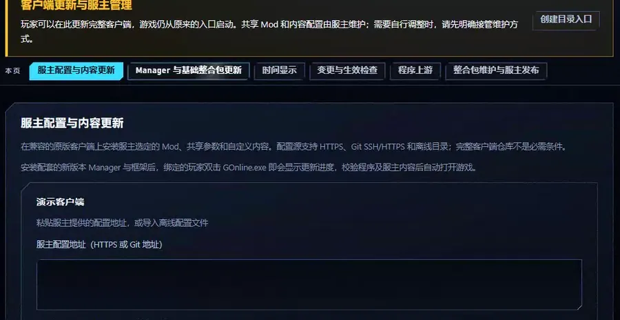
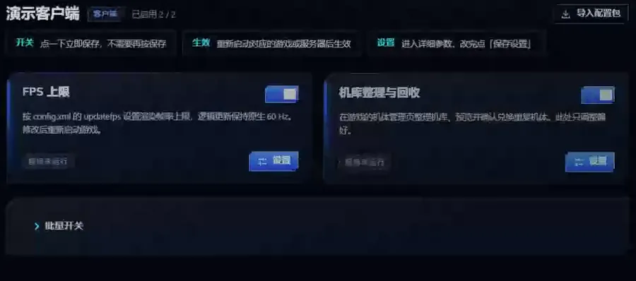
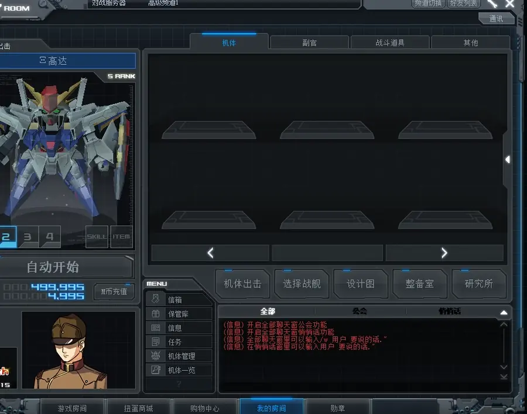
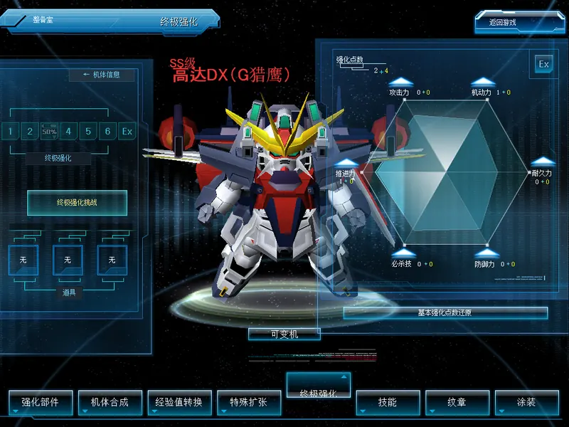

# 功能短片

[English](demonstrations.md) · [返回功能目录](../README.zh-CN.md)

以下 WebP 动图展示常用操作与游戏内效果。安装、设置和生效方式见各功能指南。

## Manager 程序更新

这里展示基础整合包模式：检查正式版本，下载并校验程序，再应用到选定客户端。已绑定服主的玩家按服主配置锁定的组合统一更新。

[Manager 使用说明](mod-manager.zh-CN.md)

## Manager 参数设置

以 FPS 上限为例，修改数值并保存；界面会说明需要重启后生效。

[帧率设置](fps-limit.zh-CN.md) · [Manager 使用说明](mod-manager.zh-CN.md)

## 机库兑换预览

在「机体管理」页查看重复机体及保留规则。预览完成后可返回机库；实际兑换需要另行确认。

[机库整理与兑换](hangar-manager.zh-CN.md)

## 对战 AI

AI 队友与敌人在对战地图中移动和交战。

[对战 AI 使用说明](pvp-ai.zh-CN.md)

## 任务 AI 僚机

任务房间中的 AI 僚机跟随队伍参与战斗。

[任务僚机使用说明](coop-wingmen.zh-CN.md)

## 整备室的三套强化体系

「终极强化」标签是 OC 页面；「强化部件」标签用左侧面板下方的按钮在 G改 2.0 与 G改 1.0 之间切换，G改 1.0 使用原版的类型栏、技能列表和初始化窗口。

[OC 六维强化与按房间选择体系](over-custom.zh-CN.md)

后台、协议及崩溃修复的用途与排错方法见相应功能指南；没有可见操作的修复不附模拟短片。
