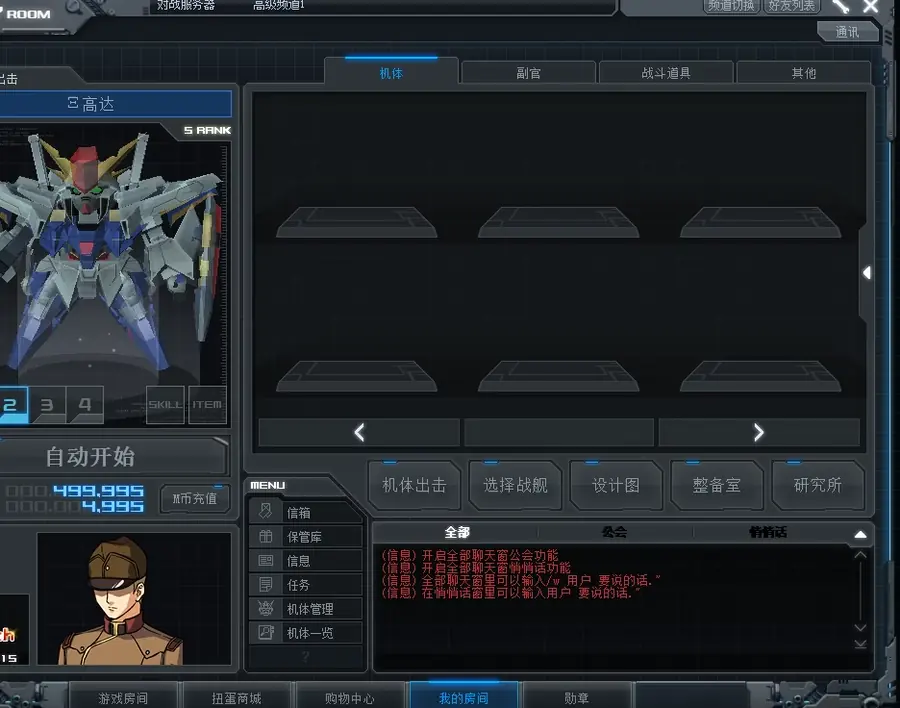

# Hangar manager

[简体中文](hangar-manager.zh-CN.md)



The client mod `hangar_manager` adds **Sort** and **Exchange duplicates** buttons next to the lock and
dismantle buttons on the game's unit-management page. Everything happens in that native page; there is
no separate window, overlay or hotkey, and the Manager does not need to stay open. Sorting and GB batch
exchange run on the server, so the owner installs the server adapter first.

## Sort

The server orders all units by grade (S/A/B/C), sub-level, unit number, acquisition time and instance
ID, changing only slot numbers. Locks, sortie units, decks, training and other unit data are kept.
Sorting also raises the registered capacity in six-slot blocks to fit the inventory, up to 1200
(an imported inventory larger than `24 + ExpandSlotCount` can crash the native login slot writer).
The page shows "sorting on the server" until the server answers; the hangar then refreshes in place with the new order (no re-login). If the server refuses, nothing changes and the page says so; only when its answer or the refreshed slot pages cannot be confirmed does the page ask you to log in again.

## Exchange duplicates

- Copies are counted by unit number; at least two of each are kept by default (`KeepCopies`, 1–20),
  and protected copies count toward that. Paint variants count as the same unit; lock any copy you
  want to keep.
- Locked, sortie, deck, rental and trained units are never exchanged. Units loaded by the installed
  `unit_catalog` are added automatically when their native grade has one unambiguous reward rule;
  unknown or conflicting grades are skipped.
- Choose native GB or the native item reward (usually experience capsules). The server's
  `tbl_UnitGradeInfo` and native dismantling decide the actual reward.
- Preview and the first confirmation delete nothing; two confirmations are required.

**GB batch exchange** builds the list from the native inventory summary. After confirmation the exact
instances, unit numbers and slots go to the server, which rechecks ownership, protection, KeepCopies and
rewards, dismantles natively and credits GB in one transaction. Incomplete or stale lists and any failure
change nothing; repeated submissions do not pay twice. When the server has answered every message, the exchanged units disappear from the page and the GB balance updates in the same session.

**Item exchange** keeps the native per-unit flow and stops, without retrying, when a reply cannot be
confirmed, the connection changes or the hangar is modified elsewhere. Confirmed steps are not undone.

Leaving the unit-management page cancels an unconfirmed preview and restores the native buttons; reopening
starts again from the preview.

## Install

**Server:** in SDGO Mod Manager open **机库整理与批量回收服务端** (hangar server), choose the server INI
containing `DB Game` and `DB Member` (same SQL instance) and install or update. Normal native mail keeps
working. The same installation adds a server-side deletion guard: one SQL `DELETE` statement may remove
units from only one account. Every allowed deletion writes the complete original unit row, UTC time and
bounded SQL session/application/host metadata to a dedicated audit table. The panel reports only the
guard state and audit-row count. Removing the adapter preserves that audit history. The panel can check
the installed procedure and trigger hashes and restore the original mail procedure. No game server
restart is needed.

**Client:** players receive it with the server owner's client package or update. The Full framework package includes this mod
(Base does not). Alternatively import the mod's overlay with **导入配置包** in the Manager, or close
the client and run `install_hangar.ps1 -GameDir "D:\Games\SDGO"` from the standalone package
(`-RefreshRules` refreshes the reward preview rules). Supported client: `GOnline-54BE1568-00C97000`.

## Settings

Under **机库整理与回收** in the Manager: **至少保留机体份数** (`KeepCopies`, default 2) and **回收后整理机库**
(`SortAfterExchange`, default 1). `RequestIntervalMs`, `ReplyTimeoutMs`, `MaxSlots` and `RulesFile` are
developer settings. The rules file only affects the preview; it cannot raise server rewards. Explicit
rows in it take priority. At client startup, the Mod validates the installed `unit_catalog/catalog.bin`
and supplements missing imported unit numbers by matching their verified native grade to an unambiguous
rule in this file. A corrupt catalog is ignored, and a grade with conflicting reward rows is never
guessed. Owners can export the base rules read-only with
`python export_hangar_rules.py --server-ini "D:\Server\StoreServer.ini" --output units.tsv`
(needs `pyodbc`; `--snapshot` reads table JSON instead).

## Developer notes

- Sort and GB batch requests use the native mail send `0x0891` (345 bytes); the server derives the owner
  from its own session and writes a separate receipt that the Manager reads back.
- Live refresh: the World's `CRequest::ReqSendMsg` runs the mail procedure, which executes the hangar
  command synchronously, and then answers each send with `0x06AD` (committed) or `0x079F` (refused). The
  client Mod copies these replies from the native receive pre-handler (`hangar.packet_prehandler`). After
  every expected `0x06AD` it requests each slot page with the native `REQ_UNIT_SLOT_PAGE` `0x04FF`
  (page *p* = slots 6*p*+1–6*p*+6, read from the database by `sp_GetUserUnitPage_V2`), writes each `0x08F2`
  record through the native `CUnitInfo::SyncFullData`, clears occupied slots that no page reported
  (`hangar.slot_clear`), asks for the user info again (`0x06B3`) and waits for its `0x05C1` reply, which rebuilds the
  active-unit record (whose slot moves with a sort) and the GB balance, before it redraws the page. A missing answer, a page error or a record
  outside the client's allocated slots leaves the cache as it was and falls back to the re-login message.
- The sort transaction changes only `tbl_UserUnits.UserUnitSlotNumber` and verifies all other columns.
- The deletion trigger rejects a statement whose `deleted` set contains more than one `AccountNumber`.
  Its audit insert participates in the caller's transaction, so a failed or rolled-back native operation
  leaves neither an inventory change nor a misleading audit row. It records no SQL text or credentials.
- Item exchange uses native dismantle `0x06D2` (19 bytes; reward 1 = GB, 2 = item) and detail `0x078B`
  (14 bytes), always addressed by the stable `UserUnitNumber`.

Build and test:

```powershell
cmake -S . -B build/hangar -G "Visual Studio 17 2022" -A Win32
cmake --build build/hangar --config Release
ctest --test-dir build/hangar -C Release --output-on-failure
```

Native mouse replay needs `-DSDGO_HANGAR_NATIVE_HOST="D:/Games/SDGO/GOnline.exe"` and the
`hangar_native_input_replay` test.
