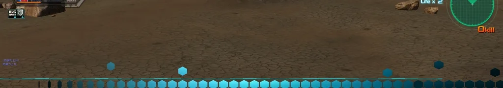

# Map and mission import

[简体中文](map-import.zh-CN.md)

Register maps and missions that were made outside the game and prepared in the **map package protocol**: new terrain, objects, spawn points, sky, minimap and music, plus PvE missions with phase objectives, enemy waves, character dialogue, opening/mid-mission/ending cutscenes and native unit illustration strips. Imported maps appear in the battle room map list and imported missions in the mission room list, next to the original ones.

The feature only imports. It reads protocol data, generates the records and resources the game needs and installs them on the client and the server. It does not unpack, export or change the game's own maps and missions.

The mission catalogue, default room name and objective title retain the mission file's `name.zh`; NPC labels and attack multipliers do not replace it. If an older build displays a weapon field name, recompile and publish the client content with Manager 1.16.25 or later. An unchanged server plan needs no reapplication or server restart.

Derived NPCs inherit template combat definitions; their unit illustration strips and speech must be explicitly authored for this mission. Compilation clears presentation references belonging to the original mission. For older packages, the client enables imported unit strips only when their speech is declared and valid in that package, keeping invalid IDs out of the native speech queue.

The native entrance and exit animation uses built-in artwork here. The owner content package supplies the artwork used by each mission.

## Parts

| Part | Role |
| --- | --- |
| Client Mod `map_catalog` | Registers imported map rows and mission records at startup, serves terrain/model/texture resources, loads mission scripts (cutscenes, phase events) and enables the character dialogue panel for imported missions |
| Battle server Mod `map_catalog_server` | Applies the imported-mission pacing policy only to MissionIDs declared by the server owner content package; stock missions, final settlement and native cutscene timing remain unchanged |
| Manager page "地图与任务导入" (map and mission import) | Register map packages, edit names/modes/servers, compile, install the client package, check and apply the server rows |
| Map package protocol | `map.json` describes a map; `missions/*.json` describe missions. See below |

## Using it in Manager

1. In the module settings, set the **map workspace** (leave empty to use the Manager data folder), the **matching client folder** (compile baseline and install target) and the **WorldServer INI**.
2. **Register a map package**: enter the folder that contains `map.json`. Every file digest is checked and the package is copied into the workspace. Registering the same `map_key` again replaces its files and keeps your edits.
3. On each map card adjust the Chinese/English name, the PvP modes, the server types, which missions to publish, whether the map is published and its position. Click Save.
4. Click **Compile all enabled maps**. All enabled maps and missions become one client package and one server plan.
5. Close the client, then click **Install client package**. You can also download the client package and hand it to other players as the server owner's client package or update.
6. Click **Check server** to see the rows that will be added or updated and any conflicts; with no conflicts click **Apply to server**, then **Read back**.
7. Restart the World/Battle services and the client.

**Example map.** The **示例地图** (example maps) card downloads *Twin Valley Fortress · Operation Odessa* from the framework's public repository, checks every file against the SHA-256 in its `map.json` and registers it like any other package; then compile, install and apply as usual. The map has a south valley arena, a fortress line with a gate on the ridge and a mining base in the north valley, and comes with an eight-phase PvE mission (opening, mid-mission and ending cutscenes, native unit illustration strips, a boss group and a countdown). Its files are in the repository under [`examples/maps/twin-valley-fortress`](../examples/maps/twin-valley-fortress) as a reference for writing your own packages; [`CREDITS.md`](../examples/maps/twin-valley-fortress/CREDITS.md) lists the CC0 sources of its textures and scans. It uses the game's own NPC templates, models, music and sounds by name, so it compiles only against a client and server that have them.

Numbers are assigned at compile time: map numbers continue after the client's own maps, and every kind of mission record continues after the original mission records, without gaps (the game reads these lists as contiguous numbers). Removing or moving a map therefore renumbers the maps and missions after it; compile, install and apply again and the server updates and removes the rows this workspace wrote earlier.

The server write runs in one transaction. A row with the same key that was not written by the map import refuses the whole apply, so original data is never overwritten.

## Map package protocol (`map.json`)

A map package is a folder: one `map.json` plus the glTF 2.0 models (`.glb`/`.gltf`), images and optional MP3 it references. Every file must be listed with its SHA-256 in `files`.

Colour textures (model base colour textures and terrain layer textures) may be PNG or JPEG; height images, layer masks and the preview, minimap, banner and catalogue images are PNG. Textures are scaled down to at most 2048 pixels; opaque textures are stored as JPEG in the game, textures with transparency stay lossless. Models are static meshes with one base colour texture per material; the client renders diffuse colour only, so bake ambient occlusion and other shading into that texture. A `.gltf` may keep its buffer and textures in separate package files, which several models can share.

**Coordinates** match the game world: X east, Y up, Z north, origin at the terrain centre, game units. Height and mask images cover the whole terrain with row 0 at the north edge and column 0 at the west edge. glTF assets keep their own convention (right-handed, -Z forward) and are converted at compile time. `rotation_y` is clockwise seen from above: 0 faces north, 90 faces east.

| Field | Meaning |
| --- | --- |
| `schema`, `schema_version` | `sdgo.map-package`, `1` or `2`; named native objects require v2. Existing packages remain readable |
| `map_key` | Unique map identifier: 3..64 lowercase letters, digits, `.`, `_`, `-` |
| `name`, `description` | `{"zh": …, "en": …}`; names up to 48 characters, Chinese descriptions up to 99 UTF-16 code units |
| `modes` | PvP modes: `normal`, `deathmatch`, `grid`, `tag`, `captain`, `ai`, `ai_battleship` (may be empty for a mission-only map) |
| `servers` | Server types: `training`, `beginner`, `expert`, `clan` |
| `terrain.half_extent` | Terrain half size: 4096, 8192 or 16384 |
| `terrain.height` | `image` (257×257 greyscale PNG), `min`, `max` |
| `terrain.layers` | 1..8 surface layers painted bottom to top: `texture` (PNG or JPEG), `mask` (coverage 0..255, optional on the first layer), `tiling`. The compiler turns the coverage masks into per-vertex blend weights that sum to 255, as in the shipped maps |
| `terrain.lighting` | `sun_direction` (y must be negative), `sun_color`, `ambient`, `bake_shadows` (baked light and shadows) |
| `terrain.fog`, `terrain.sky` | Fog colour and start/end distance; sky `zenith`/`horizon`/`ground` colours |
| `terrain.play_area` | Playable `half_x`, `half_z` and height `ceiling` |
| `objects` | Up to 1024 objects: `model` (a glTF in the package) or `native_model` (an existing client model), `position`, `rotation_y`, `scale`, `collision` (`auto`, `none` or boxes), and optional `only` (`pvp`/`mission`). In v2, `id` is the stable internal name; `block` declares a native destroyable object with a client/server `template`, display `name` (required `zh`, optional `en`) and optional `hp`; `initially_hidden` sets its initial visibility |
| `spawns` | `team_a` and `team_b` with 6 points each, `shared` with 1..12, plus `grid_respawn_a`/`grid_respawn_b` for Grid mode; each point has `position` and `facing`. In the mission terrain the shared points are the respawn points: a pilot who falls in phase *p* respawns at shared point 2*p*−2 or 2*p*−1, so the compiler gives every phase its own pair — phase 1 at `shared[0]`/`shared[1]`, a phase that enters a sector at that sector's first two `warp` points, a phase with a new `enter.area` inside that area, any other phase at the previous phase's pair |
| `sectors` | Named mission sector spawn points (`{name: {spawns: [...]}}`) |
| `item_patterns` | Item spawn sets; `red` and `blue` need the same number of sets |
| `presentation` | `preview` (PNG), `minimap` (PNG, the whole terrain), `bgm` (an MP3 in the package or `{"native": "BGM\\NNNN.mp3"}`). The compiler makes the map image from the minimap like the shipped maps: the play area keeps its aspect inside the square texture and is framed by an orange-yellow boundary line; the mission row's image also outlines every movable area its missions use. `boundary_lines` (default `true`) paints the boundary on the ground with the band the shipped PvP maps use: the play area's edge on the PvP map, and the edge of every movable area on the mission map (the play area's edge when its missions have no areas) |
| `files` | SHA-256 of every file in the package |

### Named gates and bombardment targets

Map package v2 can register a model with collision as a named native object. Scripts use `id`; players see `block.name`. Keep internal codes out of display names. Compilation produces paired client definitions, terrain objects and server placement rows. The owner applies the plan and restarts World/Battle; player content installation does not execute SQL.

Mission v3 supports `npcs.<key>.block_attack` with the target `block` and a `weapon` (`first`, `second`, `third`, `special`). It drives the NPC's real native target and weapon controls and cannot coexist with that NPC's `ai`. A later phase's `enter.blocks` accepts `{ "block": "fortress_gate", "visible": false }` to hide the leaf and open its collision passage; `visible: true` reinserts it. Place the opening command after the protection phase so it runs only on successful progress.

## Mission protocol (`missions/*.json`)

Mission files live under `missions/` in the map package and are listed in `files`. One mission is one entry of the mission list and can have 1..4 difficulties.

| Field | Meaning |
| --- | --- |
| `schema`, `schema_version` | `sdgo.map-mission`, `1`, `2` or `3`; illustration strips and immediate transitions require v2, named-object attacks and phase visibility require v3. Older compilers reject unsupported new semantics |
| `mission_key`, `name`, `description` | Mission identifier, name and description |
| `transition_delay` | Phase-change pacing: `native` (default) keeps the stock fixed wait between ordinary phases; `immediate` removes only that fixed wait between non-final phases. A phase's `SceneTime` cutscene still plays in full, and final settlement keeps the native timing |
| `briefing.zh` | Briefing panel: up to 5 lines of 49 characters |
| `difficulties` | Per difficulty: `level`, `required_rank`, `time_limit` (seconds), `lives` |
| `bgm` | Mission music (same form as the map's `presentation.bgm`) |
| `npcs` | Units: `template` (an NPC the target server already has), or `unit` + `base` (any unit using an NPC template); `hp`, `boss`, `name` and `ai` (an AI script name such as the battle AI's `VSAI_Infighter_01`) can be changed. `label` sets the name shown above the unit (for example a pilot name, up to 49 characters without `(`); `attack` and `special_attack` (0.25–4) multiply the damage of the unit's weapons and of its special attack (`special_attack` defaults to `attack`). Labels use a client presentation copy. Damage changes generate matching client and server NPC unit and weapon definitions, including matching NPC and kill-goal unit IDs. Apply the paired server plan and restart World/Battle before publishing client content |
| `lines` | Character dialogue: `portrait` (a client portrait `sprs\\NNNN.spr`), `speaker`, `text` |
| `npcs.<key>.cutin` | Native unit illustration strip: `native_sprite` references an existing unit SPR in the target client; `line` references mission dialogue. NPC arrival uses the game's own illustration strip, animation and resolution scaling. It does not generate a text effect. Do not substitute another unit's artwork when the requested unit has no illustration |
| `banners` | World-space image effects: `image` (512×128 PNG); separate from native unit illustration strips |
| `presentation` | Optional mission list artwork in PNG, each replacing the template mission's image: `list_banner` (155×68), `room_icon` (120×83; like the shipped icons, keep rows 0..18 for the title lettering), `room_poster` (250×120), `title` (155×22, white lettering on a transparent background) and `loading` (1024×1024 loading screen poster). `loading_screen` chooses the battle loading screen: `poster` shows `loading` (the default when `loading` is given), `random` keeps the game's random loading pictures |
| `area` | Movable area at the start: `[left x, top z, right x, bottom z]` (north is top). Players are kept inside it with the same call the shipped multi-area missions use. It is set when the `opening` cutscene starts, so it needs an opening. Without it the whole `terrain.play_area` is movable |
| `drops` | Optional mission drops, rolled at the end like the shipped missions: `normal` (default `true`) keeps the shipped drops of the difficulty's level (levels 1–5); `blueprints` is `"mission"` (default: every blueprint whose unit appears in the mission, including the player unit of the same name for an NPC-only unit) or a list of unit ids; `blueprint_per_mille` (1–50, default 2) is each blueprint's chance in 1000 clears (at most 500 in total). Drops arrive in the player's drop box |
| `sectors` | Sector change: `warp` (1..8 points), `facing`, optional `rect` (the new movable area, same order as `area`) |
| `cutscenes` | Cutscenes, see below |
| `phases` | 1..8 phases played in order, see below |
| `opening`, `ending` | Cutscene played at the start and on success |

**Phases** (`phases[]`):

| Field | Meaning |
| --- | --- |
| `key`, `objective` | Phase key; the objective text is shown in the objective bar |
| `goal` | `kill`: destroy a number of given units (several entries must all be met); `kill_any`: destroy that many enemies of any kind (one counter for a mixed group, like the shipped "destroy N" goals); or `survive`: hold out for some seconds |
| `fail` | `time_limit`: time limit; `lose`: the mission fails when a given allied unit is destroyed |
| `spawns` | Waves: `npc`, `positions`, `at` (seconds after the phase starts), `every` (interval), `side` (`enemy`/`ally`), `min_free`. `at` counts from the end of the cutscene that opens the phase (the `opening` for the first phase), so nobody fights while a cutscene plays; waves at 2 seconds or later appear at their time even if the earlier enemies were already destroyed |
| `slots` | On-screen unit limits: `ally` + `enemy` ≤ 10 |
| `enter` | On entering the phase: `cutscene`, `lines` (dialogue), `sector` (sector change with warp), `area` (new movable area without a warp); use `opening` and the mission `area` for the first phase |
| `reward` | Phase reward `points`, `unit_exp` |
| `next` | Next phase (default: the following one) |

**Cutscenes** (`cutscenes{}`): `length` (1..60 seconds), `actors` (`npc`, `at`, `facing`; `hold: true` keeps the actor at `at` every frame, for hovering ships that the game would otherwise drop onto the ground; actors are on the players' side so AI wingmen do not attack them, `side: "enemy"` puts one on the enemy team), `camera` (keyframes `pos`/`look` starting at `t=0`, compiled into a smooth curve that the camera follows every frame) and `events`:

| Event | Meaning |
| --- | --- |
| `anim` + `actor` | Play a unit animation (the compiler checks that the unit's model has it); `loop` optional |
| `move_to` + `actor` | Move the actor to a point at least 100 units above the ground; the path must not pass through objects |
| `banner` | Show a banner in front of the camera; `distance` or `at` optional |
| `line` | Show a dialogue line |
| `effect` | Play an effect the client already has: `{fx, at, scale}` |
| `sound` | Play a sound effect the client already has |
| `shake` | Camera shake `[amplitude, seconds]` |

Players cannot move during a cutscene; control returns when it ends.

Declare an illustration strip in the matching NPC's `cutin`; the native NPC-arrival flow plays it. `image` may reference a package PNG/JPEG instead of `native_sprite`; its default size is 1024×156. Other sizes declare `crop: [left,top,right,bottom]`: the native SPR selects that pixel rectangle and retains its logical aspect, using the original interface's placement and resolution scaling. Source dimensions are at most 2048 and the selected logical height is 64..512. Choose one artwork source and provide `line` in either case. A text title image does not replace a unit illustration strip.

Use a transparent PNG to retain parts that extend beyond the banner edge. `crop` selects the displayed rectangle; it does not remove the background.

The compiler checks placement and camera work: spawn points, mission spawns, cutscene actors and warp points must not be inside an object; a cutscene camera must not be below the ground or inside an object, and its view toward the target must not be blocked by terrain or objects (models the client already has are tested with their own collision, so open structures such as gate frames and arches stay open). Errors name the cutscene, the time and the camera position.

## Activation and compatibility

- Enable the client Mod `map_catalog` and the Battle server Mod `map_catalog_server`, and install the same publication on both sides; updating only one side leaves maps or missions missing. New builds emit `sdgo.map-import-server-plan/3`, including paired named-object definitions and placement rows. Existing v1/v2 plans remain readable; v2 continues to support pacing policy and paired unit/weapon tables, while v1 cannot declare them. The compiler sorts the MissionIDs of missions that declare `transition_delay: "immediate"` into `server-plan.json` at `runtime_policy.immediate_transition_missions` and includes that policy in the publication revision. When Manager applies the server plan, it writes the list only to BattleServer hosts that already have `map_catalog_server`, preserving unrelated configuration. A missing programme is reported as pending deployment and retains native pacing; it is never reported as active. Writing and reading back the configuration reports only `configured`; native runtime observation after restart is still required to prove that the policy loaded. The public framework package carries no server-specific IDs.
- Servers read these tables at startup: restart the World/Battle services after applying, and restart the client after installing the client package.
- Imported missions run in mission rooms as native missions; character dialogue uses the game's own character dialogue panel (portrait and name), and a mission with a `loading` poster shows it on the battle loading screen.
- NPC registration is part of the mission protocol: `npcs` entries become the server's NPC data and the client's NPC templates for that mission; no separate Mod is needed.
- Referenced client models, portraits, effects, sounds and BGM must exist in the target client; the compiler checks them.

## Troubleshooting

- In the client log `sdgo/logs/sdgo.log`, `map_catalog: native map rows registered` and `native mission records registered` confirm registration; `imported resource loaded: trns\…` shows that a battle used the imported terrain; `imported mission script call: …` and `imported cutscene finished: …` trace phase events and cutscenes.
- If a mission does not start or units are missing, turn on "write the game's native debug log" in the Mod settings; the client `app_log` then names the missing record numbers.
- Compile errors name the exact field (for example a spawn point below the ground, an undefined dialogue line, or an animation the actor's model does not have).
- If the map looks washed out to white with Bloom (HDR) on, compile and install again with Manager 1.16.16 or later: earlier compilers left the map row's Bloom bright-pass threshold at 0.
- To check a mission's movable areas, run the GameTest case `mission.import_flow`: it logs `imported mission local area x=[…] z=[…] on=… pos=(…) inside=…` for the client's own player whenever the area changes and every 10 seconds. A player outside a new area is moved to its edge. With review footage on, the case also holds the player near the west edge once so the ground line appears in the review frames.
- If the loading screen still shows a random picture, check `sdgo.log` for `imported mission …: mission poster loading screen`; a warning that the catalogue row is not reachable means the mission catalogue numbers have a gap (compile and install the whole workspace again).
- If the example map download fails, check that the Manager can reach `raw.githubusercontent.com`; files already downloaded and verified are reused on the next try.
- If "Check server" reports conflicts, the target database already has non-import rows with the same numbers and the apply is refused; make sure the client and the server come from the same original data.
