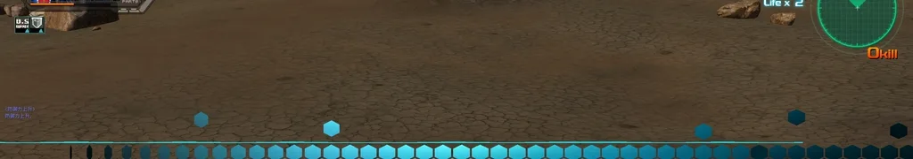
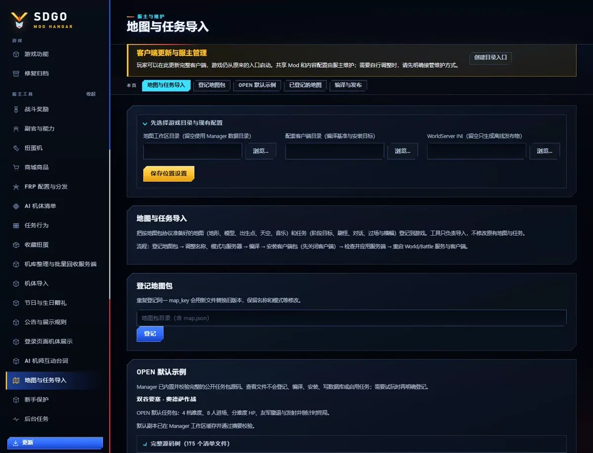
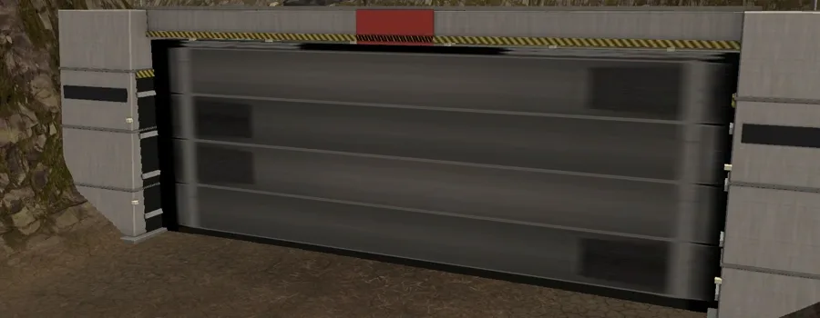
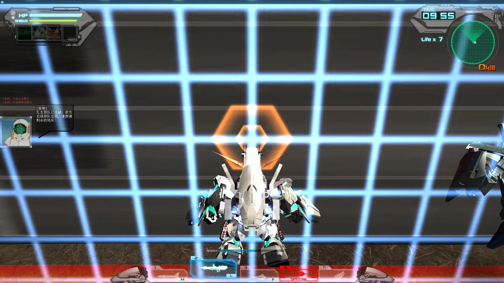
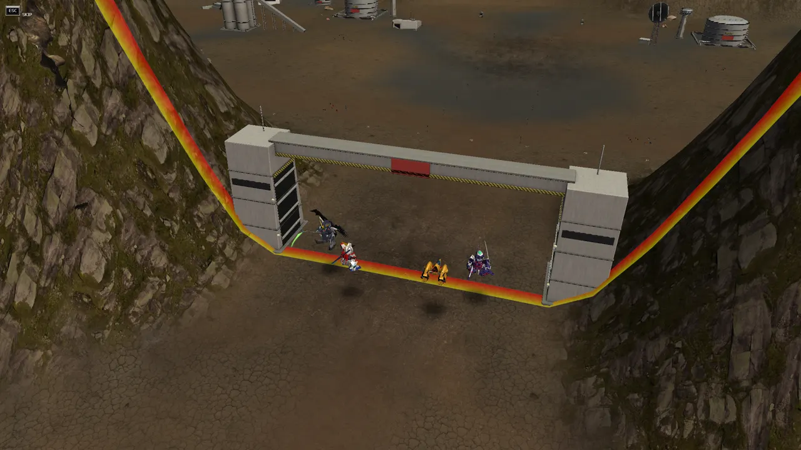

# 地图与任务导入

[English](map-import.md)

把在游戏外制作、按**地图包协议**准备好的地图和任务登记到游戏里：新的地形、物件、出生点、天空、小地图和音乐，以及带阶段目标、刷怪、人物对话、开场/过场/终场动画和原生机体图片横幅的 PvE 任务。导入后的地图出现在对战房间的地图列表中，任务出现在任务房间的任务列表中，与原有地图、任务并存。

这个功能只负责“导入”：它读取符合协议的数据，生成游戏需要的记录和资源，再安装到客户端与服务端。它不拆解、不导出、也不修改游戏原有的地图和任务。

任务目录、默认房间名和任务说明保留任务文件的 `name.zh`，NPC 的标签或攻击倍率不会替换它。若旧编译结果显示了武器字段名，使用 1.16.25 或更新的 Manager 重新编译并发布客户端内容；配套服务端计划未变时，无需重新应用或重启服务端。

派生 NPC 继承模板的战斗定义，登场横幅与台词则必须在本任务中明确声明。编译时会清掉原关卡专用的演出引用；读取旧包时，客户端也只为本包已声明且有效的台词启用原生机体横幅，避免无效编号进入原生界面的台词队列。



这里使用游戏自带素材演示原生入场与退出动画；任务实际使用的图片由服主内容包提供。

## 组成

| 部分 | 作用 |
| --- | --- |
| 客户端 Mod `map_catalog` | 启动时登记导入的地图行和任务记录，提供地形/模型/贴图资源，加载任务脚本（过场、阶段事件），并为导入任务启用人物对话框 |
| Battle 服务端 Mod `map_catalog_server` | 按内容包声明应用阶段衔接与非致命边界反馈；服务端校验任务、阶段、真实参与者和冷却后同步 HP |
| Manager「地图与任务导入」 | 登记地图包、修改名称/模式/服务器、编译、安装客户端包、检查并写入服务端 |
| 地图包协议 | `map.json` 描述地图；`missions/*.json` 描述任务。格式见下文 |

## 在 Manager 中使用

1. 在模块设置里填写**地图工作区目录**（可留空，使用 Manager 数据目录）、**配套客户端目录**（编译基准与安装目标）和 **WorldServer INI**。
2. **登记地图包**：填写包含 `map.json` 的目录。登记时会校验全部文件摘要并把地图包复制进工作区；同一 `map_key` 重新登记会替换文件，保留之前的修改。
3. 在地图卡片上调整：中文/英文名称、开放的对战模式、开放的服务器类型、要发布的任务、是否发布、排列顺序。点「保存」。
4. 点「**编译全部启用的地图**」。所有启用的地图和任务被编译成一个客户端包和一个服务端计划。
5. 关闭客户端后点「**安装客户端包**」。也可以「下载客户端包」发给其他玩家（服主提供的客户端包或更新）。
6. 点「**检查服务端**」查看将新增、更新的行和冲突；没有冲突时点「**应用到服务端**」，再「读回服务端」确认。
7. 重启 World/Battle 服务和客户端后生效。

**OPEN 默认示例。** Manager 随安装包附带《双谷要塞 · 奥德萨作战》的完整公开源文件，首次打开地图导入页时校验并缓存；无需另行下载，也无需先配置游戏目录。卡片可查看全部文件路径、`map.json`、任务 JSON、导入辅助脚本和素材来源。点「登记默认副本」后才复制到可编辑工作区，之后分别编译、安装和应用服务端；查看示例不会改数据库或自动启用任务。编译后还可查看生成包的完整文件清单以及实际的 `manifest.json`、`definitions.json`、`missions.lua`。



地图包含南谷、带闸门与接触护罩的要塞防线及北谷基地，附 8 阶段 PvE 任务，展示四档难度与配对 HP、原生机体横幅、队伍行进过场、友军撤离和倒计时终局。源文件也在 [`examples/maps/twin-valley-fortress`](../examples/maps/twin-valley-fortress)，从 [`OPEN-ME.md`](../examples/maps/twin-valley-fortress/OPEN-ME.md) 开始；[`CREDITS.md`](../examples/maps/twin-valley-fortress/CREDITS.md) 列出 CC0 素材来源。示例按名称引用游戏自带资源，只能在具备相应数据的客户端与服务端上编译；服主私人图片和部署配置不随示例分发。

编号在编译时自动分配：地图编号接在客户端原有地图之后，任务的各类记录接在原有任务记录之后，并且彼此连续（游戏按连续编号读取列表，中间不能留空）。因此移除或调整一张地图的顺序，会让排在后面的地图和任务重新编号；重新编译、安装并应用即可，服务端会更新并清理本工作区写入过的旧行。

服务端写入在一个事务里完成。已存在、但不是由地图导入写入的同键行会让整个应用被拒绝，不会覆盖原有数据。

## 不依赖现成地图素材的最小案例

先做虚构的“训练场”：平地、一层纯色地表、两队各六个出生点，无模型和任务。
下面的源码开发示例只生成几张纯色图片和 `map.json`，不读取任何现有地图包。
运行环境需要 Pillow；普通服主可用图像工具制作相同尺寸的图片，再按协议填写清单。

```python
from pathlib import Path
import hashlib
import json
from PIL import Image

root = Path("example-training-yard")
root.mkdir(exist_ok=False)
images = {
    "terrain/height.png": Image.new("L", (257, 257), 0),
    "terrain/ground.png": Image.new("RGB", (64, 64), (90, 120, 80)),
    "images/preview.png": Image.new("RGB", (128, 128), (90, 120, 80)),
    "images/minimap.png": Image.new("RGB", (128, 128), (90, 120, 80)),
}
for name, image in images.items():
    path = root / name
    path.parent.mkdir(parents=True, exist_ok=True)
    image.save(path, format="PNG")

def spawn(x, z):
    return {"position": [x, 100, z], "facing": [0, 1]}

manifest = {
    "schema": "sdgo.map-package", "schema_version": 1,
    "map_key": "example.training-yard",
    "name": {"zh": "训练场", "en": "Training Yard"},
    "modes": ["normal"], "servers": ["beginner"],
    "terrain": {
        "half_extent": 4096,
        "height": {"image": "terrain/height.png", "min": 0, "max": 0},
        "layers": [{"texture": "terrain/ground.png", "tiling": 32}],
        "lighting": {"bake_shadows": False},
    },
    "objects": [],
    "spawns": {
        "team_a": [spawn(-1500, -300 + i * 120) for i in range(6)],
        "team_b": [spawn(1500, -300 + i * 120) for i in range(6)],
        "shared": [spawn(0, 0)],
    },
    "presentation": {
        "preview": "images/preview.png", "minimap": "images/minimap.png",
        "bgm": {"native": "BGM\\0001.mp3"},
    },
    "files": {name: hashlib.sha256((root / name).read_bytes()).hexdigest()
              for name in images},
}
(root / "map.json").write_text(json.dumps(manifest, ensure_ascii=False, indent=2), encoding="utf-8")
```

`BGM\\0001.mp3` 只是原生音乐引用示例，编译前须确认目标客户端存在，或换为作者自己的包内 MP3，
同时登记它的文件摘要。`files` 不列 `map.json` 自身；图片改变后重新计算摘要。
包的尺寸、字段和摘要可用 `owner.maps.package.load(root)` 读取校验；完整编译仍需目标客户端的兼容原生模板。

在 Manager 登记刚生成的文件夹，保存卡片，编译全部启用地图，安装客户端包，再检查、应用和读回服务端计划。
目录注册只复制制作资料；未完成编译和两端安装时，游戏里不会出现这张地图。
要加物件，提供自己制作的 glTF/贴图，并将每个外部缓冲区、纹理文件列入 `files`。

再增加虚构“30 秒演习”时，将下面内容保存为 `missions/drill.json`。
`500` 只是格式示例，必须替换成两端确实存在的 NPC 模板；这份任务不携带原生模型或 AI 脚本：

```json
{
  "schema": "sdgo.map-mission", "schema_version": 1,
  "mission_key": "example.training-yard.drill",
  "name": {"zh": "30 秒演习", "en": "30-second Drill"},
  "description": {"zh": "在训练场坚持 30 秒"},
  "briefing": {"zh": ["坚持 30 秒，熟悉移动和防御。"]},
  "difficulties": [{"level": 1, "required_rank": 1, "time_limit": 120, "lives": 3}],
  "bgm": {"native": "BGM\\0001.mp3"},
  "npcs": {"target": {"template": 500}},
  "phases": [{
    "key": "hold", "objective": {"zh": "坚持 30 秒"},
    "slots": {"ally": 0, "enemy": 1},
    "spawns": [{"npc": "target", "positions": [[600, 100, 0]], "at": 1}],
    "goal": {"survive": 30}
  }]
}
```

把任务 JSON 也列入 `map.json.files` 并计算 SHA-256 后重新登记、编译、安装和应用；
目标 NPC 模板、音乐、后续头像和横幅均须在目标存在或由作者显式提供，掉落另行配置。
只复制一张任务海报或修改地图名称不会创建任务。命名门板等新语义另按所需 v2/v3 版本声明。

## 地图包协议（`map.json`）

地图包是一个文件夹：一个 `map.json`，以及它引用的 glTF 2.0 模型（`.glb`/`.gltf`）、图片和可选的 MP3。所有文件都必须在 `files` 中登记 SHA-256。

彩色贴图（模型的基础色贴图和地表层贴图）可以是 PNG 或 JPEG；高度图、地表层遮罩以及预览图、小地图、横幅和任务目录图片使用 PNG。贴图最大缩到 2048 像素；不透明贴图在游戏中以 JPEG 保存，带透明的贴图保持无损。模型是静态网格，每个材质一张基础色贴图；客户端只渲染漫反射颜色，请把环境光遮蔽等明暗烘焙进这张贴图。`.gltf` 可以把缓冲区和贴图放在包内的独立文件中，多个模型可以共用。

透明物件使用 glTF 材质 `alphaMode: "BLEND"`，`baseColorFactor` 的透明度和 PNG 的透明通道共同保留；可配合 `doubleSided`。不透明材质保持原有绘制方式。模型和图片由地图包作者提供。

**坐标系**与游戏世界相同：X 向东，Y 向上，Z 向北，原点在地形中心，单位为游戏单位。高度图和遮罩图覆盖整块地形，第 0 行是北边、第 0 列是西边。glTF 资源保持自身约定（右手系，-Z 朝前），编译时会转换。`rotation_y` 为俯视顺时针角度：0 朝北，90 朝东。

| 字段 | 说明 |
| --- | --- |
| `schema`、`schema_version` | `sdgo.map-package`，`1` 或 `2`；命名原生物件使用 v2，旧包继续读取 |
| `map_key` | 地图唯一标识，3..64 个小写字母、数字、`.`、`_`、`-` |
| `name`、`description` | `{"zh": …, "en": …}`；名称最多 48 个字符，中文说明最多 99 个 UTF-16 代码单元 |
| `modes` | 对战模式：`normal`、`deathmatch`、`grid`、`tag`、`captain`、`ai`、`ai_battleship`（可为空，只用作任务地图） |
| `servers` | 服务器类型：`training`、`beginner`、`expert`、`clan` |
| `terrain.half_extent` | 地形半宽：4096、8192 或 16384 |
| `terrain.height` | `image`（257×257 灰度 PNG）、`min`、`max` |
| `terrain.layers` | 1..8 层地表，自下而上绘制：`texture`（PNG 或 JPEG）、`mask`（覆盖度 0..255，第一层可省略）、`tiling`。编译器把覆盖度遮罩换算成每个顶点合计 255 的混合权重，与原版地图一致 |
| `terrain.lighting` | `sun_direction`（y 必须小于 0）、`sun_color`、`ambient`、`bake_shadows`（烘焙光照与阴影） |
| `terrain.fog`、`terrain.sky` | 雾的颜色与起止距离；天空 `zenith`/`horizon`/`ground` 颜色 |
| `terrain.play_area` | 可活动范围 `half_x`、`half_z` 和高度上限 `ceiling` |
| `objects` | 最多 1024 个物件：`model`（包内 glTF）或 `native_model`（目标客户端已有的模型），`position`、`rotation_y`、`scale`、`collision`（`auto`、`none` 或碰撞盒列表）、可选 `only`（`pvp`/`mission`）。v2 的 `id` 是稳定内部名称；`block` 声明原生可破坏物件，包含目标客户端/服务端都有的 `template`、显示名称 `name`（`zh` 必填，`en` 可选）和可选 `hp`；`initially_hidden` 设置初始隐藏状态 |
| `spawns` | `team_a`、`team_b` 各 6 个，`shared` 1..12 个，`grid` 模式另需 `grid_respawn_a`/`grid_respawn_b`；每个点 `position` 与 `facing`。任务地形中的 shared 点即复活点：第 *p* 阶段阵亡的驾驶员在第 2*p*−2 或 2*p*−1 个 shared 点复活，因此编译器为每个阶段生成一对复活点——第 1 阶段为 `shared[0]`/`shared[1]`，进入区域（sector）的阶段为该区域前两个 `warp` 点，设置新 `enter.area` 的阶段移入该范围内，其余阶段沿用上一阶段 |
| `sectors` | 任务分区出生点（`{name: {spawns: [...]}}`），供任务切换区域使用 |
| `item_patterns` | 道具刷新组，`red` 与 `blue` 组数相同 |
| `presentation` | `preview`（地图预览 PNG）、`minimap`（小地图 PNG，覆盖整个地形）、`bgm`（包内 MP3 或 `{"native": "BGM\\NNNN.mp3"}`）。编译器按原版地图的做法由小地图生成地图图像：活动区保持原比例放在方形贴图中，四周画出橙黄色边界线；任务行的地图图像还会框出任务用到的每个活动范围。`boundary_lines`（默认 `true`）在地面上画出边界线，使用原版对战地图的边界色带：对战地图画在活动区边缘，任务地图画在任务用到的每个活动范围边缘（任务没有活动范围时画在活动区边缘） |
| `files` | 包内每个文件的 SHA-256 |

### 命名门板与炮击目标





触边后短暂显现原生网格与光圈，服务端确认的扣血复用游戏原生受击流程；平时可把屏障材质设为透明。

短片使用原生任务镜头展示闸门：保护期间关闭，进入后续过场前开放通道。

Manager 1.16.28 及更新版本会在进入阶段的过场开始前应用 `enter.blocks`，复用同一过场的各阶段分别保留自己的门状态。旧任务包需重新编译才能采用这个顺序。

地图包 v2 可把一件带碰撞模型登记为命名原生物件。`id` 供脚本引用，`block.name` 用于玩家看到的名称；不要把内部代号当作显示名称。编译器生成配对的客户端定义、地形物件和服务端放置行，服主应用计划并重启 World/Battle 后生效；玩家安装内容不执行 SQL。

任务 v3 的 `npcs.<key>.block_attack` 指定 `block` 名称和 `weapon`（`first`、`second`、`third`、`special`），让 NPC 通过原生攻击目标和武器控制向物件实际开火，不能与该 NPC 的 `ai` 同时声明。后续阶段的 `enter.blocks` 接受 `{ "block": "fortress_gate", "visible": false }` 隐藏门板并开放碰撞通道；`visible: true` 重新加入门板。把开门动作放在保护阶段之后，只有保护成功才会进入开门阶段。 隐藏状态沿 `next` 阶段链持续保留，后续过场与终场按实际显隐状态检查镜头；需要恢复时再显式设为 `visible: true`。

## 任务协议（`missions/*.json`）

任务文件放在地图包的 `missions/` 下并在 `files` 中登记。一个任务对应任务列表中的一项，可以有 1..4 个难度。

| 字段 | 说明 |
| --- | --- |
| `schema`、`schema_version` | `sdgo.map-mission`，`1` 至 `5`；机体图片横幅和立即阶段衔接需要 v2，命名物件攻击与阶段显隐需要 v3，大阶段横幅与地面标线选择需要 v4，队伍行进过场、目标保护与友军撤离需要 v5；旧编译器会拒绝新语义 |
| `mission_key`、`name`、`description` | 任务标识、名称和说明 |
| `transition_delay` | 阶段切换节奏：`native`（默认）保留原生普通阶段固定等待；`immediate` 只取消非最终阶段之间的这段固定等待。进入阶段的 `SceneTime` 过场仍完整播放，最终结算保持原生节奏 |
| `briefing.zh` | 任务说明面板，最多 5 行、每行 49 字 |
| `difficulties` | 每档：`level`、`required_rank`、`time_limit`（秒）、`lives` |
| `bgm` | 任务音乐（与地图 `presentation.bgm` 写法相同） |
| `npcs` | 登场单位：`template`（目标服务器已有的 NPC），或 `unit` + `base`（用任意机体套用一个 NPC 模板）；可改 `hp`、`boss`、`name`、`ai`（AI 脚本名，例如对战 AI 的 `VSAI_Infighter_01`）。`label` 设置单位头顶显示的名字（例如驾驶员名，最多 49 字、不含半角括号）；`attack`、`special_attack`（0.25–4）分别放大武器和必杀技的伤害（`special_attack` 默认同 `attack`）。头顶名字使用客户端展示副本；修改伤害时，编译器同时生成匹配的客户端与服务端任务机体、武器定义，并同步 NPC 与击破目标的机体编号。请应用配套服务端计划并重启 World/Battle 后再发布客户端内容 |
| `npcs.<key>.hp_by_difficulty` | v5：按难度编号声明 HP，例如 `{"1":12500,"2":22000,"3":50000,"4":68500}`。每个已声明难度都要有一项；编译器生成配对的独立 NPC 模板和服务端定义，各难度刷怪使用自己的 HP |
| `lines` | 人物对话：`portrait`（客户端已有头像 `sprs\\NNNN.spr`）、`speaker`、`text` |
| `npcs.<key>.cutin` | 原生机体图片横幅：`native_sprite` 引用目标客户端已有的机体 SPR，`line` 引用本任务的对白。NPC 出场时使用游戏自带的横向机体展示、入场动画与分辨率适配，不生成文字特效；没有对应机体素材时不能用另一台机体代替 |
| `banners` | 场景内图片特效：`image`（512×128 PNG）；与原生机体图片横幅分开 |
| `presentation` | 可选的任务列表图片（PNG），各自替换模板任务的对应图片：`list_banner`（155×68）、`room_icon`（120×83；与原版图标一样，第 0..18 行留给标题字）、`room_poster`（250×120）、`title`（155×22，透明底白字）、`loading`（1024×1024 读取画面海报）。`loading_screen` 选择进入战斗时的读取画面：`poster` 显示 `loading` 海报（给了 `loading` 时的默认值），`random` 使用游戏自带的随机读取图 |
| `area` | 开局活动范围：`[左 x, 上 z, 右 x, 下 z]`（北为上）。玩家被限制在范围内，与原版多区域任务使用相同的调用。范围在 `opening` 过场开始时设置，因此需要开场过场；战斗时同时约束真人、友军和敌方 NPC，并覆盖新刷出、重生与形态重建的单位。过场期间释放演员的范围限制。不写时整个 `terrain.play_area` 都可活动 |
| `boundary_warning` | v4：引用 `lines` 中的台词。真人触边时使用原生人物对话；同一句至少间隔 12 秒。阶段 `enter.boundary_warning` 可覆盖，`false` 清除。配置接触伤害时只在其指定边缘提示 |
| `boundary_damage` | v4，可选，默认关闭：`phases`（阶段 key 列表）、`edge`（`left` / `top` / `right` / `bottom`）、`permille`（最大 HP 的 1..999 千分比）、`cooldown`（0.25..60 秒）。真人与服主控制的 NPC 接触时由服务端扣血，最低保留 1 HP；不消耗生命或生成击破奖励 |
| `boundary_markings` | v4 地面标线：`all`（默认）绘制所选任务的所有活动区；`initial` 只绘制开局 `area`，避免把后续区域的橙线提前画在关卡内部。小地图和实际活动范围仍保留全部区域 |
| `drops` | 可选的任务掉落，与原版任务一样在结束时结算：`normal`（默认 `true`）保留该等级原版任务的掉落（等级 1–5）；`blueprints` 为 `"mission"`（默认：任务中出现的机体只要有设计图都会掉落，只在 NPC 中存在的机体按同名玩家机体计算）或机体编号列表；`blueprint_per_mille`（1–50，默认 2）为每张设计图每 1000 次通关的掉落次数（合计不超过 500）。掉落物进入玩家的掉落箱 |
| `sectors` | 区域切换：`warp`（1..8 个传送点）、`facing`、可选 `rect`（新的活动范围，顺序同 `area`）。各客户端按房间真人位置选择自己的传送点，并用真实运行时 ID 执行原生传送 |
| `cutscenes` | 过场动画，见下表 |
| `phases` | 1..8 个阶段，按顺序推进，见下表 |
| `opening`、`ending` | 开场、通关时播放的过场名 |


接触反馈需要配对的客户端 `map_catalog >= 0.6.0` 与服务端 `map_catalog_server >= 0.2.0`。Manager 在写入内容前校验边界声明与客户端程序版本，并把同一份策略应用到目标 Battle 服务；重启后才生效。透明材质保留物件碰撞，`HideObject` 同时移除显示与碰撞；常态隐形的实心屏障应使用透明度 0，而在开放通道时隐藏物件。保护区的刷怪点也应放在屏障外。

**阶段**（`phases[]`）：

| 字段 | 说明 |
| --- | --- |
| `key`、`objective` | 阶段标识；目标说明显示在任务目标栏 |
| `section_clear` | v4 布尔值；默认显示本阶段完成时的原生 `Section Clear`。小阶段设为 `false`，一个大阶段的末段保留 `true`；任务完成与失败继续使用原生提示 |
| `goal` | `kill`：击破指定单位若干台（可多条同时满足）；`kill_any`：击破任意敌人若干台（混编敌群共用一个计数，与原版“击破 N 台”目标相同）；或 `survive`：坚持若干秒 |
| `fail` | `time_limit`：限时；`lose`：指定友方单位被击破即失败 |
| `spawns` | 刷怪：`npc`、`positions`、`at`（阶段开始后秒数）、`every`（本批次相邻出生点的时间差，不会循环重复这批怪）、`side`（`enemy`/`ally`）、`min_free`。`at` 从开启该阶段的过场结束时算起（第一阶段为 `opening`），过场播放时不会有单位交战；2 秒及以后的刷怪按时间出现，即使之前的敌人已全部击破也不会停刷 |
| `slots` | 同屏单位上限 `ally` + `enemy` ≤ 10 |
| `enter` | 进入本阶段时：`cutscene`（过场）、`lines`（对话）、`sector`（带传送的区域切换）、`area`（不传送，只改活动范围）；第一阶段请使用 `opening` 和任务的 `area` |
| `reward` | 阶段奖励 `points`、`unit_exp` |
| `next` | 下一阶段（默认按顺序） |
| `damage_gates` | v5：`[{"target":"objective","requires_defeat":["guardian"],"warning":"blocked"}]`。目标与守卫必须在本阶段作为敌方刷出；所有声明的守卫都真正被击破后才开放目标伤害。`warning` 可选，引用 `lines` 中的原生指挥官提醒，提前攻击时显示并限制频率 |
| `retreat_allies` | v5：本阶段友军 key 列表。在原生阶段成功清理通知中，仍存活的指定友军使用安静撤离呈现；正常战斗死亡和失败流程保留原样 |

**过场**（`cutscenes{}`）：`length`（1..60 秒），`actors`（演员：`npc`、`at`、`facing`；`hold: true` 让演员每帧保持在 `at`，用于悬浮的舰船等，否则游戏会让它落到地面；演员默认属于玩家一方，AI 僚机不会攻击它们，`side: "enemy"` 可设为敌方），`camera`（从 `t=0` 开始的关键帧 `pos`/`look`，编译成平滑曲线，镜头每帧沿曲线移动），以及 `events`：

| 事件 | 说明 |
| --- | --- |
| `anim` + `actor` | 播放机体动作（编译时检查该机体模型确有此动作），可设 `loop` |
| `move_to` + `actor` | 演员移动到指定点；目标点需高于地面至少 100，路径不能穿过物件 |
| `banner` | 在镜头前显示横幅，可设 `distance` 或 `at` |
| `line` | 显示人物对话 |
| `effect` | 播放客户端已有特效 `{fx, at, scale}` |
| `sound` | 播放客户端已有音效 |
| `shake` | 镜头震动 `[幅度, 秒]` |

过场期间玩家不可操作，结束后自动交还控制。

**队伍行进过场**（v5）：在阶段入口过场中增加 `party`，声明 `from`、`via`、`to` 三组等长的 1..8 个位置、可选 `facing` 和 `include_wingmen`（默认 `true`）。本阶段同时声明 `enter.sector`，其 `warp` 必须与 `party.to` 完全相同。运行时使用真人当前外观的原生替身与僚机当前 NPC 模板，隐藏原单位并播放原生路点动作。演员准备完成后按 `length` 的实际秒数计时，帧率不会缩短时长；正常完成和跳过都清理演员、恢复原单位，再按同一原生阶段落点交还控制。这个类型用于阶段入口，不能用作 `opening` 或 `ending`。



目标保护在服务端的本体与部件伤害入口执行，同时清除强制致死伤害；缺席、消失或仅破坏部件不算击破守卫。客户端显示原生护盾效果和原生人物对话，不改写目标 HP。阶段 `time_limit` 是整个阶段的总时限，击破守卫不会重新计时。

v5 功能需要客户端 `map_catalog >= 0.7.0`；目标保护还需要服务端 `map_catalog_server >= 0.3.0`。新客户端包使用清单 v2 并声明最低程序版本，安装器在写入内容或移除旧文件前拒绝不配套程序；带保护目标的服务端计划在所需 Battle 程序就绪前拒绝写入任务数据。非致命边界扣血复用游戏原生受击动作，保留服务端已确认的 HP，不伪造攻击者或击破，也不额外叠加身体粒子与单独音效。

机体图片横幅在对应 NPC 的 `cutin` 中声明，由原生 NPC 出场流程播放。可用 `image`（包内 PNG／JPEG）替代 `native_sprite`；默认图片为 1024×156。其他尺寸声明 `crop: [左,上,右,下]`：原生 SPR 选取该像素区域，保留其逻辑比例，位置与分辨率缩放使用原生界面规则。图片宽高最多 2048，裁剪后的逻辑高度为 64..512。两种来源只能选一个，并且都需要 `line`。汉字标题图片不能代替机体图片横幅。

有部件伸出横幅边缘时，使用透明 PNG 保留这些部件；`crop` 只选取显示范围，不会自动移除背景。

编译时会检查摆放与镜头：出生点、刷怪点、过场演员和传送点不能位于物件内部；过场镜头不能低于地面或位于物件内部，看向目标的视线也不能被地形或物件挡住（客户端已有模型按它自带的碰撞体计算，门框、拱门等镂空结构保持通透）。报错会给出过场名、时间和镜头坐标。

## 生效与兼容

- 需要启用客户端 Mod `map_catalog` 和 Battle 服务端 Mod `map_catalog_server`，并在两端安装同一版本的发布物；只更新一端会出现地图或任务缺失。新编译器生成 `sdgo.map-import-server-plan/4`，包含配对的命名物件定义和放置行。v1/v2/v3 计划仍可读取；v3 保留命名物件与边界声明，v2 保留节奏策略及配对机体/武器表，v1 不能声明这些内容。目标保护使用 v4 计划。编译器把声明 `transition_delay: "immediate"` 的任务 MissionID 排序写入 `server-plan.json` 的 `runtime_policy.immediate_transition_missions`，并把策略纳入发布 revision。Manager 应用服务端计划时，只在每个已安装 `map_catalog_server` 的 BattleServer 写入该名单并保留其他配置；缺少模块时明确显示“等待部署程序”，继续使用原生等待，不会假报已激活。写入并读回配置只表示 `configured`；重启后仍需原生运行观察才能证明策略实际加载。公开框架包不携带任何服务器专用编号。
- 服务端表在服务启动时读取，应用后需重启 World/Battle 服务；客户端包安装后重启客户端。
- 导入任务在任务房间中以原生任务模式运行，人物对话使用游戏自带的人物对话框（带头像和名字）；设置了 `loading` 海报的任务在进入战斗的读取画面显示该海报。
- NPC 注册属于任务协议：`npcs` 中的单位会成为该任务的服务端 NPC 数据和客户端 NPC 模板，不需要单独的 Mod。
- 引用的原生模型、头像、特效、音效和 BGM 必须在目标客户端中存在；编译时会检查。

## 排错

- 客户端日志 `sdgo/logs/sdgo.log` 中，`map_catalog: native map rows registered` 与 `native mission records registered` 表示登记成功；`imported resource loaded: trns\…` 表示战斗确实使用了导入的地形；`imported mission script call: …` 与 `imported cutscene finished: …` 记录任务阶段事件和过场的执行。
- 任务开不起来或单位缺失时，在 Mod 设置中打开「写入游戏原生调试日志」，客户端 `app_log` 会记录找不到的记录编号。
- 编译报错会指出具体字段（例如刷怪点低于地面、引用了未定义的台词、演员模型没有该动作）。
- 开启 Bloom（HDR）后地图整体发白：请用 Manager 1.16.16 或更新版本重新编译并安装；旧版编译器把地图行的 Bloom 亮度阈值留成了 0。
- 检查任务的活动范围：运行 GameTest 用例 `mission.import_flow`，它会在范围变化时和每 10 秒记录本机玩家的 `imported mission local area x=[…] z=[…] on=… pos=(…) inside=…`。玩家位于新范围之外时会被移到范围边缘。开启回放画面时，该用例还会把玩家在西侧边缘附近停留一次，以便在回放帧中看到地面边界线。
- 读取画面仍是随机图时，查看 `sdgo.log` 中的 `imported mission …: mission poster loading screen`；若提示目录行不可达，说明任务目录编号有缺口，请重新编译并安装整个工作区。
- 默认示例校验失败：更新或重新安装配套 Manager；示例直接来自内置文件。缓存被修改时会先保留原副本，再恢复标准缓存；已登记的可编辑工作区不受影响。
- 「检查服务端」报告冲突时，说明目标数据库中已有同编号的非导入数据，应用会被拒绝；请确认客户端与服务端来自同一套原始数据。
