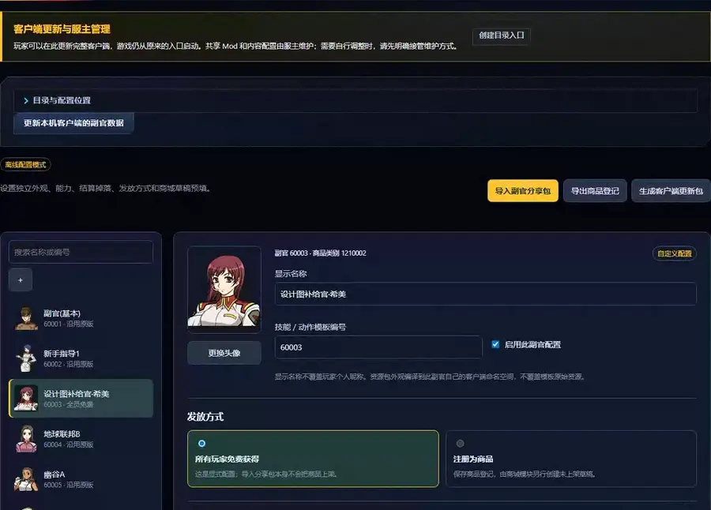

# Operator supplies, resources, and abilities

[简体中文](operator-assistant.zh-CN.md) · [Back to the feature index](../README.md) · [Pack and extension protocol](operator-pack-protocol.md)

Thanks to [幻羽未来 (Bilibili UID 564285)](https://space.bilibili.com/564285) for sharing the operator template used as a reference for this project.

The **副官与能力** panel in SDGO Mod Manager configures operator names, native/uploaded/package
portraits, abilities, mutually exclusive item drops, free access or product registration, and shop-draft
defaults. Saving a draft, applying server rules, installing client content, activating the BattleServer
runtime, and publishing a shop product remain separate actions. The Chinese guide covers each step in
more detail.

## Default supply officers

A fresh full import includes five permanent free supply officers for blueprints, experience packs,
cosmetics, upgrade kits, and capsule coins. They preserve the original branch probabilities and
quantity ranges, while each native trigger receives an independent draw. Item pools contain only items
registered on both client and server; blueprint aliases are deduplicated by recipe and invalid outputs
or materials are excluded. Existing workspaces can add the default pack with a
[command-line tool](#command-line-tools).

The five use fixed Chinese names and skip the naming prompt. Existing names are backed up first, and
other operators keep the native naming flow. Existing holdings are upgraded in place to permanent use
while preserving operator IDs, slots, and equipped references. All five can equip mission parts. They
need the matching client update and a client restart.

## Creating and importing operators

You can create a new entry from an existing operator or import an `.opack` / ZIP:

1. Preview the package. Manager reports its hashes, resource template, missing base dependencies,
   sprite frame counts, voice events, ignored files, abilities, acquisition rules, and shop defaults.
2. Choose the display name, the skill/action template, and the resource fallback template. The two
   templates may differ.
3. Confirm import. This creates an independent operator draft; it does not apply the server, install a
   client update, create a shop product, or publish anything.
4. Review the operator, save it, then perform the required client, server, runtime, and shop actions
   separately.

Package-backed operators can be shared again with **导出 .opack**, together with their current name,
abilities, acquisition rules, and shop defaults. Voice, artwork, and other game assets remain client
content and are delivered only through the server owner's client package or update. **These assets and
the `.opack` files that contain them are excluded from the Manager executable, public framework releases,
the source repository, and generic server packages.**

Packages are execution-free. Files outside the supported native resource roots are reported but never
run or installed. Supplied resources are compiled into the imported operator's own client namespace and
do not overwrite the template's original files. Multiframe sprites and both dialogue voice variants are
preserved; resources with an invalid format are rejected. The
[pack and extension protocol](operator-pack-protocol.md) documents the format and package limits.

## Abilities

Leaving abilities unset inherits the complete template behavior. Custom mode supports:

- general, victory, and defeat GP, unit EXP, and energy-save percentages;
- up to four ordered time windows;
- a separate pilot EXP percentage;
- inherited, allowed, or forbidden mission parts;
- parameters for registered extensions.

Pilot EXP is settled by the matching BattleServer runtime component, independently of the GP bonus.
Native skill fields whose meaning is unconfirmed stay inherited from the template; Manager does not
assign meanings based on their names.

Timed windows use strict `HH:MM`, include both bounds, and cannot cross midnight. Overlap is accepted,
but the first matching slot wins. A combination identical to an existing native skill reuses that
skill; a new combination can be applied only when the target server supports it.

Extensions are not package scripts. A package carries JSON parameters for registered extension names
only; a trusted native Mod loaded on the server handles them. If any required extension is missing, none
of that operator's abilities apply.

Custom pilot EXP and extension effects are loaded by the BattleServer runtime at process startup. A file
installation therefore stays pending until the relevant host restarts and Manager confirms that the
running BattleServer has loaded the configuration.

## Drops, free access, and products

Each native operator-drop trigger can select at most one configured rule. Probabilities use 0.01%
precision, may total at most 100%, and leave the remainder as no drop. Quantities use inclusive bounds.

- `all_players`: permanent access is granted on normal login or when the operator page opens. Existing
  rentals are upgraded. A full 100-slot operator inventory is never cleared to make room.
- `product`: registers the operator item and description. It does not grant, list, price, or publish the
  operator.

For products, the operator panel may prefill a Chinese name, sales label, price, GB/MB currency, and
validity. The shop module uses those values only when the owner creates a product draft. That draft is
always disabled and is not applied or published automatically.

Purchase options and confirmations use the game's existing dialogs and the operator's native icon;
there is no separate product-image upload. Install the matching generated client resources before
listing the product for players.

Disabling a managed definition restores original operators from their backups. A module-created
operator with no owners is removed from the server definition table. If players already own it, the
definition is retained using the selected native template with custom drops and abilities removed, so
their records remain valid.

## Client and server workflow

Select the matching game client and host server configuration. The panel imports operator and item
definitions read-only; credentials remain on the host.

After saving:

1. For a new ability runtime or changed ability configuration, stop the selected BattleServer hosts
   through the owner's normal operations, then use **检查安装** and **安装配套组件**.
2. Apply the saved catalog with **应用到服务端**. Runtime-backed capabilities require the matching
   installed files to pass verification before application.
3. Use **生成客户端更新包** and install the ZIP while that client is closed: select the client under
   Manager's game features and use **导入配置包**, or use **更新本机客户端的副官数据** for the local client.
   The update carries names, portraits, dialogue, voice, and other client resources.
4. Restart affected game processes through the owner's normal operations and check live runtime status.
5. For `product` entries, open the shop module, create the disabled draft, review it, and separately
   apply or publish it.

Players use the server owner's client package or update and their normal launcher; they do not need
Python or Manager.

## Use in game

Buy a listed operator through the normal shop and confirm its price and term in the native dialog.
Free-for-all operators are granted through the normal login/operator-page flow instead.

Open the game's operator page and use its existing page controls to find the owned entry. Name it
when prompted, then select it for use through the native controls. Saving a Manager draft does not
equip an operator for a player; match effects use the operator actually equipped in game.

## Developer notes

### Client and server modules

The client mod inserts operator records through verified native calls and uses the native CRT allocator.
It handles SPR 10000/11000 portraits and multiframe atlas UVs. Default supply officers turn on the native
`GParts` flag in the client while the server allows mission-part equipment; their fixed Chinese names
are displayed by the client Mod instead of being written into the native `varchar(16)` nickname field.

The server adapter manages the operator tables and wraps the native read/drop procedures with backups,
installed-definition hashes, and conflict checks. Drops are sampled by the server; client configuration
cannot choose its own rewards. The module uses its own rule table instead of the original script's
`tbl_OperatorDropDice`, which is refreshed every 30 seconds.

`gp_percent` maps to the native `PointAdd` field, and `general`, `victory`, and `defeat` map to
`BattleResult`, `TeamWin`, and `TeamLose`. Pilot EXP is never `PointAdd`. Unconfirmed native fields such as
`ChangeSp` and `ServiceType` remain inherited. The compiler reuses an exact native `SkillType=1` row,
protects original `SkillNo` 1–27, and allocates new skill or time IDs only for capabilities the target
server has registered.

Live runtime status counts only when the PID belongs to the target BattleServer and the runtime version,
catalog revision, loaded profile count, and hook mode match.

The server Mod's developer setting `TraceSettlements` records at most sixteen reward input/target
comparisons per process. It is off by default and omits account IDs and nicknames.

### Pack protocol and extension ABI

The complete asset-free package schema, strict ability object, Manager API, missing-resource behavior,
and native extension ABI are documented in the
[operator pack and extension protocol](operator-pack-protocol.md).

The native headers are
[`include/sdgo/operator_effects.h`](../include/sdgo/operator_effects.h) and
[`include/sdgo/operator_reward_filter.h`](../include/sdgo/operator_reward_filter.h). A package can carry
finite JSON payloads for registered namespaces, but cannot register a handler or execute code. Handler
authors define and version their own payload contract; the framework does not provide a universal
parameter-schema registry.

### Command-line tools

Command-line development and offline inspection require Python, Pillow, and pyodbc.
`tools/operator_snapshot.py` builds a workspace snapshot from a server configuration, or an offline one
without `--server-ini`. `tools/Initialize-OperatorDefaults.py` adds the default supply officers to an
existing workspace. An unzipped client update can also be installed with
`Install-Operator.ps1 -ClientRoot <game folder>`.
