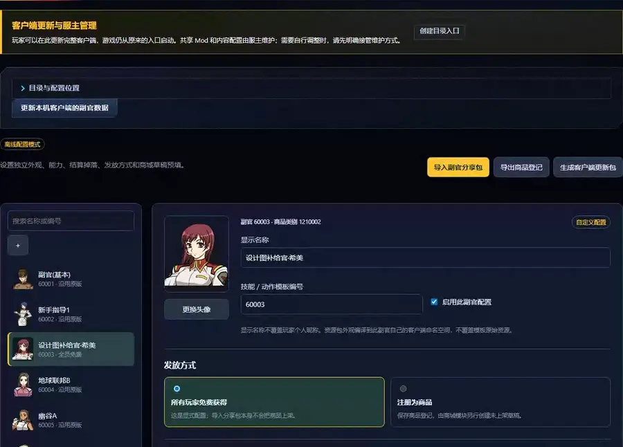

# 副官补给、资源与能力

[English](operator-assistant.md) · [返回功能目录](../README.zh-CN.md) · [分享包与扩展协议](operator-pack-protocol.zh-CN.md)



副官模块在 SDGO Mod Manager 中提供服主界面：修改副官定义名，选择原有、上传 PNG 或分享包外观，
配置数值能力、任务部件与扩展效果，设置互斥物品掉落，选择“全员免费获得”或“注册为商品”，并保存商城
草稿预填。配置保存、服务端应用、客户端内容安装、BattleServer 能力运行时生效和商城上架是不同操作。

当前原生客户端包含 46 名副官。支持基于原生副官创建新条目，也支持导入 `.opack` / ZIP 分享包中的台词、
两个语音变体、七个图像位置和完整依赖。技能/动作模板与资源模板可分别选择。

## 默认补给副官

首次从完整宿主快照初始化助手时，自带以下 5 位全员免费、永久可用的补给副官。
安装服务端配置后，玩家正常登录或打开副官页即可获得。已有工作目录可用命令行工具补齐默认包
（见[命令行工具](#命令行工具)），再应用服务端并同步客户端。已托管的自定义设置及已停用条目不会被默认包覆盖。

| 编号 | 默认名称 | 每次原生掉落触发的内容 |
|---|---|---|
| 60003 | 设计图补给官·希美 | 100% 随机有效设计图，1 张 |
| 60013 | 经验补给官·瑞希 | 四种经验包各 25%：5000 经验包 2–10；1000 经验包 5–15；1500 经验包 8–12；200 经验包 10–20 |
| 60018 | 装饰补给官·彩 | 贴纸 40%（2–5）、涂装 40%（2–5）、抛光剂 20%（1） |
| 60025 | 强化补给官·惠 | 100% 强化套件，10–30 个 |
| 60041 | 扭蛋币补给官·富美 | 沿用服务器原配置的概率和数量（参考服为 100%、8 枚） |

这 5 位默认副官均可使用任务部件，不改变各自技能、掉落概率或数量。服务端首次应用会备份原设置，
停用默认配置时恢复。需要安装配套的客户端更新并重启客户端；较早 Manager 生成的配置同样可用。

保留原生触发时机、顶层命中率、分支权重和数量范围，每次触发独立抽取。物品池按实际引用去重后等概率选择，
不按别名数量重复加权；只收录两端都已登记的有效物品，设计图须有真实配方且产物与材料机体均已登记。

这 5 位默认副官直接使用固定中文名，领取和装备时无需玩家起名。已有昵称、临时起名和未完成起名的记录会
先备份；其他副官的个人命名保持原流程。中文名由配套客户端 Mod 显示。
默认包不包含额外的送机体副官，也不改原服务端已有的其他结算奖励。
这 5 位按原副官编号原位替换，不创建重复条目。应用默认包时，现有持有记录备份后升级为永久有效，
保留玩家副官编号、槽位、序列号和当前装备引用；禁止记录不解禁。

## 启动

打开完整框架包中的 `SDGO Mod Manager.exe`，进入「副官与能力」。选择游戏客户端与 `StoreServer.ini`，
助手只读导入副官和物品定义后打开管理页面。INI 的连接凭据留在宿主本地，不进入玩家更新包。
Manager 已内置所需组件；**玩家客户端不需要 Python，也不需要每次开助手启动游戏。**

## UI 工作流

1. 搜索并选择副官，用 `＋` 基于当前副官创建条目，或点击「导入副官分享包」先预览 `.opack` / ZIP。
2. 设置显示名称、技能/动作模板和外观。导入包还可单独选择资源回退模板；它不必和技能模板相同。
3. 选择继承模板能力或自定义常规、胜利、失败、定时、驾驶员经验、任务部件与已登记扩展。
4. 为结算掉落添加物品、概率和最少/最多数量。概率精度为 0.01%，合计不得超过 100%。
5. 选择发放方式；如为商品，可填写名称、销售标签、价格、GB/MB 和数量/租赁天数预填。
6. 保存配置草稿。之后按需要分别执行「应用到服务端」、生成/安装客户端更新包、能力运行时安装与重启，
   以及商城草稿创建和上架。

名称支持 Unicode，保存在独立配置中，不受服务器个人昵称的长度限制。默认补给官使用固定名；
其他副官的定义名不会覆盖玩家的个人昵称。

每次原生副官掉落触发最多选中一个物品规则，余量为不掉落。数量在闭区间中均匀选择。
物品选择可使用默认随机物品池；分支概率只计算一次，命中后再从池内均匀选择一个物品。
游戏原有的其他结算奖励保持原流程，不重复发放。

「生成客户端更新包」输出一个 ZIP。关闭对应客户端后，在 Manager「游戏功能」中选择该客户端，用「导入配置包」
安装；本机客户端也可直接点击「更新本机客户端的副官数据」。更新只涉及本模块的 Mod 和符号，保留其他模块与
全局开关。玩家使用服主提供的客户端包或更新以及正常游戏启动器；外观在客户端重启时读取。
新增副官的服务端原生缓存也需要重启相关游戏服务读取。

更新包附带公开的定义描述。换电脑或新建助手工作目录时，可从已更新的客户端和服务端快照恢复自定义条目与
头像；已发布的新副官不会被误判为“不匹配的原生客户端”。两端定义版本不一致时拒绝混用。

## 分享包与独立客户端资源

导入分享包分为预览和确认两步。预览会显示包的 SHA-256、资源模板、候选模板、语音文件和事件数量、
图像帧数、目标客户端缺少的基础依赖、被忽略的文件，以及包内能力、获取和商城设置。确认后只创建独立副官
草稿，不会应用服务端、安装客户端、创建商城商品或启动游戏。

分享包只接受原生资源目录中的台词表、图像、贴图和语音文件；其他条目会在预览中列出，但不执行、不安装、
不重新导出。包内没有脚本或 DLL 执行入口。导入后，已提供资源写入该新副官自己的客户端命名空间，
不覆盖模板原有的资源文件。多帧图像和台词的两个语音变体都会完整保留；格式无效的资源会被拒绝。

由分享包导入的副官可用「导出 .opack」连同当前名称、能力、获取和商城预填重新分享。语音、图片和其他
游戏素材始终是客户端内容，只随服主提供的客户端包或更新交付。
**这些素材及包含它们的 `.opack` 不进入 Manager EXE、公开框架 Release、源码仓库或通用服务端包。**

完整格式、限制、语音策略和 API 见[分享包与能力扩展协议](operator-pack-protocol.zh-CN.md)。

## 能力配置

未设置能力时完整继承模板。自定义能力支持：

- 常规、胜利、失败的 GP、机体经验和能量节省百分比；
- 最多四个按开始时间排序的定时时段；
- 独立的驾驶员经验百分比；
- 继承、允许或禁止任务部件；
- 已登记扩展的参数。

驾驶员经验由配套的 BattleServer 服务端组件结算，与 GP 加成相互独立。模板中用途未确认的原生技能字段
继续继承模板，不根据字段名推测用途。

定时时段严格使用 `HH:MM`，开始和结束边界均包含，不支持跨午夜。重叠时按第一项到第四项取首个命中。
与已有原生技能完全相同的组合直接复用该技能；新的组合只有目标服务端支持时才能应用。

能力扩展不是包内脚本。分享包只为已登记的扩展名称携带 JSON 参数，效果由服务端已加载、版本匹配的
受信任原生 Mod 处理。扩展名称需先在副官目录登记；任一所需扩展缺失时，该副官的整套能力都不应用，
不会只执行内置部分。

## 全员免费与商品登记

- `all_players`：正常登录、打开副官页面时补齐永久使用权，不要求玩家购买或运行额外领取命令。
  已拥有的租赁副官会升级为永久；保留昵称、当前装备选择和个人记录。
- `product`：注册副官物品与描述，**不自动给玩家，不自动创建、应用或上架商城商品**。保存的商城字段
  只供商城模块创建未上架草稿。

原生副官仓位上限为 100。已满且没有可升级记录的账号会保留全部原有副官，记录补发失败，
不会通过覆盖或删除来腾位置。原生禁止标记不被清除。关闭免费发放不会收回已送出的永久副官。

「停用自定义配置」先恢复原生副官的完整备份。模块新增副官若无人持有，会删除服务端定义；若已有玩家持有，
则保留同编号记录并恢复为所选原生模板的基线字段，移除自定义掉落与能力，避免留下无定义的玩家记录。
已经获得自定义外观的玩家仍需保留相应客户端 Mod 数据。

## 商城上架

只有已托管、已启用且发放方式为商品的副官出现在商城导入列表。副官物品类别需先应用到同一宿主数据库。
商城「创建」始终生成未上架的草稿并应用合法预填，不会自动应用商城配置；没有预填时使用商城默认值。
服主检查价格、期限、标签和商品身份后，再决定是否正式上架。

购买选项与确认沿用游戏已有窗口，并复用该副官的原生图标，无需另传商品图片。
正式上架前，先安装与服务端登记匹配的客户端生成资源。

## 服务端与客户端生效

首次安装能力组件或更改能力配置时：

1. 通过服主现有运维方式关闭所选 BattleServer，在面板中「检查安装」并「安装配套组件」。
2. 「应用到服务端」写入已保存的副官目录。运行时能力必须先通过已安装文件校验，才能应用到数据库。
3. 关闭配套客户端后安装其内容更新。
4. 启动相关游戏服务，再读取生效状态。

能力配置在 BattleServer 进程启动时读取，因此写入运行文件后仍需重启对应主机。Manager 将“文件已安装”和
“当前进程已生效”分开显示：只有确认当前运行的 BattleServer 已载入这份配置时才视为生效，否则保持待处理。

## 游戏内使用

已上架的副官通过游戏商城购买，在原生确认窗口核对价格和期限；全员免费副官则通过正常登录或打开副官页发放。

打开游戏副官页，使用已有翻页控件找到持有条目。需要命名时按原生提示命名，再通过原生控件选择使用。
Manager 保存草稿不会替玩家装备副官，战斗效果以玩家在游戏中实际装备的副官为准。

## 开发者说明

### 客户端模块

客户端遵循现有 `d3d9 → core.dll → mods/operator_catalog` 框架，按构建与字节签名验证函数。
Hook 副官 GDT 加载入口，其余数据表通过经验证的原生调用读取/插入。助手读取客户端真实资源，
支持 SPR 10000/11000 两种头像格式和多帧图集 UV。
固定名通过游戏自身的代码页转换 IAT 显示，只接受已验证原生解码器传来的默认副官标记，
不抢占商城标签模块的共用函数 Hook，也不改变其他文本转换或其他副官的命名检查。
名称使用 UTF16LE hex，避免 INI 的引号剥离和代码页限制。上传 PNG 保留透明度，分别生成
七个显示位置的 SPR 描述，保持各位置原生几何尺寸。

默认补给官的任务部件由配套客户端打开原生 `GParts` 标记，服务端同步允许任务部件装备，首次应用时备份原标记。
固定中文名不写入服务端昵称：持有记录只写入短名称标记并设为“已命名”，不向原生泰文代码页的
`varchar(16)` 昵称字段强写中文。持有记录升级时保留 `UserOperatorNumber`。

现有副官优先复用正确的原生副官类别；缺少登记的条目使用独立的 `1219xxx` 编号，并检查冲突。
不重命名或改写别人的原生物品类别。客户端使用原生 CRT 分配的数据节点注册新记录，
原生数据管理器可正常释放，不把宿主 DLL 的堆内存交给游戏释放。

### 服务端与结算

服务端适配器管理 `sdgo_Operator*` 表，包装原生副官读取/掉落过程。原过程保留备份和已安装
定义哈希；发现其他修改时事务回滚，不覆盖它。原生结算前置逻辑（包括宿主已有的额外奖励）
保留一次；配置物品从服务端采样和入箱，客户端配置不能决定自己获得什么。

原服务端脚本每 30 秒刷新一次 `tbl_OperatorDropDice`，期间的触发共享同一随机结果；本模块使用独立规则表，
不受该刷新影响。设计图池要求原生设计图类别、两端 `RefIndex` 一致、存在真实配方且产物与材料机体均已登记；
涂装、抛光剂、贴纸分别核对原生类型与对应定义表，不按 SQL 名称模糊匹配。

能力字段映射：`gp_percent` 对应原生 `PointAdd`；`general`、`victory`、`defeat` 分别对应 `BattleResult`、
`TeamWin`、`TeamLose`。驾驶员经验是独立的 BattleServer 运行能力，不能用 `PointAdd` 代替。`ChangeSp`、
`ServiceType` 等未确认字段继续继承模板。编译器优先复用完全相同的原生 `SkillType=1` 行，保护原版
`SkillNo` 1–27；只有目标服务端已登记对应验证能力时才分配新技能或时间编号。

驾驶员经验与命名空间扩展由 `operator_catalog_server` 在 BattleServer 结算点执行。任务的机体经验在
早期阶段处理，驾驶员经验与 GP 在最终阶段处理；不使用延迟 SQL 补发替代原生经验结算。

实时状态只有在 PID 确属目标 BattleServer、模块版本、目录 revision、已载入 profile 数和 hook 模式均符合
预期时才视为有效；陈旧 PID 或无法验证的进程保持待处理。

服务端 Mod 的开发设置 `TraceSettlements` 默认关闭；打开后每个进程最多记录十六次奖励输入与目标值，
供核对结算能力，不记录账号编号或昵称。

### 商城模块的交接格式

保存后生成工作目录的 `product-registrations.json`；UI 的「导出商品登记」也输出同一格式。
`provider=operator_catalog`，每条记录以 `operator:<ID>` 为稳定键：

```json
{
  "key": "operator:60047",
  "kind": "operator",
  "operator_id": 60047,
  "category_id": 1219047,
  "display_name": "补给副官",
  "avatar": { "kind": "native", "operator_id": 60013 },
  "registration": "product",
  "enabled": true
}
```

商城只消费 `registration=product` 且 `enabled=true` 的记录；免费发放记录标为 `free_for_all`。
登记记录本身没有商品销售编号或上架命令。若副官保存了 `storefront`，商城模块可读取名称、标签、售价、
GB/MB 和有效期预填。`category_id` 是原生物品登记号，不能误当作商城 `f_productid`。
实际导出另含 `drop_rules`，用于商城展示副官效果；它只是描述，发货仍由服务端判定。
商城导入列表只收录 `delivery=product` 的副官；「创建」生成 `enabled=false` 的草稿，不执行商城 `apply`。

### 能力扩展 ABI

第三方原生能力扩展 ABI 见
[`include/sdgo/operator_effects.h`](../include/sdgo/operator_effects.h)；共享结算过滤 ABI 见
[`include/sdgo/operator_reward_filter.h`](../include/sdgo/operator_reward_filter.h)。框架没有通用参数
schema 注册器，扩展作者需自行定义并版本化 payload 合同。完整 manifest 示例、Manager API 和 SDK 合同见
[分享包与能力扩展协议](operator-pack-protocol.zh-CN.md)。

### 命令行工具

命令行工具用于开发或离线检查，需要 Python、Pillow 和 pyodbc：

```powershell
python -B tools/operator_snapshot.py --server-ini "D:\Server\StoreServer.ini" --output "D:\OperatorConfig\source"
```

省略 `--server-ini` 就是离线编辑模式，页面不能执行服务端写入。开发构建位于非默认目录时，
可用 `--module-binary` 指定已编译的 `operator_catalog.dll`。发行目录会自动找到自己的客户端模块。

已有助手工作目录可用
`tools/Initialize-OperatorDefaults.py --workspace <工作目录> --client <客户端> --snapshot <完整快照>`
补齐默认补给副官。客户端更新包解压后也可用 `Install-Operator.ps1 -ClientRoot <游戏目录>` 安装；
它只更新本模块的 Mod 和 `operator.*` 符号。

### 权限与测试

UI 仅绑定回环地址，写入需要同源、会话 token 和配置版本。快照不包含玩家账号与仓库数据；
客户端 ZIP 只含 Mod、外观、登记描述和导入脚本，没有 SQL 凭据或管理 token。

协议、能力、商城桥接、客户端安装与运行时各有离线测试；这些测试不覆盖原生加载、实际结算和游戏内显示。
