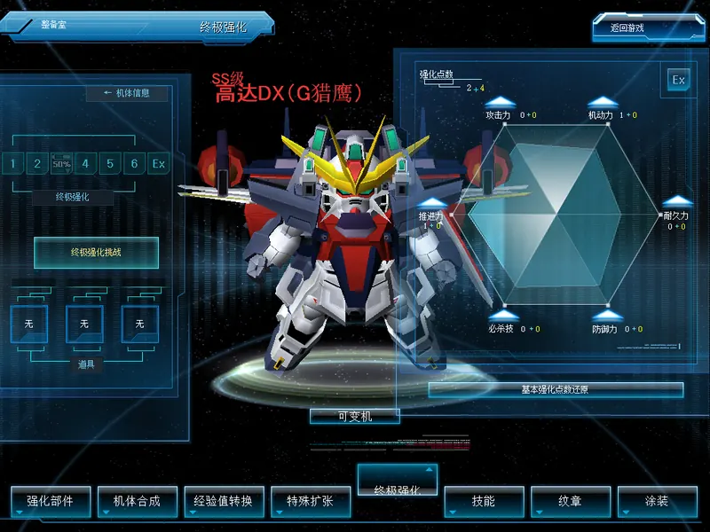

# Over-custom six-stat enhancement

[简体中文](over-custom.zh-CN.md) · [Back to the feature index](../README.md) · [Friend unit gifts](friend-unit-gift.md)

Allocation, the OVER CUSTOM challenge and reset are available, OC values apply in battle, and both data sets survive a mode switch; one server can also let each room choose OC, G改 2.0 (the current custom parts) or G改 1.0 (see [Room systems](#room-systems)). The feature is on the Stable channel from 1.15.11. The OC-era EX abilities are not implemented yet (see [Scope and compatibility](#scope-and-compatibility)).

Brings back the original six-stat over-custom (OC) enhancement next to the current custom-parts system. Each owned unit gets an OC profile with normal points (speed, HP, attack, defense, agility, special), Over points earned through the OC challenge, and a reset that costs GP. The rules are the original 2009 stored procedures, ported to the Mod's own tables so the current custom-parts data in the game database is never written.

Both data sets coexist. The server owner chooses which one the whole server uses, or lets each room choose:

| Mode | Battles use | Owned-unit records | OC profiles |
| --- | --- | --- | --- |
| `current` (default) | Current custom parts (`UnitSkill_1..4`) | Native, unchanged | Stored, inactive |
| `oc` | OC allocation deltas | OC payload in the reserved gap; the four custom-skill slots are blanked in the records the World server sends | Active |
| `room` (per room) | OC deltas in rooms whose title carries `!oc`; the unit's G改 1.0 slots in rooms with `!g1`; the current custom parts (G改 2.0) in every other room | OC payload and G改 1.0 slots in the reserved gap; the four custom-skill slots stay as they are | Active in OC rooms |

Switching the mode or disabling the Mods leaves every table in place. Nothing is deleted or rewritten in the native tables, so removing the Mods restores the native behaviour immediately.

## Components

| Mod | Host | Role |
| --- | --- | --- |
| `oc_custom_server` | World server | Installs the `sdgo_mod_oc_*` tables and procedures in the game database (plus `sdgo_mod_g1_*` with a G改 1.0 rule file), answers lobby requests through the friend-gift carrier and, in `oc` and `room` mode, fills the OC payload and the G改 1.0 slots into every owned-unit record it sends |
| `oc_custom_battle` | Battle server | Adds the record's OC deltas to HP, attack, defense and special damage after the native per-form stat builder, within the native per-grade caps; in `room` mode it swaps the battle unit's custom parts per room |
| `oc_custom_client` | Client | Makes the factory a dual-system factory: next to the untouched native tabs, a 终极强化 tab with its own page built from the client package's OC layouts (OVER CUSTOM level track and ITEM box, the allocation window with the six-dimension chart, the challenge window and the confirmation popup) for the active unit; sends allocation, challenge and reset requests; in battle it adds the OC speed and agility gains to the local unit |

`oc_custom_server` needs `friend_unit_gift_server` on the Agent and World servers, and `oc_custom_client` needs `friend_unit_gift_client`, because the OC requests ride that authenticated carrier. The gift feature itself can stay disabled.

## Setup

1. Enable **启用 OC 六维强化** under **OC 六维强化 · World 服务端** in SDGO Mod Manager and set **生效的强化体系** to `oc` (OC on the whole server) or `room` (each room chooses). Restart the World servers; the schema and the per-unit growth mapping install on the first request.
2. Keep **OC 六维强化 · 对战服务端** enabled on every Battle server and restart them.
3. To offer G改 1.0 in `room` mode, put the G改 1.0 rule file `g1_attributes.tsv` in the World Mod folder and restart the World server (see [The G改 1.0 rule file](#the-g改-10-rule-file)).
4. Players use the server owner's client package or update; the client Mod is enabled by default and shows nothing actionable until the server reports `oc` mode.

## Playing

The client package still ships the original OC layouts, and the Mod uses them as they are: the OC tab page (OVER CUSTOM level track and ITEM box), the allocation window, the challenge window, the confirmation popup and the OC-era OVER CUSTOM button. The window texts are the client's own original OC strings.

Set the unit you want to enhance as the active unit and open the factory. With the server in `oc` mode the factory works as a dual-system factory: the tab bar gets back the OC-era **终极强化** tab right after **特殊扩张**, the other tabs move along, and every native tab keeps its own page untouched. All OC content lives on the 终极强化 tab.

- **终极强化** shows the OC page in place of the native page; the header reads 「终极强化」 and the tab shows as selected. The left page lights OVER CUSTOM 1 to 6 and EX up to the unit's OC level, carries the OVER CUSTOM challenge entry and lists the OC items the account holds in its ITEM box: each slot shows the item's own 3D model, loaded the way the native factory pages show their items, with a label by effect (for example 「+100% x3」 or 「等级保护 x2」); an empty slot shows the NONE frame. The allocation window on the right draws all six dimensions on its hexagon: the unit's own stats and, over them, the stats with its OC points, each measured against the OC stat cap. Around the hexagon, 推进力 (speed), 耐久力 (HP), 攻击力 (attack), 防御力 (defense), 机动力 (agility) and 必杀技 (special) show their allocated normal + Over points; the top line shows 强化点数 and the remaining normal + Over points. The native inventory and the page actions under the unit (经验值转换, 还原) are hidden while the tab is open; 可变机 stays.
- A stat's arrow button opens the original confirmation 「在使用强化点数之前再仔细考虑下如何？确定要强化这项性能吗?」. After confirming, the server checks the budget and the stat caps from the original tables (speed 100, HP 23800, attack 169, defense 169, agility 100, special 7950) and stores one point. Once the normal points are spent and the OC level is 9 or higher, the arrows allocate Over points. Without a free point, or above a cap, the original messages 「无法使用强化点数.」 or 「不能再使用.超过了最大能力值.」 appear.
- Normal points follow the OC level: one point per level from level 5 up to the unit's normal maximum (level 6 to 8 depending on the unit). The OC level follows the native level while it is below 9.
- The long button at the bottom resets points. Below OC level 9 it reads 「基本强化点数还原」 and resets normal points; from level 9 it reads 「终极强化还原」 and resets Over points. The confirmation shows the G coin cost; confirming charges it and clears that allocation. 「初始化费用不足.」 appears when the coins are short.
- The OVER CUSTOM entry on the left page glows when the unit can take the challenge, and otherwise shows as a dim label. The challenge needs the normal maximum level and a full experience bar. The entry opens the challenge window (the left page stays meanwhile) with the unit name, battle count, target level (OVER CUSTOM1 to OVER CUSTOM EX), the condition, the failure rule, and the account's challenge items usable at the current level; up to three can be checked (for example success-rate or level-protection items). The current client renamed these items to 「不可用」, so the window shows them by the effect in their item data, such as 「成功率+100%」 or 「等级保护」. 「开始」 opens the 「进行终极强化.使用道具 : …」 confirmation and then rolls the original probability. Success grants Over points and the reward item and shows 「[ OVER CUSTOMn ]强化成功!」. Failure drops the OC level back to the normal maximum, unless a level-protection item was used; each case shows its original failure message. The native level and experience never change.
- Any other tab leaves the OC page: the native page, its inventory and its actions come back with their own data, and the header shows that tab's title. Coming back to 终极强化 shows the same OC profile. While the native tab menu is still busy (loading, or with a page switch pending) it ignores tab clicks, and the 终极强化 tab follows it; click again.

Every save refreshes the active-unit record, so it applies from the next battle. In `oc` mode the current custom skill parts stay equipped in the database but are hidden from the records and have no effect in battle. Switching the server back to `current` shows and applies them again, and switching to `oc` again finds every OC profile as it was: each mode uses its own data and never rewrites the other's. With the server in `current` mode the factory stays fully native and shows no OC tab.

## Room systems

With **生效的强化体系** set to `room`, several systems run on one server and each room decides which one its battles use:



| Title command | System | In battle |
| --- | --- | --- |
| (none) or `!g2` | G改 2.0 (the current custom parts) | The unit record's custom parts (`UnitSkill_1..4`); the OC allocation does not apply |
| `!oc` | OC | The OC allocation deltas (HP, attack, defense and special damage on the Battle server; speed and agility on the client); custom parts do not apply |
| `!g1` | G改 1.0 | The unit's G改 1.0 slots replace its custom parts; the OC allocation does not apply; a unit without G改 1.0 skills plays without custom parts |

- The current client's 强化部件 factory page is G改 2.0: 6 types (战斗型, 攻击型, 防御型, 机动型, 平衡型, 任务型) and up to 4 slots filled with skills of one type.
- G改 1.0 is the earlier rule set: 8 types, and every unit keeps a second set of 4 slots for it, stored apart from its G改 2.0 slots. It is available once the server owner provides a G改 1.0 rule file; without one, rooms choose between OC and G改 2.0.
- The commands are written like `!ai`, `!rand` and the other [room commands](room-commands.md) and combine with them, for example `practice !ai e2 a1 !g1`. With both `!oc` and `!g1`, `!oc` wins. Native titles hold 20 bytes; with [long room titles](room-titles.md) a command is read anywhere in the full title. When the host renames the room to add or remove a command, the next battle uses the new system.
- When creating a room, the ordinary and AI battle create windows gain a 体系 row in the left panel below the minimap. Its right arrow steps through 「G改 2.0」, 「OC」 and 「G改 1.0」 (only the first two when the server has no G改 1.0 rules) and the left arrow steps back, appending `!oc` or `!g1` to the room name or removing the command. Typing or deleting a command in the name updates the row as well. Without long room titles the native name holds 20 bytes, so the end of the name is shortened when the command needs the room.
- The room list marks every title with its system: 【OC】, 【G改1】 or 【G改2】. Inside a room, the title bar shows 「体系：OC」, 「体系：G改 1.0」 or 「体系：G改 2.0」 to the right of the title. The client Mod draws these marks; the room title itself is unchanged.
- In the factory each system has its own page and none overlaps another: the 终极强化 tab shows only the OC profile; the 强化部件 tab is the original attribute page, and the two buttons 「G改 2.0」 and 「G改 1.0」 under its left panel choose which system it edits (the current one is marked ●), with the factory title reading 「强化部件 · G改 2.0」 or 「强化部件 · G改 1.0」. Leaving the tab or the factory puts the page's data back to G改 2.0; the choice is kept for the next visit.
- Neither the unit records nor the database lose their custom parts. OC and G改 1.0 rooms only build their battle units with other skills; in the next G改 2.0 room the parts apply again.
- Custom parts act on the Battle server's battle units, and the Battle server swaps them per room. Clients still receive each unit record with its G改 2.0 parts in the room data; the battle packets themselves carry no custom parts. Whether the client uses those parts itself (for example, part icons in the battle HUD) is unconfirmed.
- Requires client Mod 0.6.1, World Mod 0.5.0 and Battle Mod 0.3.0 or later (client 0.5.0 had the G改 1.0 page inside the 终极强化 tab; from 0.6.0 it is the original 强化部件 page; client 0.6.0 could miss the OC speed and agility gains when the native room data changed while the battle was loading); choosing only between OC and G改 2.0 works from client 0.4.0, World 0.4.0 and Battle 0.2.0. An older client Mod still offers the OC pages in `room` mode but adds no speed or agility in any room and shows no system marks.

### The G改 1.0 page

With the 强化部件 tab switched to G改 1.0 it is still the same original page and works exactly as in G改 2.0, with the G改 1.0 rules and the unit's G改 1.0 slots:

- The type bar on the right lists the 8 G改 1.0 types (战斗型, 格斗型, 装甲型, 射击型, 突击型, 重武装型, 强袭型, 支援型). A type opens the original skill list ordered by unit level, with the skill icons, levels and the description tooltip; skills above the unit's or user's level show locked. The G改 1.0 types have no native type description, so hovering a type shows no tooltip, and the type buttons show no G改 2.0 type icons.
- Double-clicking a skill (or dragging it onto a slot) fills an empty slot with the original rules: one type in every slot, no skill twice, a filled slot changes only after a reset, slots 3 and 4 need the unit's normal slot level (`Normal_MaxLv`) 3 and 4. The type line on the left shows the unit's range and the G改 1.0 type (for example 「中距离 战斗型」), and the slots show the type colour and level of the G改 1.0 rule.
- 设置保存 opens the original save confirmation and then sends the slots, which the server equips by the G改 1.0 rules; when it refuses, the notice line under the switch says why. 还原 drops picks that are not saved.
- 强化槽初始化 opens the original reset window with the G改 1.0 reset cost, the current GP and the GP left after it, and empties every G改 1.0 slot once confirmed. The cost follows the G改 2.0 formula: the first reset is free, later ones add the unit grade's base cost, a weight per reset and the equipped skills' own reset costs; an active operator with the reset skill makes it free. Without enough GP the window closes.
- A save or reset refreshes the active-unit record at once, so it applies from the next G改 1.0 room. The G改 2.0 slots are untouched; switching back to G改 2.0 shows the unit's custom parts again.

### Chinese on the factory pages

The client Mod replaces the English left on these factory pages with Chinese. It only changes what is shown and replaces or redistributes no game resource:

- The header's FACTORY becomes 「整备室」 (the client's own text-free twin of the header art) and the exit button loses its EXIT lettering (the client's own text-free button art).
- 「SS RANK」 above the unit name reads 「SS级」 and level tags such as 「2Lv」 on the slots and in the skill list read 「2级」 (the two format strings in the client's text table are translated).
- The 终极强化 page: UNIT INFORMATION, OVER CUSTOM under the level track and ITEM on the ITEM box are covered with flat art from the client's own panels and read 「← 机体信息」, 「终极强化」 and 「道具」; an empty item slot shows the original 强化部件 page's empty-slot frame with 「无」 instead of NONE; the OVER CUSTOM challenge entry becomes the original glass button captioned 「终极强化挑战」 (lit when the challenge can start).
- The 强化部件 page: the type bar's NEW badges read 「新」.
- Left as they are: the unit level 「Ex」 and the 「Ex」 on the OC level track (the Chinese client writes it so itself, for example 「EX等级」); the size tags on custom-part icons (S, M, L, ML, SML) and words drawn into the icons such as CRITICAL or SP UP (the Chinese client's part names keep them too, for example 「[任务] SML_自动补给装置 A型」); and words drawn into popup title art such as MESSAGE or CUSTOM SLOT RESET.

### The G改 1.0 rule file

The server owner provides the G改 1.0 skill rules as `g1_attributes.tsv` in the World Mod folder (UTF-8, tab separated, lines starting with `#` are comments); restart the World server after changing it.

```
category	<type index>	<name>
skill	<skill id>	<type index>	<kind>	<unit level>	<user level>	<premium 0/1>	<reset cost>
```

- Types are numbered from 0 without gaps, up to 12, with names of at most 14 characters.
- Skill ids lie in 30001–31023 and must exist in the game database's `tbl_UnitCustomSkill` and the client's skill table; battles apply the skill's existing definition. Each skill appears once. The unit and user levels are the minimum levels to equip it; the reset cost adds to the reset GP.
- When the file changes, the World Mod rewrites `sdgo_mod_g1_Rule` on its next request. Equipped skills stay and keep applying; changing them under the new rules needs a reset.
- A faulty file is logged with its line and reason (`g1_attributes.tsv rejected`); G改 1.0 stays unavailable and the other systems keep running.

## Scope and compatibility

- A saved allocation, reset or challenge applies from the next battle without logging in again, including when the player is already in a room.
- The Battle server applies HP (first form), attack, defense and special damage per form. Speed and agility are client-side movement values: when a battle starts the client Mod adds the active record's deltas to the local unit's dash level and motive power, at the same place the current system's stat bonus lands, for both forms of a transformable unit. Each unit's movement is computed by its own client, so other players see the result of that player's client.
- The OC-era EX abilities (extra abilities at OVER CUSTOM EX) are not implemented yet, and the Ex button of the allocation window stays disabled. The current game database keeps only an unused `ExtraBonus` column. The OC-era rule for setting one was: at the EX level, spend one EX ability modifier to pick one of eight abilities, never the one already set. The client table `gdrs\0121.gdt` keeps the eight abilities' names, values and icons (attack, defense, mobility, speed and movement speed 3 each, evasion speed 7, lock-on range 700, booster recovery 7), but how those values translate in battle (percentages or flat amounts, computed by the Battle server or the client) is not confirmed. The Mod does not enable EX until it is.
- GP shown in the client refreshes on the next native GP update after a reset.
- The per-unit growth rows come from the original OC catalogue for 472 units; the remaining current units use the balanced row of their grade.

## Troubleshooting

- No 终极强化 tab in the factory: the server does not run OC mode (the World Mod is disabled, its mode is `current`, or the schema failed to install; the World log reports `oc schema` messages), or the friend-gift client or server Mod is missing; the OC carrier needs both. The client log's `oc original windows` lines report whether the windows loaded and bound.
- Battle values unchanged: check the Battle server log for `oc applied uid=...` lines after the room starts; the Battle Mod logs every applied allocation. Speed and agility appear as `oc mobility applied` lines in the client log; the `oc room view` lines show the system the client read for the room, and `oc room view keeps` lines show that it kept that system through loading and battle.
- A room plays an unexpected system in `room` mode: the Battle server's `oc room system=... title="..."` lines record the title it read, the system it chose, and the unit's native stats and custom parts; the client's `oc room view system=...` lines record the system the client read. The command must be separated from other text by spaces; `!oc3` and `room!oc` are not `!oc`.
- No system marks in the room list or title bar: the server does not run `room` mode, or the client Mod is older than 0.4.0 (before 0.6.0 the room list showed its marks only after a visit to the factory; from 0.6.0 the lobby asks the server for its mode itself). The client log's `oc room system label` lines report the title bar mark.
- No G改 1.0 step in the create window and the 强化部件 page's 「G改 1.0」 button disabled: the World server has no usable G改 1.0 rule file. The World log's `ready:` line lists the skills and types it read; a faulty file adds a `g1_attributes.tsv rejected` line.
- The 强化部件 page still lists the G改 2.0 types after switching to G改 1.0: the client log's `g1 native:` lines record the rule set read, the data manager reload (types and entries) and the switch back; while the page is saving, resetting or dragging, the switch applies once it is idle.
- G改 1.0 skills do not apply in a G改 1.0 room: the Battle server's `oc room system=g1 ... g1 skills=...` lines show the G改 1.0 slots each unit brought into the battle (all 0: nothing equipped yet). The World log's `oc carrier filled ... with a G1 loadout` lines show whether the records it sent carried them.
- The OVER CUSTOM entry stays dim: the unit has not reached its normal maximum level, or it is already OVER CUSTOM EX.
- The ITEM box is empty although the account holds OC items: the World Mod is older than the client Mod and does not answer the item list request.
- An ITEM box slot shows its label but no model: the client log's `oc item model slot` lines report each model path and whether it loaded; the model files must be in the client package.

## Developer notes

**Record carrier.** The owned-unit record (`_UnitData`, 0x99 bytes) has a 25-byte reserved gap at +21..+45. In `oc` mode the World Mod writes `'O' 'C'`, version 1, flags (1 = OC mode, 2 = profile present), the OC level, the normal and Over point totals, six signed 16-bit stat deltas (speed, HP, attack, defense, agility, special), a revision and a checksum there, and clears the four custom-skill slots at +138. The World send hook (`oc_custom.world_send`) patches packets 0x8F2, 0x9B4, 0x699 and 0x5C1 after the request handlers that build them. The owned-unit records of the unit pages, the active-unit reply, the unit-info reply, the user info and the end-of-battle user update therefore carry the OC payload, and every native copy of those records keeps it, including the room pilots the Battle server builds from.

**Lobby requests.** The OC commands use the friend-gift carrier's opaque extension range 0x1000..0x10FF: 0x1000 mode, 0x1001 profile, 0x1002 normal allocation, 0x1003 Over allocation, 0x1004 challenge, 0x1005 reset cost, 0x1006 reset, 0x1007 the account's challenge items for the next challenge (type 3 `tbl_EtcItems` entries with a success bonus or level protection whose level range covers the current OC level, at most 10), 0x1008 every such OC item the account holds whatever its level range (the ITEM box; same reply layout). The server registers through `SdgoFriendUnitGiftRegisterExtensionV1`; the client sends through `SdgoFriendUnitGiftClientExtensionSendV1`. While a handler runs, `SdgoFriendUnitGiftCurrentRequestV1` returns the native World request object that carried it.

**Battle-side copies.** A Battle server requests the user info (request 0x6B3, reply 0x5C1) when the player enters its channel and keeps the account's active record; room pilots are copied from it. Its 0x5C1 handler updates that cached user outside a room, or the pilot inside a room and broadcasts 0x861. After a successful allocation, reset or challenge the World Mod replays the native user-info handler (`oc_custom.world_req_user_info`) for the account to every peer that received its user info, except the agent that carried the request, using a copy of the request object with the new destination and packet buffer. The end-of-battle user update (request 0x68D, `oc_custom.world_req_battle_end_user`, reply 0x4A9 with the record at +0x2B) is filled as well, because the Battle server stores that record as the account's active record. The client refreshes its own active record with the same user-info request after a save.

**Battle.** `oc_custom.battle_set_unit_stat` hooks the native stat dispatcher (`__stdcall`, seven arguments, `RET 0x1C`). After the original runs, the deltas are added per form and clamped to the grade caps table (`oc_custom.battle_grade_caps`); special damage is capped against the fatal weapon's damage size (`oc_custom.battle_weapon_lookup`).

**Client windows.** `CServiceFactoryRoomUnitUpGrade` (service `ServiceFactoryUnitUpGrade`) embeds its page component at +0xA8. The current `GOnline.exe` does not contain the OC-era service classes, but the package keeps the OC layouts complete: `uirs\0800.uir` (OC tab page), `uirs\0794.uir` (allocation), `uirs\0813.uir` (challenge) and `uirs\0819.uir` (confirmation) match the OC-era client byte for byte or control for control, as they do in later dual-system clients, whose tab bar puts 终极强化 after 特殊扩张. The current `0799` dropped the OC-era `OverCustomBtn`; its sprites `sprs\8525-8528.spr` are still in the package.

Every factory page service stays active while the factory is open; the tab menu shows one page at a time by selecting its radio and posting a page switch. The OC page therefore takes the 经验值转换 slot: the 终极强化 tab selects that slot through the menu when another tab is shown, waits until the menu has shown `0799`, then hides it and shows `0800` (same frame at 0,100) and `0794`. A native tab click first restores `0799`, the hidden native dialogs and the factory actions, then lets the menu switch. The menu callback ignores clicks while its load state (`**(service+0x44+0x14)`) is busy or its queue (`*(*(service+0x9C+4)+4)`) holds a message; the 终极强化 tab applies the same rule.

| Symbol | Role |
| --- | --- |
| `oc_custom.client_upgrade_init` | Page component Init: loads `uirs\0799.uir` and copies the active-unit record to component +0x6C. `__thiscall` with one unused stack argument (`RET 4`), on the resource loader thread. The Mod loads the OC layouts right after it on the same thread |
| `oc_custom.client_upgrade_update` | The service's per-frame update (vtable slot 12), game thread. The Mod adopts the loaded windows here and re-creates `OverCustomBtn` on the page |
| `oc_custom.client_upgrade_callback` | The service's UI callback (vtable slot 14), `__stdcall(service, event, second, control)`; button clicks arrive as 0x101, check boxes as 0x401 |
| `oc_custom.client_upgrade_vtable` | Service vtable, checked before the windows are adopted |
| `oc_custom.client_tab_menu_update`, `oc_custom.client_tab_menu_callback`, `oc_custom.client_tab_menu_vtable` | The factory tab menu (`ServiceFactoryRoomMenu`): per-frame update, UI callback and vtable. The Mod puts `OverCustomRadio` back among the seven native radios (cached at service +0xD4), after 特殊扩张 (`ExpensionCustomSlotRadio`, or after 经验值转换 without it), with the native radio skins (normal, hover and the selected skin 8467) and caption style and text 126631 as its caption; the bar is reflowed at 125 px per tab. The open OC tab draws the selected skin and stands 16 px higher, like a selected native tab |
| `oc_custom.client_header_update`, `oc_custom.client_header_vtable` | The factory header service (`uirs\0804.uir`, dialog +0xC4, `TabNameStatic` +0xC8). A page switch posts 0x2342 with the tab index, kept at +0xCC until the header writes that tab's title and resets it to -1. On the OC tab the Mod writes 126631 once no native title is pending |
| `oc_custom.client_factory_update`, `oc_custom.client_factory_vtable` | The factory main service (`uirs\0803.uir`; component +0xA8 with `SaveBtn` +0x3C, `ReturnBtn` +0x40, `UnitBtn` +0x44). On the OC tab the page actions `SaveBtn` and `ReturnBtn` are hidden after every native update and restored before a native tab switch |
| `oc_custom.client_renderer` | The statically linked engine's renderer (`CRenderer*`); its `IDirect3DDevice9*` is at +8 |
| `oc_custom.client_render_lock`, `oc_custom.client_render_clear`, `oc_custom.client_render_load`, `oc_custom.client_render_rotation`, `oc_custom.client_render_model`, `oc_custom.client_model_animation`, `oc_custom.client_render_unlock` | The 3DRender control calls the factory pages use to show an item (`FUN_00873B40`): under the control's lock (critical section at +0x274) clear, load the model path (`Load(path, 0)`), reset the rotation, take the model (+0x250), start its `default` animation (`model->Play(name, 1, 1.0, 0.1, 2, 1, 0)`), place it (+0x88/+0x8C/+0x90 = 0/-11/0, +0xA0 = 1), unlock and refresh (vtable +0x1C). The camera is the one the upgrade page gives its own renders (+0x234..+0x248 eye 0,0,-35 and target 0,0,0; near +0x25C = 1, far +0x260 = 500) |
| `oc_custom.grid_singleton` | The client table manager (`DAT_01005608`). +4 is a `std::map` keyed by id whose values are {type, record}; type 0x3B is the UI text table (UTF-16 from record +5), type 2 the unit table, type 0x39 the item table (model path in UTF-16 at record +0x79). The client's item table `gdrs\0117.gdt` still holds the OC challenge items but flags them disabled (byte +4 = 1, named 「不可用」) and does not load them, so the ITEM box falls back to the model paths of those rows: 3240005 and 3240006 `mdrs\2977.mod`, 3240030 `mdrs\2952.mod` |

The windows are created by the service's own loader (vtable +0x58, `Load(name, path)`, the call the page uses for `0799`), so the service owns, draws and destroys them and their control events reach its UI callback. The service files dialogs by name, so each window has its own registry name. Controls are looked up by their original names and types (`FindControl`: static 3, button 4, icon 1, check box 10); static texts and check boxes use vtable +0x88 (`SetText`, `SetCheck`), and a check box keeps its state at +0x21C. Factory dialogs are top-level. While an OC window is open, the dialogs that the factory inventory service (`CServiceFactoryRoomInventory`, captured by `oc_custom.client_inventory_update`) keeps in its dialog map (service +0x30) and that lie mostly under the window are hidden, and restored to their previous visibility when it closes or the page goes away. On the OC tab the areas of `0800` and `0794` stay reserved, including while the challenge window is in front of `0794`. The allocation window sits 40 px higher than in the OC-era layout, clear of the current page's unit-view buttons along its bottom. `OverCustomBtn` (205x30, sprites 8526-8528) and its dim label (84x24, sprite 8525), from the OC-era `0799` records, are created on `0800` at 37,250 between the level track and the ITEM box. Icons a layout keeps hidden draw nothing when they are shown later, so the lit level icons (sprites 8997..9003) and the NONE frames (sprite 8486) are created on `0800` at the positions of `OverCustomSlotIcon0..6` and `NoneIcon0..2`, which stay hidden. The ITEM names are centred over their slots by moving their statics.

`0794`'s `CustomIcon` (95,108, 296x264) has no sprite: the OC client drew the unit's stat shape there. The Mod gives the loaded `0794` dialog a private copy of its vtable whose render slot (+0x34, called by the owning service in dialog-name order) runs the original render and then draws two filled hexagons with outlines through the renderer's device (pre-transformed vertices, the device state saved in a state block and applied back): the native stats and the stats with the OC points, each stat divided by its cap. The vertices follow the label positions: speed left, HP right, attack top left, agility top right, special bottom left, defense bottom right. The confirmation and challenge windows are filed after `0794`, so they draw over the chart. The window texts come from the original OC strings in text ids 126262..127192 (for example 126631 「终极强化」, 126638..126643 the six stat names, 126644 「强化点数」, 126646\126647 the resets, 126683..126685 the challenge confirmations).

**Speed and agility in battle.** The unit stat setup `FUN_00676C70` copies DashLevel (+0x21E) and MotivePower (+0x221) of the unit table to the battle unit at +0xB64 and +0xB6A, adds the current system's stat bonus there and calls `FUN_00675850` to derive the movement values from those levels. `oc_custom.client_unit_derive_call` (a site hook on that call) adds the deltas to the local unit's two levels and their restore copies +0xD5C and +0xD5E before the derive step. The local unit is the one at unit manager +0x88. At battle start a unit can be set up before `oc_custom.client_add_player` (`AddPlayer`, `__thiscall(manager, unit, local, player)`, `RET 0xC`) marks it local; the deltas are then added at that point and `oc_custom.client_unit_derive` recomputes the movement values.

**Room systems.** In `room` mode the World Mod writes reserved-gap flag 4 (`carrier_room_rule`) and leaves the custom-skill slots in place; the mode reply carries `kModeFlagRoomRule`. The room title selects the system; the parser is `include/sdgo/oc_room_system.h`, on the shared room-command grammar, which reads the title and never rewrites it. Battle server: all four calls of the native stat dispatcher sit in the human-unit builder `battle.build_human_unit` (an EBP frame with the room at `[ebp+8]` and the pilot at `[ebp+0x10]`); the Mod's naked entry records that caller frame and reads the title: the full title from the long-title provider, else `WaitRoomEx` +0x79/+0x7A, else the lobby `WaitRoom` +0x53/+0x54. Before building the stats, that builder copies the four custom-skill slots of the record (+0x8A) into the battle unit (+0x644), and battles read the parts from that copy; an OC room clears the copy after the native build and adds the deltas, while the room's record stays unchanged. The `oc room system=... native hp=... skills=...` log lines record each decision, and `SdgoOcCustomBattleRoomBuildsV1` returns the build counts of both kinds of room. Client: the current room is the account profile's +0xEC (`CBaseRoomData`, title length +0x79, title +0x7A), or the long-title client's full title; speed and agility rise only in OC rooms. The client reads a room's system only in the lobby and waiting-room states (`CGameApp` +0x4A0); from the battle start (loading) until the room is left it keeps that system for the room, because the native room data can be rewritten during loading. The room list marks follow the `CServiceRoomList` per-frame update (vtable slot 12, `oc_custom.client_room_list_update`) and prefix text item 1 of each row (entries +0x124..+0x128, 0x90 bytes each; row buttons at +0x94 + index × 0x0C); the title bar mark follows the `C3DWaitRoomTitleBar` per-frame update (`oc_custom.client_titlebar_update`) and creates the button `OcRoomSystemStatic` to the right of `TitleChangeBtn` in the title bar dialog (+0x48), writing its text item 0. The create windows (`CServiceMakeRoom`, `CServiceMakeRoomAI`, `uirs\1304.uir`; dialog root +0x50, room-name edit +0x54, ready from state +0x44 = 4) are found by vtable through the service manager (`flow.service_managed_pointer`, list at +0x44); when several exist the last ready one in the list is used (every accepted `MakeRoomBtn` click creates another). The 体系 row creates `OcSystemLeftBtn`, `OcSystemStatic` and `OcSystemRightBtn` between the minimap (bottom 177) and `SettingBtn` (top 211); the arrows reuse the window's game-mode arrow sprites (`sprs\17915`–`17920`). Their clicks arrive through the window's UI callback (vtable slot 14, `oc_custom.client_make_room_event` / `oc_custom.client_make_room_ai_event`), and the row steps the title's system command through the room-name edit's `SetText`.

**G改 1.0.** The current client's attribute data is the later G改 2.0 set: `gdrs\0261.gdt` (attribute entries, the shape of the server's `tbl_UnitCustomSkillRev`: skill id +5, type +9, kind +10, unit level +11, user level +12, premium +13) and `gdrs\0263.gdt` (6 types); its factory page is `CServiceFactoryRoomAttribute` (`uirs\1252.uir`, categories `uirs\1254.uir` with 8 slots, the skill list `uirs\1253.uir`). The World Mod reads the server owner's `g1_attributes.tsv` at start, installs `g1_schema.sql` (`sdgo_mod_g1_Rule` filled from the file, `sdgo_mod_g1_UserUnitSkill` with four skills, the reset count and a revision per unit) and checks equips in `sdgo_mod_g1_Set` with the rules of the native `sp_SetUserUnitCustomSkill` (a filled slot keeps its skill until a reset, no skill twice, every skill in the rule set within the unit and user levels, one type, slots 3 and 4 with `Normal_MaxLv` 3 and 4); `sdgo_mod_g1_GetResetCost` follows `sp_GetResetCustomSkillCost`. Lobby commands 0x1009 (one rule page of 100), 0x100A (type names), 0x100B (loadout), 0x100C (equip) and 0x100D (reset) ride the friend-gift carrier; a saved equip or reset replays the native user info like an OC save. Records of units with a G改 1.0 loadout carry carrier version 2 (flag 8, `carrier_g1_profile`): the OC deltas as speed, attack, defense, agility bytes and HP, special words, a 24-bit revision and the four skills as 10-bit offsets from 30000; every other record keeps version 1. The mode reply carries `kModeFlagG1` when the rule set loaded. Battle server: a room with `!g1` (the room-command `g` with count 1) writes the carrier's four skills into the battle unit copy at +0x644 after the native build, or clears it when the unit has none; `SdgoOcCustomBattleRoomBuildsV2` adds the G改 1.0 count. Client: `SdgoOcCustomClientG1SnapshotV1`, `SdgoOcCustomClientG1ActionV1`, `SdgoOcCustomClientG1RuleV1` and `SdgoOcCustomClientG1CategoryV1` expose the rule set, the loadout and the page state. The 强化部件 page itself plays G改 1.0: its data manager (`CAttributeMgr`, filled lazily from 0261/0263) is cleared and reloaded with the Mod's loaders, which put a placeholder at index 0 (the bar starts at index 1) and the G改 1.0 types at 1..8, each entry a copy of the client's 0261 row for the same skill with the rule's type, kind, unit level, user level and premium. While the mode lasts the profile's unit record shows the G改 1.0 skills and open slot count, the type text and the slot renderers use the G改 1.0 rows, the category tooltip and the native "mission" category rule stay off, and the page's save (0x591) and reset (0x867) requests become the lobby commands 0x100B and 0x100C, whose replies run the page's own success paths (0x984, 0x683); the reset window's cost reply shows the G改 1.0 cost. Leaving the mode, the tab or the factory reloads the native data. `SdgoOcCustomClientG1NativeV1` reports the mode, the manager's counts and the native services. Skill names and descriptions are the client's own (`gdrs\0234.gdt`).

**GameTest.** `--room-switch` (with `--oc-allocate` and `--play-unit-uid`) plays the PvP battle three times in one client session, in an `!oc` room, a `!g1` room and the plain (G改 2.0) room, after `g1.loadout` and `oc.create`; each round runs `pvp.<system>.room/start/ai_spawn/system/return`, where `system` checks the client's view of the room and the OC gains for that round only; the run plays its battles at the lowest battle resolution, so the hidden device is not reset between battles, and the AI scoreboard check of each return is recorded rather than required. The Battle Mod exports its recent room decisions (`SdgoOcCustomBattleRecentDecisionsV1`: room, system, unit, the native and the played custom skills, whether the OC gains applied); the GameTest server observer adds them to each `battle_end` event, and `tools\game_test_server_report.py` requires one battle per room in order with the play unit built as OC (no custom skills, gains applied), G改 1.0 (its loadout in place of the custom skills) and G改 2.0 (custom skills kept). The offline contracts `game_test_room_switch_offline` and `oc_room_system_offline` run in CI, and the workflow `Native room-system switching GameTest` runs the live `--room-switch` test with the server report on the maintainer's self-hosted native runner for every master push that touches these Mods or the GameTest tools (never for pull requests). `tools\game_test.py prepare` accepts `--oc-allocate STAT:POINTS[,STAT:POINTS...]` (with `--play-unit-uid`: save normal points directly before an ordinary PvP battle), `--oc-panel` and `--oc-challenge`. When speed (0) or agility (4) is allocated, `oc.mobility` checks after the battle starts that the local unit's dash level and motive power rose by exactly the saved deltas. `--oc-room` adds `!oc` to the `--oc-allocate` PvP room title and runs `oc.create` before the room: it opens the create window through the room list's native `MakeRoomBtn`, checks that the 体系 row starts on G改 2.0, switches to OC with the right arrow (the name gains `!oc`), on to G改 1.0 when the server offers it (`!g1`) and back with the left arrow (the command removed), saving frames under `visual\`, and cancels the window. `--g1-room` adds `!g1` instead and runs `g1.loadout` once the play unit is the active unit: it reads the rule set and the unit's loadout through the client Mod, resets a filled loadout through the real command, equips two skills of one type the unit's and user's levels allow and waits until the refreshed active-unit record carries them; in the battle `oc.mobility` checks that the room plays G改 1.0, adds no OC gains and that the record carries the loadout. After `oc.panel` it runs `g1.page` on the 强化部件 tab: the page's switch selects G改 1.0 (the manager then holds the G改 1.0 types and entries and the page shows the unit's loadout), 强化槽初始化 with the reset window and its confirmation empties a filled loadout, a type on the bar opens the skill list, a double click puts a skill into a slot, 设置保存 with the save confirmation equips it, the slots are reset again and the switch returns to G改 2.0, where the unit's custom parts show again; each step is the owning native service's UI event on its own control, and the server's loadout is read back after the save and the resets. With `--pages-only --page-group hangar --oc-panel`, `--g1-room` runs `g1.page` after the hangar pages' OC panel without a battle. With the server in `room` mode, `oc.mobility` checks per room: in an OC room that the gains land exactly on the local unit, in a current-system room that they do not and that the unit record keeps its custom parts, and it records which inbound packets carried the unit's custom parts. `oc.panel` opens the factory 经验值转换 page from the unit manager after the battle and checks that it stays native, opens the 终极强化 tab and checks the OC page (`0800` in the page's place with the lit level icons and the OVER CUSTOM entry, the ITEM box, the drawn six-dimension chart, the header title, the hidden inventory and page actions), then drives the original controls by name, delivering each UI event through the client Mod's `SdgoOcCustomClientClickV2` to the page service's native callback: reset (`ResetBtn`, then `OKBtn` in the confirmation), one speed point (`SpeedUpBtn`), one agility point (`AgiUpBtn`), an Over point and the Over reset once the normal points are spent, and with `--oc-challenge` OVER CUSTOM, an item check box and the challenge start. Finally it switches to 特殊扩张, 技能 and 强化部件 through the menu's own tab events (pressing again when the menu ignores a click), checks that only the native page remains, returns to 终极强化 and checks that the OC profile and the record's custom part slots are unchanged. With the server in `current` mode it checks that the factory stays native and reports the record's custom part slots, so one run per mode checks that both data sets survive the switch. Frames of each step are kept under `visual\` in the run folder.
