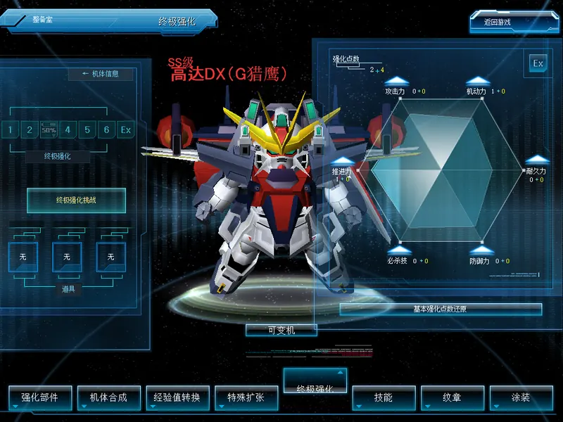

# 三种强化体系，一个客户端

[English](over-custom.md) · [返回功能目录](../README.zh-CN.md) · [好友机体赠送](friend-unit-gift.zh-CN.md)

同一个客户端共存 **OC、G改 1.0、G改 2.0**，服主可以指定整服使用的体系，也可以让每个房间选择。G改 1.0 需要服主提供配套规则文件。



可以加点、进行 OVER CUSTOM 挑战和洗点，OC 数值在战斗中生效，切换模式后两套数据都保留；同一服务器上还可以按房间选择 OC、G改 2.0（现行改造部件）或 G改 1.0（见[按房间选择体系](#按房间选择体系)）。本功能自 1.15.14 起在 Stable 通道发布。OC 年代的 EX 能力尚未实现（见[范围与兼容性](#范围与兼容性)）。

把原版的 OC 六维强化（Over Custom）带回现行客户端，与现行改造部件体系并存。每台机体有自己的 OC 档：普通点（速度、HP、攻击、防御、敏捷、必杀）、通过 OC 挑战取得的 Over 点，以及消耗 GP 的洗点。规则来自 2009 年原版存储过程，移植到 Mod 自有的表和过程中；游戏库里现行改造部件的数据不会被写入。

两套数据同时保存，由服主决定整服使用哪一套，或交给每个房间选择：

| 模式 | 战斗使用 | 机体记录 | OC 档 |
| --- | --- | --- | --- |
| `current`（默认） | 现行改造部件（`UnitSkill_1..4`） | 原生，不改动 | 保存但不生效 |
| `oc` | OC 加点增量 | World 服务端发出的记录在保留区携带 OC 数据，并把四个改造部件槽位置空 | 生效 |
| `room`（按房间） | 房名带 `!oc` 的房间用 OC 加点增量，带 `!g1` 的房间用机体的 G改 1.0 强化槽，其余房间用现行改造部件（G改 2.0） | 保留区携带 OC 数据和 G改 1.0 强化槽，四个改造部件槽保持原样 | 在 OC 房间生效 |

切换模式或停用 Mod 都不会删除或改写任何表。原生表从未被写入，卸载 Mod 后立即恢复原生行为。

机体和道具名可复用已启用的商城汉化服务；缺失时保留原名。原生中文提示保持原文，未翻译的固定提示使用审定中文。自定义机体内容的文字仍由内容包提供。

## 组件

| Mod | 宿主 | 作用 |
| --- | --- | --- |
| `oc_custom_server` | World 服务端 | 在游戏库安装 `sdgo_mod_oc_*` 表与过程（有 G改 1.0 规则文件时另装 `sdgo_mod_g1_*`），通过好友赠送载体处理大厅请求；`oc`、`room` 模式下把 OC 数据和 G改 1.0 强化槽写入发出的每条机体记录 |
| `oc_custom_battle` | 对战服务端 | 在原生逐形态属性构建之后，把记录中的 OC 增量加到 HP、攻击和防御上，沿用原生按等级的上限；`room` 模式下按房间换掉战斗机体的改造部件 |
| `oc_custom_client` | 客户端 | 让工厂成为双系统工厂：原生标签保持原样，旁边恢复「终极强化」标签，其页面由客户端包内原有的 OC 布局组成（OVER CUSTOM 等级栏与 ITEM 栏、带六维图的加点窗、终极强化挑战窗与确认框），作用于当前出击机体；发送加点、挑战和洗点请求；战斗中为本机机体加上 OC 推进力与机动力，本机必杀伤害按武器伤害加 OC 必杀点计算 |

`oc_custom_server` 需要 Agent 与 World 服务端上的 `friend_unit_gift_server`，`oc_custom_client` 需要 `friend_unit_gift_client`：OC 请求借用该已认证载体传输。赠送功能本身可以保持关闭。

## 启用

1. 在 SDGO Mod Manager 的「OC 六维强化 · World 服务端」中打开「启用 OC 六维强化」，把「生效的强化体系」设为 `oc`（整服使用 OC）或 `room`（按房间选择），重启 World 服务端。首个请求到达时自动安装表、过程和机体成长映射。
2. 每个对战服务端保持「OC 六维强化 · 对战服务端」启用并重启。
3. 要在 `room` 模式下提供 G改 1.0，把 G改 1.0 规则文件 `g1_attributes.tsv` 放到 World 服务端 Mod 目录并重启 World 服务端（见 [G改 1.0 规则文件](#g改-10-规则文件)）。
4. 玩家使用服主提供的客户端包或更新；客户端 Mod 默认启用，在服务器未报告 `oc` 模式时不显示任何可操作内容。

## 使用

客户端包里保留着原版 OC 的界面文件，Mod 直接使用它们：OC 标签页（OVER CUSTOM 等级栏与 ITEM 栏）、加点窗、终极强化（OC 挑战）窗、确认框，以及 OC 年代的 OVER CUSTOM 按钮。窗口里的文字也是客户端自带的原版 OC 文本。

把要强化的机体设为出击机体并进入工厂。服务器处于 `oc` 模式时，工厂按双系统工厂运作：标签栏在「特殊扩张」之后恢复 OC 年代的「终极强化」标签，其余标签依次右移；每个原生标签的页面保持原样，所有 OC 内容只出现在「终极强化」标签里。

- 点击「终极强化」，OC 页面取代原生页面显示，顶部标题为「终极强化」，标签显示为选中状态。左侧页面按机体的 OC 等级点亮 OVER CUSTOM 1 到 6 和 EX，放置 OVER CUSTOM 挑战入口，并在 ITEM 栏列出账号持有的 OC 道具：每格显示该道具自己的 3D 模型，加载方式与原生工厂页面显示道具相同，下方按效果标注（例如「+100% x3」「等级保护 x2」）；空格显示 NONE 框。右侧加点窗在六边形上画出全部六个维度，与原版 OC 图形一致：深绿色是机体自身的属性，浅绿色是加上普通点后的部分，黄色只显示 Over 点增加的部分；各项按客户端属性图表的范围折算（例如耐久力 4000–23800），打开时从中心展开。维度图显示在机体模型前面，不会被机体挡住；`0794` 布局里固定照亮一角的光影图不显示。六边形周围的推进力、耐久力、攻击力、防御力、机动力、必杀技各显示已分配的普通点 + Over 点，顶部是「强化点数」和剩余的普通点 + Over 点。从点击该标签起，原生库存窗口（包括「经验值转换」页从右侧滑入的库存）和机体下方的页面操作（经验值转换、还原）都不显示，「可变机」保留。
- 点击某项的箭头按钮，弹出原版确认框「在使用强化点数之前再仔细考虑下如何？确定要强化这项性能吗?」。确认后服务器按原表校验预算和属性上限（推进力 100、耐久力 23800、攻击力 169、防御力 169、机动力 100、必杀技 7950），保存一点。普通点用完且 OC 等级达到 9 以上时，箭头改为分配 Over 点。没有可用点数或超过上限时，弹出原版提示「无法使用强化点数.」或「不能再使用.超过了最大能力值.」。
- 普通点随 OC 等级发放：从 5 级起每级 1 点，直到该机体的普通上限等级（按机体为 6 到 8 级）。OC 等级在 9 级以下时跟随机体原生等级。
- 加点窗底部的长按钮是洗点。OC 等级 9 以下显示「基本强化点数还原」，洗普通点；9 以上显示「终极强化还原」，洗 Over 点。点击后确认框显示所需 G币，确认后扣除并清空该项分配。G币不足时提示「初始化费用不足.」。
- 左侧页面上的 OVER CUSTOM 入口在可以挑战时发光，否则显示为暗色标签。普通上限等级已到且经验条已满时即可挑战。点击后打开终极强化窗（期间左侧页面保留）：显示机体名、对战次数、目标等级（OVER CUSTOM1 到 OVER CUSTOM EX）、挑战条件和失败规则，并列出账号里可在当前等级使用的终极强化道具，最多勾选三个（例如提高成功率或防止掉级的道具）。现行客户端已把这些道具的名称改为「不可用」，窗口改用道具数据中的效果显示它们，例如「成功率+100%」「等级保护」。「开始」弹出「进行终极强化.使用道具 : …」确认框，确认后按原版概率挑战。成功获得 Over 点和奖励道具，显示「[ OVER CUSTOMn ]强化成功!」。失败时 OC 等级退回普通上限，使用了防掉级道具时保留等级；两种情况分别显示原版的失败提示。机体原生等级和经验不会改变。
- 点击任意其他标签即离开 OC 页面：原生页面、它的库存和操作按钮连同各自的数据一起回来，标题显示该标签的名称。回到「终极强化」时 OC 档保持不变。原生标签菜单仍在忙（加载中或尚有页面切换未完成）时会忽略点击，「终极强化」标签也一样，再点一次即可。

每次保存都会刷新出击机体记录，下一场战斗即生效。`oc` 模式下，现行改造部件仍保存在数据库中，但在记录里被隐藏，战斗中不生效。服务器切回 `current` 后，改造部件重新显示并生效；再切到 `oc` 时，每个 OC 档都保持原样。两种模式各用自己的数据，互不改写。服务器处于 `current` 模式时，工厂完全保持原生，不显示「终极强化」标签。

## 按房间选择体系

「生效的强化体系」为 `room` 时，几套体系在同一服务器上同时可用，由每个房间决定这一局使用哪一套：

| 房名指令 | 体系 | 战斗中生效 |
| --- | --- | --- |
| （无）或 `!g2` | G改 2.0（现行改造部件） | 机体记录里的改造部件（`UnitSkill_1..4`），OC 加点不生效 |
| `!oc` | OC | OC 加点增量（HP、攻击、防御由对战服务端加到战斗机体上；推进力、机动力和必杀技由客户端计算），改造部件不生效 |
| `!g1` | G改 1.0 | 机体的 G改 1.0 强化槽代替改造部件，OC 加点不生效；没有装备时这台机体不带改造部件 |

- 现行客户端工厂的「强化部件」页面就是 G改 2.0：6 种类型（战斗型、攻击型、防御型、机动型、平衡型、任务型），技能按类型装进最多 4 个强化槽。
- G改 1.0 是更早的一套规则：8 种类型，每台机体另有一组 4 个强化槽，与 G改 2.0 的强化槽分开保存，互不影响。服主提供 G改 1.0 规则文件后才可使用；没有规则文件时只在 OC 和 G改 2.0 之间选择。
- 指令写法与 `!ai`、`!rand` 等[房名组合指令](room-commands.zh-CN.md)相同，可以组合，例如 `练习局 !ai e2 a1 !g1`。同时有 `!oc` 和 `!g1` 时按 `!oc`。原生房名限 20 字节；启用[长房名](room-titles.zh-CN.md)后，指令写在完整房名的任意位置都能读取。房主改名时加上或去掉指令，下一场战斗即按新体系进行。
- 建房时，普通对战和 AI 对战的建房窗口在左侧小地图下方多出一行「体系」，右箭头依次切换「G改 2.0」「OC」「G改 1.0」（服务器没有 G改 1.0 规则时只在前两项之间切换），左箭头反向，房名末尾相应加上 `!oc`、`!g1` 或去掉指令。直接在房名里输入或删除指令，这一行也会同步显示。没有长房名时原生房名只有 20 字节，必要时截短房名末尾为指令腾出位置。
- 房间列表在每个房名前标出体系：【OC】【G改1】或【G改2】。进入房间后，标题栏右侧显示「体系：OC」「体系：G改 1.0」或「体系：G改 2.0」。这些标记由客户端 Mod 绘制，房名本身不变。
- 工厂里三套体系各有自己的页面，互不重叠：「终极强化」标签只显示 OC 档；「强化部件」标签是原版的强化部件页面，左侧面板下方的「G改 2.0」「G改 1.0」两个按钮切换这一页编辑哪一套（当前体系的按钮带 ● 标记），标题栏显示「强化部件 · G改 2.0」或「强化部件 · G改 1.0」。离开这个标签或退出工厂时页面回到 G改 2.0 的数据，再次进入时保留上次选的体系。
- 机体记录和数据库里的改造部件不会被改写。OC 和 G改 1.0 房间只是在开战构建战斗机体时换掉改造部件，之后进入 G改 2.0 房间，改造部件照常生效。
- 改造部件在对战服务端的战斗机体上生效，由对战服务端按房间换掉。客户端在房间资料里收到的机体记录仍带 G改 2.0 的改造部件；战斗数据包本身不带改造部件。客户端是否另行使用这些部件（例如战斗界面上的部件图标）尚未确认。
- 需要客户端 Mod 0.6.1、World 服务端 Mod 0.5.1 和对战服务端 Mod 0.3.0 或更新（World 0.5.0 不给 OC 成长表建好之后才加入的机体建立 OC 档；客户端 0.5.0 的 G改 1.0 页面在「终极强化」标签内，0.6.0 起改用原版「强化部件」页面；客户端 0.6.0 在战斗载入期间原生房间数据变化时，可能漏加 OC 推进力和机动力）；只在 OC 和 G改 2.0 之间选择时，客户端 0.4.0、World 0.4.0、对战 0.2.0 起即可。旧版客户端 Mod 在 `room` 模式下仍可使用 OC 页面，但不会在任何房间加推进力和机动力，也不显示体系标记。

### G改 1.0 页面

「强化部件」标签切到 G改 1.0 后，仍是同一个原版页面，操作与 G改 2.0 完全一样，只是换成 G改 1.0 的规则和这台机体的 G改 1.0 强化槽：

- 右侧类型栏列出 8 种 G改 1.0 类型（战斗型、格斗型、装甲型、射击型、突击型、重武装型、强袭型、支援型）。点击类型打开原版的技能列表，按机体等级排列，带技能图标、等级和说明浮窗；机体或用户等级不足的技能显示为锁定。G改 1.0 类型没有原版的类型说明，鼠标停在类型上不显示说明浮窗，类型按钮也不显示 G改 2.0 的类型图标。
- 双击列表中的技能（或拖到强化槽）放进空槽，规则与原版相同：所有强化槽须为同一类型、技能不能重复、已装备的槽要初始化后才能更换，强化槽3、4 需要机体的普通强化槽等级（`Normal_MaxLv`）达到 3、4。左侧类型行显示机体射程和 G改 1.0 类型（例如「中距离 战斗型」），强化槽显示 G改 1.0 规则中的类型颜色和等级。
- 「设置保存」弹出原版的保存确认框，确认后交给服务器按 G改 1.0 规则装备；服务器拒绝时，切换按钮下方的提示行显示原因。「还原」放弃尚未保存的选择。
- 「强化槽初始化」弹出原版的初始化窗口，显示 G改 1.0 的初始化费用、当前 G币和初始化后剩余的 G币，确认后清空全部 G改 1.0 强化槽。费用按与 G改 2.0 相同的算法计算：第一次免费，之后按机体等级的基础费用、初始化次数和所装技能各自的初始化费用累加；出击操作员带初始化技能时免费。G币不足时窗口直接关闭。
- 保存或初始化后出击机体记录随即刷新，下一场 G改 1.0 房间即生效。G改 2.0 的强化槽不受影响；切回 G改 2.0 后页面显示原来的改造部件。

### 工厂页面的中文显示

客户端 Mod 把这几个工厂页面上残留的英文换成中文，只改显示，不替换或分发任何游戏资源：

- 标题栏的 FACTORY 改为「整备室」（换成客户端自带的无字版标题图），返回游戏按钮去掉 EXIT 字样（换成客户端自带的无字版按钮图）。
- 机体名称上方的「SS RANK」显示为「SS级」，强化槽与技能列表的「2Lv」等级标签显示为「2级」（翻译客户端文字表中对应的两条格式文字）。
- 「终极强化」页面：UNIT INFORMATION、等级条下方的 OVER CUSTOM、ITEM 栏的 ITEM 用客户端面板自带的纯色图盖住，改为「← 机体信息」「终极强化」「道具」；空道具栏的 NONE 改为原版强化部件页面的空槽框加「无」；OVER CUSTOM 挑战入口改为原版的玻璃按钮，文字为「终极强化挑战」（可以挑战时文字点亮）。
- 「强化部件」页面：类型栏的 NEW 标记显示为「新」。
- 保留不改的部分：机体等级「Ex」和 OC 等级条上的「Ex」（客户端中文版自己就这样写，例如「EX等级」）；强化部件图标上的尺寸标记（S、M、L、ML、SML）以及 CRITICAL、SP UP 等烙在图标里的文字（客户端中文版的部件名称里同样保留，例如「[任务] SML_自动补给装置 A型」）；弹窗标题图上的 MESSAGE、CUSTOM SLOT RESET 等字样。

### G改 1.0 规则文件

G改 1.0 的技能规则由服主提供：World 服务端 Mod 目录下的 `g1_attributes.tsv`（UTF-8，制表符分隔，`#` 开头为注释），重启 World 服务端后生效。

```
category	<类型编号>	<名称>
skill	<技能 ID>	<类型编号>	<分类>	<机体等级>	<用户等级>	<高级 0/1>	<初始化费用>
```

- 类型从 0 起连续编号，最多 12 种，名称不超过 14 个字。
- 技能 ID 在 30001–31023 之间，须是游戏库 `tbl_UnitCustomSkill` 和客户端技能表中已有的技能；战斗效果按该技能现有的定义计算。每个技能只出现一次。「机体等级」「用户等级」是装备所需的最低等级，「初始化费用」计入初始化 G币。
- 文件内容变化后，World Mod 在下一次请求时重新写入 `sdgo_mod_g1_Rule`。已装备的技能保留并继续生效；要按新规则更换须先初始化。
- 文件有误时 World 日志记录行号与原因（`g1_attributes.tsv rejected`），G改 1.0 保持不可用，其余体系照常运行。

### 机体成长行

每台机体的 OC 加点效果（每点加多少推进力、耐久力、攻击力、防御力、机动力、必杀技）由一行成长数据决定，即游戏库 `tbl_CustomRev` 中的一行（编号 1010001–1010012）。World 服务端 Mod 0.5.1 起，每次 World 服务端启动时按下面的规则为机体表中的每台机体确定成长行：

1. 服主的成长文件列出的机体，使用文件中的成长行；
2. 否则，原版 OC 目录收录的机体（472 台）使用原版成长行；
3. 其余机体按等级公式：成长行编号 = 1010000 + 机体等级（1–4）。

运行期间才加入机体表的机体，在首次打开 OC 档时按等级公式补上，下次启动时再按上面的规则核对。

成长文件是 World 服务端 Mod 目录下可选的 `oc_growth_overrides.tsv`（UTF-8，制表符分隔，`#` 开头为注释，可以有一行表头），每行一台机体：

```
UnitNumber	CustomNumber
15100	1010008
```

- 重启 World 服务端后生效。从文件删去某台机体（或删除整个文件），这台机体在下次启动时恢复原版或公式的成长行。
- 机体表中没有的机体，以及 `tbl_CustomRev` 中不存在的成长行编号，会被跳过并计入日志的 rejected 数。文件格式有误（非数字、缺列、同一机体出现两次）时整个文件不生效，成长表保持不变，World 日志记录 `oc_growth_overrides.tsv rejected` 及行号。
- 更换成长行后，机体已分配的点数保留，按新成长行计算效果。
- World 日志每次启动记录一行 `oc growth:`，列出原版、成长文件和等级公式各覆盖多少台机体、本次新增和改动的行数，以及仍没有成长行的机体数（正常为 0）。

## 范围与兼容性

- 保存加点、洗点或挑战后无需重新登录，下一场战斗即生效；玩家已在房间内时也会同步更新。
- 对战服务端应用 HP（第一形态）、攻击和防御（按形态）。伤害由出招一方的客户端计算后上报，对战服务端只按上限截断再扣除耐久，所以必杀技在客户端生效（1.16.18 起；此前必杀点数不改变实际伤害）：本机打出必杀时，必杀伤害按「必杀武器伤害 + OC 必杀点」计算，两者合计不超过 7950；随机浮动、多目标衰减和必杀觉醒倍率照原版计算。只影响本机自己的必杀，近战、远程和地图三类必杀都生效，可变形机体按当前形态的必杀武器计算。推进力和机动力是客户端侧的移动数值：战斗开始时客户端 Mod 把出击机体记录中的增量加到本机机体的推进等级和机动力上，与现行体系的属性加成作用在同一位置，可变形机体的两个形态都生效。每台机体的移动由其所属客户端计算，其他玩家看到的是该玩家自己客户端的结果。
- OC 年代的 EX 能力（终极强化 EX 等级的附加能力）尚未实现，加点窗上的 Ex 按钮保持不可用。现行游戏库只留下一个未使用的 `ExtraBonus` 列；OC 年代的设置规则是：机体达到 EX 等级后，消耗一个 EX 能力修改器，从 8 项能力中选一项，不能重复选择当前能力。客户端数据表 `gdrs\0121.gdt` 保留了这 8 项能力的名称、数值和图标（攻击、防御、机动力、速度、移动速度各 3，回避速度 7，锁定范围 700，推进器恢复速度 7），但这些数值在战斗中如何折算（百分比还是固定值，由对战服务端还是客户端计算）还没有确认。确认之前 Mod 不会启用 EX。
- 洗点扣除的 GP 在客户端下一次原生 GP 刷新后显示。
- 机体成长行：原版 OC 目录收录的 472 台机体使用原版数据，其余机体按等级公式使用平衡成长行，服主可以逐台自定义（见[机体成长行](#机体成长行)）。

## 排错

- 工厂里没有「终极强化」标签：服务器未启用 OC 模式（World Mod 未启用、模式为 `current`，或表安装失败；World 日志中有 `oc schema` 相关记录），或缺少好友赠送客户端或服务端 Mod，OC 载体需要两者都在。客户端日志中的 `oc original windows` 行记录窗口是否加载、绑定。
- 战斗数值没有变化：房间开始后查看对战服务端日志中的 `oc applied uid=...` 行，对战 Mod 会记录每次应用的加点。推进力和机动力看客户端日志中的 `oc mobility applied` 行；`oc room view` 行记录客户端为房间读到的体系，`oc room view keeps` 行表示载入和战斗期间沿用了这个体系。
- `room` 模式下房间使用了意外的体系：对战服务端日志的 `oc room system=... title="..."` 行记录它读到的房名和选择的体系，以及该机体原生构建出的属性和改造部件；客户端日志的 `oc room view system=...` 行记录客户端读到的体系。指令需要以空格与其他文字分开，`!oc3`、`房间!oc` 不会当作 `!oc`，`!g` 和 `!g3` 不选择任何体系。
- 房间列表或标题栏没有体系标记：服务器没有运行 `room` 模式，或客户端 Mod 早于 0.4.0（0.6.0 之前的客户端要先进过一次工厂才会显示房间列表的标记，0.6.0 起在大厅就向服务器询问模式）；客户端日志中的 `oc room system label` 行记录标题栏标记的创建与内容。
- 建房窗口的「体系」行没有 G改 1.0、「强化部件」页面的「G改 1.0」按钮不可用：World 服务端没有读到 G改 1.0 规则文件。World 日志的 `ready:` 行列出读到的技能和类型数，文件有误时有 `g1_attributes.tsv rejected` 行。
- 「强化部件」页面切到 G改 1.0 后类型栏仍是 G改 2.0 的类型：客户端日志的 `g1 native:` 行记录规则读取、数据管理器重新载入（类型数和条目数）与切回；页面忙于保存、初始化或拖动时，切换在页面空闲后才生效。
- G改 1.0 房间里技能没有生效：对战服务端日志的 `oc room system=g1 ... g1 skills=...` 行记录该机体带入战斗的 G改 1.0 强化槽；全为 0 时这台机体还没有装备。World 日志的 `oc carrier filled ... with a G1 loadout` 行记录发出的机体记录是否带上了强化槽。
- 点击「终极强化」时右侧先滑出库存窗口，或先闪出「经验值转换」页面：客户端 Mod 低于 0.6.4。通过 SDGO Mod Manager 或服主提供的客户端包或更新取得新版，并重启客户端。
- 点击「终极强化」只切到「经验值转换」、OC 页面不出现：服务器没有发来出击机体的 OC 档。World 服务端 Mod 0.5.0 对成长表建好之后才加入机体表的机体会出现这种情况；把 World 服务端 Mod 更新到 0.5.1 或更新并重启 World 服务端；World 日志的 `oc growth:` 行中「仍没有成长行」的机体数应为 0（见[机体成长行](#机体成长行)）。
- OVER CUSTOM 入口一直是暗色：机体尚未达到普通上限等级，或已经是 OVER CUSTOM EX。
- 账号持有 OC 道具但 ITEM 栏为空：World 服务端 Mod 版本比客户端 Mod 旧，不支持道具列表请求。
- ITEM 栏某格只有文字没有模型：客户端日志中的 `oc item model slot` 行记录每个模型路径以及是否加载成功；模型文件须在客户端包内。

## 开发者说明

**记录载体。** 机体记录（`_UnitData`，0x99 字节）在 +21..+45 有 25 字节保留区。`oc` 模式下 World Mod 在此写入 `'O' 'C'`、版本 1、标志（1 = OC 模式，2 = 已有 OC 档）、OC 等级、普通点与 Over 点总数、六个有符号 16 位属性增量（速度、HP、攻击、防御、敏捷、必杀）、修订号和校验和，并清空 +138 的四个改造部件槽。World 发包钩子（`oc_custom.world_send`）在构建这些包的请求处理之后修补 0x8F2、0x9B4、0x699 和 0x5C1。因此机体页、出击机体回复、机体信息回复、用户信息和战斗结束用户更新中的机体记录都带有 OC 数据，这些记录的所有原生拷贝也保留它，包括对战服务端构建房间飞行员时使用的记录。

**大厅请求。** OC 指令使用好友赠送载体的不透明扩展区间 0x1000..0x10FF：0x1000 模式、0x1001 读取 OC 档、0x1002 普通点分配、0x1003 Over 点分配、0x1004 挑战、0x1005 洗点费用、0x1006 洗点、0x1007 列出账号可用于下一次挑战的终极强化道具（`tbl_EtcItems` 中带成功率加成或防掉级、且使用等级覆盖当前 OC 等级的类型 3 道具，最多 10 个）、0x1008 列出账号持有的全部这类 OC 道具，不限使用等级（ITEM 栏；回复格式相同）。服务端通过 `SdgoFriendUnitGiftRegisterExtensionV1` 注册，客户端通过 `SdgoFriendUnitGiftClientExtensionSendV1` 发送。处理函数执行期间，`SdgoFriendUnitGiftCurrentRequestV1` 返回承载该请求的原生 World 请求对象。

**对战服务端的拷贝。** 玩家进入频道时，对战服务端请求用户信息（请求 0x6B3，回复 0x5C1）并保存该账号的出击机体记录，房间飞行员从这份拷贝复制。它的 0x5C1 处理在房间外更新缓存的用户，在房间内更新飞行员并广播 0x861。加点、洗点或挑战成功后，World Mod 把原生用户信息处理（`oc_custom.world_req_user_info`）对该账号重放给所有收到过其用户信息的对端（承载本次请求的 Agent 除外），重放时复制请求对象，只替换目标和包缓冲区。战斗结束用户更新（请求 0x68D，`oc_custom.world_req_battle_end_user`，回复 0x4A9，记录位于 +0x2B）同样被填充，因为对战服务端会把这条记录保存为该账号的出击机体记录。客户端保存后也用同一个用户信息请求刷新自己的出击机体记录。

**对战。** `oc_custom.battle_set_unit_stat` 挂接原生属性分派函数（`__stdcall`，七个参数，`RET 0x1C`）。原函数执行后按形态加上增量，并以等级上限表（`oc_custom.battle_grade_caps`）截断；战斗机体上的必杀追加值以致命武器的伤害尺寸（`oc_custom.battle_weapon_lookup`）为上限，但原生对战服务端和客户端都不读取这个值。

**必杀伤害。** 出招一方的客户端用自己武器数据的伤害值（武器行 +0x6C）计算必杀伤害并上报，对战服务端只加上比分补偿并按 19000 截断。客户端 Mod 在三处计算点把本机必杀的武器伤害换成「伤害 + OC 必杀增量」（不超过 7950）：近战演出必杀在随机数取整后的存值处（`oc_custom.special_melee_damage_store`，用同样的 x87 运算和 `crt.ftol2` 按新伤害重算 `trunc((伤害+增量)×随机)`）；远程演出必杀在多目标衰减后的基数处（`oc_custom.special_ranged_scaled_base`，`(115−15c)×(伤害+增量)/100`）；地图与突进必杀在共用命中构建的附加伤害处（`oc_custom.special_packet_bonus`，只处理射程类型 3 和 8、没有伤害覆盖值的命中）。随机数、目标数衰减、每段 1/21 和觉醒倍率都按原生在之后计算，结果与武器伤害本身更高时一致；武器数据本身不被修改（敌我共用同一行）。只有攻击状态机属于本机玩家单位时才计算，其他客户端模拟的单位保持原生。设置 `BattleSpecial=0` 可关闭。

**客户端界面。** `CServiceFactoryRoomUnitUpGrade`（服务名 `ServiceFactoryUnitUpGrade`）在 +0xA8 内嵌页面组件。现行 `GOnline.exe` 不含 OC 年代的服务类，但包内的 OC 布局完整：`uirs\0800.uir`（OC 标签页）、`uirs\0794.uir`（加点窗）、`uirs\0813.uir`（终极强化窗）、`uirs\0819.uir`（确认框）与 OC 年代客户端逐字节或控件一致，后期的双系统客户端也一样，其标签栏把「终极强化」放在「特殊扩张」之后。当前 `0799` 去掉了 OC 年代的 `OverCustomBtn`，其精灵 `sprs\8525-8528.spr` 仍在包内。

工厂打开期间，所有页面服务都保持活动；标签菜单通过选中对应标签并发出页面切换消息，一次只显示一个页面。因此 OC 页面占用「经验值转换」的位置：在其他标签上点「终极强化」时，先通过菜单选中该位置，等菜单显示出 `0799` 后，再把它隐藏，显示 `0800`（同一框位 0,100）和 `0794`。从点击起（点击时立即执行一次，菜单切换之前每帧执行），`0799` 不再绘制，机体下方的页面操作和 OC 区域内的原生库存对话框隐藏，标签和标题已显示「终极强化」；菜单显示 `0799` 的那一帧，`0800` 和 `0794` 即取而代之。OC 区域是整列：`0794` 一直延伸到屏幕右缘，`0800` 一直延伸到屏幕左缘；库存对话框在其原生更新之后的同一帧判定，所以「经验值转换」页从右侧滑入的库存在滑动途中也不会出现。点击原生标签时，先恢复 `0799`、被隐藏的原生对话框和工厂操作按钮，再交给菜单切换。菜单回调在其加载状态（`**(service+0x44+0x14)`）忙碌或消息队列（`*(*(service+0x9C+4)+4)`）非空时忽略点击，「终极强化」标签遵循同样的规则。

| 符号 | 作用 |
| --- | --- |
| `oc_custom.client_upgrade_init` | 页面组件 Init：加载 `uirs\0799.uir`，把出击机体记录复制到组件 +0x6C。`__thiscall`，带一个未使用的栈参数（`RET 4`），在资源加载线程执行。Mod 在其后用同一线程加载 OC 布局 |
| `oc_custom.client_upgrade_update` | 服务逐帧更新（虚表第 12 项），游戏线程。Mod 在这里接管加载好的窗口，并在页面上重建 `OverCustomBtn` |
| `oc_custom.client_upgrade_callback` | 服务 UI 回调（虚表第 14 项），`__stdcall(service, event, second, control)`；按钮点击为 0x101，复选框为 0x401 |
| `oc_custom.client_upgrade_vtable` | 服务虚表，接管窗口前核对 |
| `oc_custom.client_tab_menu_update`、`oc_custom.client_tab_menu_callback`、`oc_custom.client_tab_menu_vtable` | 工厂标签菜单（`ServiceFactoryRoomMenu`）的逐帧更新、UI 回调与虚表。Mod 在七个原生标签（缓存在服务 +0xD4）之间、「特殊扩张」（`ExpensionCustomSlotRadio`；没有该标签时为「经验值转换」）之后放回 `OverCustomRadio`，使用原生标签的皮肤（普通、悬停和选中皮肤 8467）和文字样式，标题为文本 126631；标签栏按每格 125 像素重新排布。打开的 OC 标签与原生选中标签一样，显示选中皮肤并上移 16 像素 |
| `oc_custom.client_header_update`、`oc_custom.client_header_vtable` | 工厂标题服务（`uirs\0804.uir`，对话框 +0xC4，`TabNameStatic` +0xC8）。页面切换发出带标签序号的 0x2342，序号保存在 +0xCC，标题写入该标签名称后复位为 -1。在 OC 标签上，没有待写入的原生标题时，Mod 写入 126631 |
| `oc_custom.client_factory_update`、`oc_custom.client_factory_vtable` | 工厂主服务（`uirs\0803.uir`；组件 +0xA8，`SaveBtn` +0x3C、`ReturnBtn` +0x40、`UnitBtn` +0x44）。在 OC 标签上，每次原生更新后隐藏页面操作 `SaveBtn` 和 `ReturnBtn`，原生标签切换前恢复 |
| `oc_custom.client_renderer` | 静态链接引擎的渲染器（`CRenderer*`），其 `IDirect3DDevice9*` 位于 +8 |
| `oc_custom.client_render_lock`、`oc_custom.client_render_clear`、`oc_custom.client_render_load`、`oc_custom.client_render_rotation`、`oc_custom.client_render_model`、`oc_custom.client_model_animation`、`oc_custom.client_render_unlock` | 工厂页面显示道具时调用的 3DRender 控件函数（`FUN_00873B40`）：在控件锁（+0x274 的临界区）内清空、加载模型路径（`Load(path, 0)`）、重置旋转、取得模型（+0x250）、播放其 `default` 动画（`model->Play(name, 1, 1.0, 0.1, 2, 1, 0)`）、放置模型（+0x88/+0x8C/+0x90 = 0/-11/0，+0xA0 = 1），解锁后刷新（虚表 +0x1C）。相机沿用升级页面给自己的 3DRender 设置的参数（+0x234..+0x248 视点 0,0,-35、目标 0,0,0；近平面 +0x25C = 1，远平面 +0x260 = 500） |
| `oc_custom.grid_singleton` | 客户端表管理器（`DAT_01005608`）。+4 是以 id 为键的 `std::map`，值为 {类型, 记录}；类型 0x3B 是界面文本（记录 +5 起为 UTF-16），类型 2 是机体表，类型 0x39 是道具表（记录 +0x79 起为 UTF-16 模型路径）。客户端道具表 `gdrs\0117.gdt` 仍保留终极强化道具，但把它们标为停用（+4 字节为 1，名称「不可用」）且不加载，所以 ITEM 栏改用这些行里的模型路径：3240005 与 3240006 为 `mdrs\2977.mod`，3240030 为 `mdrs\2952.mod` |

窗口由服务自己的加载函数（虚表 +0x58，`Load(name, path)`，页面加载 `0799` 用的同一调用）创建，归服务所有、绘制和销毁，控件事件进入服务 UI 回调。服务按名字登记对话框，所以三个窗口使用各自的登记名。控件按原名字和类型查找（`FindControl`，静态文本 3、按钮 4、图标 1、复选框 10）；静态文本和复选框分别通过虚表 +0x88 的 `SetText` 与 `SetCheck` 设置，复选框勾选状态在 +0x21C。工厂的对话框都是顶层对话框。OC 窗口打开期间，工厂库存服务（`CServiceFactoryRoomInventory`，`oc_custom.client_inventory_update` 记下该服务）登记在服务对话框映射（服务 +0x30）里、且大部分落在窗口下方的对话框被暂时隐藏，窗口关闭或离开页面时恢复原来的可见状态。在 OC 标签上，`0800` 和 `0794` 的区域始终保留，包括挑战窗挡在 `0794` 前面的时候。加点窗比 OC 年代布局上移 40 像素，避开现行页面底部的视角按钮。`OverCustomBtn`（205×30，精灵 8526-8528）和其暗色标签（84×24，精灵 8525）取自 OC 年代 `0799` 的记录，建在 `0800` 的 37,250，位于等级栏与 ITEM 栏之间。布局中初始隐藏的图标在之后显示时不会绘制，所以点亮的等级图标（精灵 8997..9003）和 NONE 框（精灵 8486）在 `OverCustomSlotIcon0..6`、`NoneIcon0..2` 的位置新建，原控件保持隐藏。ITEM 名称通过移动其静态文本居中于各自的格子上方。

`0794` 的 `CustomIcon`（95,108，296×264）没有精灵，OC 客户端在这里画出机体的属性形状。Mod 给加载的 `0794` 对话框一份私有虚表副本，其绘制项（+0x34，由所属服务按对话框名称顺序调用）先执行原绘制，再通过渲染器的设备，按 OC 客户端的六边形渲染（双系统客户端的 `CUnitInfoHexagonRender`）画出四层填充六边形（预变换顶点，设备状态存入状态块后还原），中心为 `CustomIcon` 中心，半径为其宽度的一半，打开时每帧放大 0.1。由下到上：含待分配点 `0x33FFFFFF`（本客户端逐点保存，与下一层相同）、含普通点和 Over 点 `0xB2FFFF99`、含普通点 `0x7F339965`、原生属性 `0xB2339965`。各项按属性图表（网格类型 7，编号 27501..27506：+5 属性序号、+6 最小值、+10 最大值）折算为 (值−最小值)/(最大值−最小值)。顶点与标签位置一致：推进力在左、耐久力在右、攻击力左上、机动力右上、必杀技左下、防御力右下。确认框和挑战窗登记在 `0794` 之后，所以画在图形上方。工厂的机体模型是 `0803` 中的 `Multi3DRender`（0,80 512×608，`CUIMulti3DRender` 控件）。界面先绘制各对话框的 2D 内容，再绘制这类控件的模型（其绘制函数 `FUN_00C6DEA0` 自行设置视口、视图和投影并立即绘制），最后才统一提交批量精灵；因此在 `0794` 自己的绘制顺序里画的图形会被机体盖住。OC 标签显示且机体在屏幕上时，Mod 在该控件绘制完后立即画图形（符号 `oc_custom.client_multi3d_draw`）：位于机体之上，又低于各窗口的精灵以及确认框和挑战窗。机体不显示时仍在 `0794` 的绘制中画图形。`0794` 的 `BackIcon1`（`sprs\8536`，照亮左半边的光影图）在 OC 页面上隐藏。窗口文字取自文本表 126262..127192 中的原版 OC 文本（例如 126631「终极强化」、126638..126643 六项属性名、126644「强化点数」、126646/126647 洗点、126683..126685 挑战确认）。

**战斗中的推进力与机动力。** 机体属性初始化 `FUN_00676C70` 把机体表的 DashLevel（+0x21E）和 MotivePower（+0x221）复制到机体对象 +0xB64、+0xB6A，加上现行体系的属性加成，再调用 `FUN_00675850` 由这两个等级推算移动数值。`oc_custom.client_unit_derive_call`（该调用处的 site 挂钩）在推算前把增量加到本机机体的这两个等级及其恢复副本 +0xD5C、+0xD5E 上。本机机体由机体管理器 +0x88 标识；开战时机体可能先完成初始化，再由 `oc_custom.client_add_player`（`AddPlayer`，`__thiscall(manager, unit, local, player)`，`RET 0xC`）标记为本机，此时补加增量并调用 `oc_custom.client_unit_derive` 重新推算。

**按房间选择体系。** `room` 模式下，World Mod 写入的保留区标志为 4（`carrier_room_rule`），不清空改造部件槽；模式回复带 `kModeFlagRoomRule`。体系由房名指令决定，解析见 `include/sdgo/oc_room_system.h`（沿用公共房名指令语法，读取而不改写房名）。对战服务端：原生属性分派的四个调用点都在人类机体构建函数 `battle.build_human_unit` 内（EBP 帧，房间在 `[ebp+8]`、飞行员在 `[ebp+0x10]`），Mod 的裸入口记录调用方帧，按房名决定体系：完整房名来自长房名提供者，否则读 `WaitRoomEx` +0x79/+0x7A，再退回大厅 `WaitRoom` +0x53/+0x54。该构建函数在构建属性前把记录 +0x8A 的四个改造部件槽复制到战斗机体 +0x644，战斗从这份拷贝读取改造部件；OC 房间在原生构建后清空这份拷贝并加上 OC 增量，房间记录本身不变。日志行 `oc room system=... native hp=... skills=...` 记录每次决定，导出 `SdgoOcCustomBattleRoomBuildsV1` 返回两种房间的构建次数。客户端：当前房间取自账号资料 +0xEC（`CBaseRoomData`，房名长度 +0x79、房名 +0x7A），或长房名客户端提供的完整房名；推进力和机动力只在 OC 房间增加。客户端只在大厅和待机室状态（`CGameApp` +0x4A0）读取房间的体系；从战斗开始（载入）到离开房间，同一房间沿用这个体系，因为载入期间原生房间数据可能被改写。房间列表标记在 `CServiceRoomList` 逐帧更新（虚表第 12 项，`oc_custom.client_room_list_update`）之后，为每行（条目 +0x124..+0x128，每条 0x90 字节；行按钮 +0x94 + 序号 × 0x0C）的文本项 1 加前缀；标题栏标记在 `C3DWaitRoomTitleBar` 逐帧更新（`oc_custom.client_titlebar_update`）之后，在标题栏对话框（+0x48）里 `TitleChangeBtn` 右侧建立按钮 `OcRoomSystemStatic` 并写入文本项 0。建房窗口（`CServiceMakeRoom`、`CServiceMakeRoomAI`，`uirs\1304.uir`；根对话框 +0x50，房名编辑框 +0x54，状态 +0x44 到 4 后可用）通过服务管理器（`flow.service_managed_pointer`，列表在 +0x44）按虚表找到，同时有多个时使用列表中最后一个就绪的窗口（每次被接受的 `MakeRoomBtn` 点击都会新建一个）；「体系」行在小地图（下沿 177）与 `SettingBtn`（上沿 211）之间新建 `OcSystemLeftBtn`、`OcSystemStatic`、`OcSystemRightBtn`，箭头沿用该窗口游戏模式箭头的精灵（`sprs\17915`–`17920`），点击由窗口 UI 回调（虚表第 14 项，`oc_custom.client_make_room_event` / `oc_custom.client_make_room_ai_event`）接收，通过房名编辑框的 `SetText` 切换房名中的体系指令。

**G改 1.0。** 现行客户端的强化部件数据是后期的 G改 2.0：`gdrs\0261.gdt`（强化部件条目，形状与服务器的 `tbl_UnitCustomSkillRev` 相同：技能 ID +5、类型 +9、分类 +10、机体等级 +11、用户等级 +12、高级 +13）和 `gdrs\0263.gdt`（6 种类型）；工厂页面是 `CServiceFactoryRoomAttribute`（`uirs\1252.uir`，类型列表 `uirs\1254.uir` 有 8 格，技能列表 `uirs\1253.uir`）。World Mod 启动时读取服主的 `g1_attributes.tsv`，安装 `g1_schema.sql`（按文件写入 `sdgo_mod_g1_Rule`；`sdgo_mod_g1_UserUnitSkill` 每台机体四个技能、初始化次数和修订号），`sdgo_mod_g1_Set` 按原生 `sp_SetUserUnitCustomSkill` 的规则校验装备（已装备的槽在初始化前不变、技能不重复、技能在规则中且机体和用户等级足够、同一类型、强化槽3和4需要 `Normal_MaxLv` 3和4），`sdgo_mod_g1_GetResetCost` 沿用 `sp_GetResetCustomSkillCost` 的算法。大厅指令 0x1009（每页 100 条规则）、0x100A（类型名称）、0x100B（强化槽）、0x100C（装备）、0x100D（初始化）经好友赠送载体传输；保存装备或初始化后与 OC 保存一样重放原生用户信息。有 G改 1.0 强化槽的机体记录使用载体版本 2（标志 8，`carrier_g1_profile`）：OC 增量按推进、攻击、防御、机动各 1 字节，HP、必杀各 2 字节存放，修订号 24 位，四个技能以相对 30000 的 10 位偏移存放；其他记录仍为版本 1。规则读入后模式回复带 `kModeFlagG1`。对战服务端：带 `!g1`（房名指令 `g`，次数 1）的房间在原生构建后把载体中的四个技能写入战斗机体 +0x644 的拷贝，没有强化槽的机体则清空；`SdgoOcCustomBattleRoomBuildsV2` 另报告 G改 1.0 房间的构建次数。客户端：`SdgoOcCustomClientG1SnapshotV1`、`SdgoOcCustomClientG1ActionV1`、`SdgoOcCustomClientG1RuleV1`、`SdgoOcCustomClientG1CategoryV1` 提供规则、强化槽和页面状态。「强化部件」页面本身负责 G改 1.0：页面的数据管理器（`CAttributeMgr`，首次使用时从 0261/0263 填入）被清空，由 Mod 的加载函数重新填入：索引 0 放一个占位类型（类型栏从索引 1 开始显示），G改 1.0 的类型放在 1 到 8，每个条目复制客户端 0261 中同一技能的行，再换上规则文件中的类型、种类、机体等级、用户等级和高级标志。该模式下玩家资料中的机体记录显示 G改 1.0 的技能和开放槽数，类型文字和强化槽绘制使用 G改 1.0 的行，类型说明浮窗和原生的「任务类型」限制不生效，页面的保存（0x591）和初始化（0x867）请求改为大厅指令 0x100B 和 0x100C，其回复走页面自己的成功流程（0x984、0x683）；初始化窗口的费用回复显示 G改 1.0 的费用。离开该模式、标签或工厂时重新载入原生数据。`SdgoOcCustomClientG1NativeV1` 报告模式、数据管理器的数量和原生服务。技能名称和说明取自客户端自己的技能表（`gdrs\0234.gdt`）。

**GameTest。** `--room-switch`（配合 `--oc-allocate` 和 `--play-unit-uid`）在同一个客户端会话里连打三场 PvP：`!oc` 房间、`!g1` 房间和不带指令的（G改 2.0）房间，之前先运行 `g1.loadout` 和 `oc.create`；每一轮依次运行 `pvp.<体系>.room/start/ai_spawn/system/return`，其中 `system` 只按本轮核对客户端读到的体系和 OC 增益；这类运行以最低的战斗分辨率进行，隐藏的图形设备在两场战斗之间不需要重置，每场返回时的 AI 计分板检查只记录、不作为通过条件。对战服务端 Mod 导出最近的房间判定（`SdgoOcCustomBattleRecentDecisionsV1`：房间、体系、机体、原生与实际使用的改造部件、是否加了 OC 增益），GameTest 服务端观察器把它们写进每个 `battle_end` 事件，`tools/game_test_server_report.py` 要求三个房间按顺序各打一场，且出击机体分别按 OC（不带改造部件、加了增益）、G改 1.0（G改 1.0 强化槽代替改造部件）和 G改 2.0（改造部件保持不变）构建。离线契约 `game_test_room_switch_offline` 和 `oc_room_system_offline` 在 CI 中运行；工作流 `Native room-system switching GameTest` 在维护者的自托管原生 runner 上，对每次涉及这些 Mod 或 GameTest 工具的 master 推送运行实战 `--room-switch` 测试和服务端报告（拉取请求不会触发）。`tools/game_test.py prepare` 支持 `--oc-allocate STAT:POINTS[,STAT:POINTS...]`（配合 `--play-unit-uid`，在普通 PvP 战斗前直接保存普通点）、`--oc-panel` 和 `--oc-challenge`。分配了推进力（0）或机动力（4）时，`oc.mobility` 在开战后核对本机机体的推进等级和机动力正好增加了保存的增量。分配了攻击（2）或防御（3）时，`oc.stats` 核对客户端收到的战斗属性块等于基础值加上保存的增量（最多 169）。`--oc-special`（分配中须包含必杀技 5）在这场战斗里打出出击机体真正的必杀：原生玩家探针用普通攻击给实际的必杀槽充能，槽满后经映射动作选中必杀栏位并发动，`oc.special` 核对客户端算出的数值：OC 房间里核对携带的必杀点、增益 `min(点数, 7950 − 武器伤害)` 以及按该类原生算法提高后的数值（近战 `trunc((武器伤害 + 增益) × r)`、远程 `(115 − 15c)(武器伤害 + 增益) / 100`、地图与突进为基础值加增益）；不加 `--oc-room` 时房间按现行体系进行，必杀必须保持原生。`--oc-room` 给 `--oc-allocate` 的 PvP 房名加上 `!oc`，并在开房前运行 `oc.create`：从房间列表按原生 `MakeRoomBtn` 打开建房窗口，核对「体系」行初始为 G改 2.0，用右箭头切到 OC（房名加上 `!oc`），服务器提供 G改 1.0 时再切到 G改 1.0（`!g1`），再用左箭头切回（去掉指令），各步画面存入 `visual\`，然后取消窗口。`--g1-room` 改为加上 `!g1`，并在出击机体设好后运行 `g1.loadout`：经客户端 Mod 读取规则和机体的强化槽，已有装备时先经真实指令初始化，再装备同一类型中机体和用户等级允许的两个技能，等待刷新后的出击机体记录带上这组技能；战斗中 `oc.mobility` 核对房间按 G改 1.0 进行、没有加 OC 增益、记录带有这组强化槽。`oc.panel` 之后在「强化部件」标签运行 `g1.page`：用页面的切换按钮选 G改 1.0（数据管理器随即装入 G改 1.0 的类型和条目，页面显示机体的 G改 1.0 强化槽），已有装备时经初始化窗口和确认框清空，点类型栏打开技能列表，双击技能放进强化槽，经保存确认框设置保存，再初始化一次，最后切回 G改 2.0 并核对页面重新显示改造部件；每一步都是对应原生服务对自己控件的 UI 事件，保存和每次初始化后都读回服务器上的强化槽。配合 `--pages-only --page-group hangar --oc-panel` 时，`--g1-room` 在机库页面的 OC 面板检查之后运行 `g1.page`，不进行战斗。服务器处于 `room` 模式时，`oc.mobility` 按房间核对：OC 房间核对增益正好加到本机机体，现行体系房间核对增益没有加上、机体记录的改造部件仍在，并记录收到的哪些数据包带有该机体的改造部件。`oc.panel` 在战斗结束后从机体管理进入工厂「经验值转换」页并核对它保持原生，再打开「终极强化」标签核对 OC 页面（`0800` 取代页面、点亮的等级图标和 OVER CUSTOM 入口、ITEM 栏、已绘制的六维图、标题、被隐藏的库存窗口和页面操作），然后通过客户端 Mod 的 `SdgoOcCustomClientClickV2` 把 UI 事件送进页面服务的原生回调，按原控件名操作：洗点（`ResetBtn` → 确认框 `OKBtn`）、加推进力（`SpeedUpBtn`）、加机动力（`AgiUpBtn`）、普通点用完后加 Over 点并执行终极强化还原，配合 `--oc-challenge` 时再按 OVER CUSTOM、勾选道具并开始终极强化。最后通过菜单自身的标签事件切到「特殊扩张」「技能」和「强化部件」（菜单忽略点击时再按一次），核对只剩原生页面，再回到「终极强化」，核对 OC 档和机体记录的改造部件槽不变。两次打开「终极强化」（从「经验值转换」页和从「强化部件」页）时，客户端 Mod 从点击起逐帧检查，在机体模型绘制时判定原生「经验值转换」页面、OC 区域内的库存对话框或机体下方的页面操作是否仍在显示，要求为零帧（`SdgoOcCustomClientSnapshotV2` 的 `oc_switch_frames`、`oc_pending_frames`、`native_flash_frames`）；从「强化部件」打开时还会保存一帧切换中的画面。服务器处于 `current` 模式时核对工厂保持原生，并报告机体记录的改造部件槽，每种模式各跑一次，可核对两套数据在切换后都保留。各步骤的画面保存在运行目录的 `visual\` 下。
