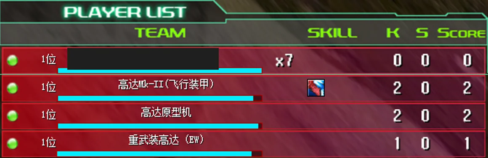

# PvE AI TAB roster

[简体中文](pve-ai-scoreboard.zh-CN.md) · [Feature index](../README.md)

The PvE AI TAB roster is a client-side automatic fix. When a mission has registered AI teammates, pressing TAB uses the shipped battle roster to show those teammates together with human players.

The native rows display AI names, HP bars, units, kills, assists and points. An AI row remains available while its unit is destroyed or waiting to respawn because the roster identity and score record still exists. A newly spawned live unit is checked against that record before its row is used.

## Installation and behavior

Install the Mod with the client programme package and restart the client. There are no settings and no room-title command.

The Mod only extends the native roster's temporary display order while that panel is drawing. It immediately restores the original order and row state afterwards. Mission player count, units, HP, lives, positions, respawn rules, target state and scripts are unchanged. PvP and missions without registered AI keep their original behavior.

## Compatibility and troubleshooting

This Mod is independent of a particular imported map and does not require Mission AI wingmen. It displays AI only when another mission system has already registered a complete native teammate slot and room record.

If an AI does not appear, verify that the client has restarted and that the mission actually registered the AI participant. Invalid or conflicting slots are skipped instead of modifying gameplay data. The Mod uses the shipped TAB panel and adds no custom UI.
