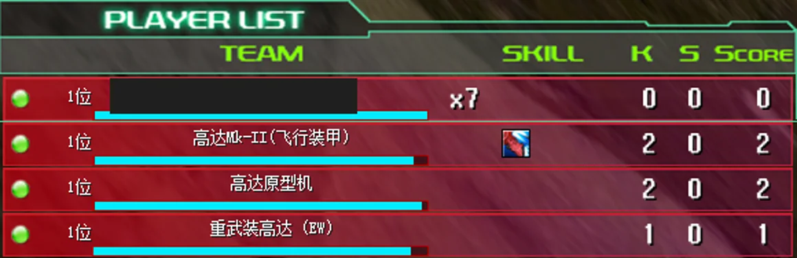

# PvE AI TAB 队友列表

[English](pve-ai-scoreboard.md) · [返回功能目录](../README.zh-CN.md)

PvE AI TAB 队友列表是客户端自动修复。任务已经注册 AI 队友时，按 TAB 会继续使用游戏原生战斗列表，把 AI 与真人一起显示。

原生条目会显示 AI 名称、血条、机体、击破、助攻和分数。AI 被击破或等待复活时，原生名单与战绩记录仍然存在，因此对应行不会消失；AI 已经重新生成实时单位时，还会先核对单位与名单身份一致。

## 安装与行为

随客户端程序包安装此 Mod，然后重启客户端。它没有设置项，也不需要房名指令。

Mod 只在原生 TAB 面板绘制期间临时补齐显示顺序，绘制后立即恢复原顺序和行状态。任务中的真人数量、单位、血量、生命、位置、复活规则、目标状态和脚本均不改变。对战模式和没有注册 AI 的任务保持原样。

## 兼容与排错

此 Mod 不绑定某张导入地图，也不硬依赖“任务 AI 僚机”。只要其他任务系统已经注册了完整的原生 AI 队友槽位和房间记录，它就可以显示该队友。

AI 没有出现时，先确认客户端已经重启，并确认任务确实注册了 AI 参与者。无效或冲突的槽位会被跳过，不会修改玩法数据。Mod 复用游戏原生 TAB 面板，不增加自定义 UI。
