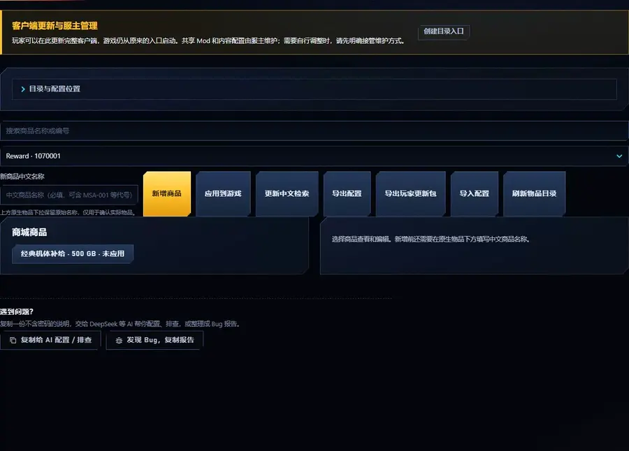

# Shop catalog manager

[简体中文（完整说明）](shop-catalog.zh-CN.md)

Owners manage their own native shop offers in the **商城商品** (shop) panel of SDGO Mod Manager:
add, search, edit, list/unlist, retire and restore. Players keep buying in the native in-game shop.
Chinese option names and rental labels come from the separate [shop labels fix](shop-labels.md).

Set the existing shop workspace, the `WorldServer` folder and optionally a local client folder (for
display labels). Pick a native item and click **新增商品** (add); edit name, option label, price, GB/MB
currency, quantity or rental days and listing, then **保存商品** (save). Changes are drafts until
**应用到游戏** (apply to game). Retired offers keep their IDs and purchase history. JSON import/export
contains no credentials or local paths.

After a successful apply, the selected client receives acquisition data for actually visible unit and blueprint offers, distinguishing purchases from rentals and removing unlisted sources. Distribute that data with the client update; players with [unit acquisition sources](acquisition-sources.md) enabled can see it in the encyclopedia. This integration is optional and does not affect shop purchases when the acquisition Mod is absent.

## Example: sell an already registered Training Unit

For target-resolved examples, use [four item classes and five authoring templates](../examples/shop/README.md):
permanent/rental units, operators, blueprints and consumables. Recipes carry no server data. Generation inherits
visible target terms, preserves existing offers and leaves every example disabled. Draft import, explicit listing
and player display installation are separate operations.

Assume the fictional unit and its permanent item category are already applied to the same database, with matching
client models/icons. Refresh the item catalog, select that category, create “训练机使用权” with label “永久”,
price `1000 GB`, `validity=1`, and save it unlisted. Manager allocates the product ID, SKU and native template.
A unit ID is not an item-category ID, and another workspace's product identity must not be copied.

Export JSON, change this product's `price` to `1200`, and reimport in the same workspace while retaining
`catalog_id`, `key`, `product_id`, `item_id`, `template_id` and `category_id`. Review the draft, explicitly list it
and apply. Distribute client display resources separately. JSON import neither grants a unit nor installs its model.

This is same-catalog configuration exchange, not a universal product installer. Another `catalog_id` or missing
target item/template is refused: create a matching offer in that target instead of deleting identity fields or
overwriting ledgers. Missing old offers in a complete JSON import are retired with their IDs preserved; do not
reduce an export to only the product being edited. Imported operators likewise need their category applied before
an unlisted shop draft can be created. Registered imported units/operators/blueprints use existing native single-item
templates; shop configuration does not create new game resources or multi-item bundles.

## Application and limits

A listing claim needs product/subitem readback and the matching native client's real list and purchase preview.
Configuration validation, SQL or image-preview success alone does not prove that chain. GameTest's
`pages.shop.catalog` stock scope opens/cancels buy/gift previews and compares wallets/inventory; it does not
purchase or deliver. See [the native testing guide](game-test.md) and do not describe a read-only preview as a
completed purchase test.

The WorldServer module (`548A86E3-0010C000`) starts disabled until configured and is installed once with
the standalone `Install.ps1`. It updates only its own single-item offers in a transaction and keeps native
listing, billing and delivery; accounts, balances, inventory and history are untouched. Prices must be
positive; GB is native currency 1 (GP), MB native currency 2 (GC). Only the Manager publishes the
configuration; the WorldServer component applies nothing at startup.

The apply tool preserves native computed columns and their UDFs. It writes the
underlying subitems and checks the effective parent quantity, validity, price
and currency in the same transaction, without changing the database layout.

New product names and sale-option labels require Chinese text. Existing owner data remains intact;
fill missing names before editing or publishing. The separate [shop localization Mod](shop-localization.md)
provides translated descriptions and shared preview names. Its **Update Chinese search** action refreshes
only the guarded search procedure and aliases; it does not apply catalog drafts or prices.
