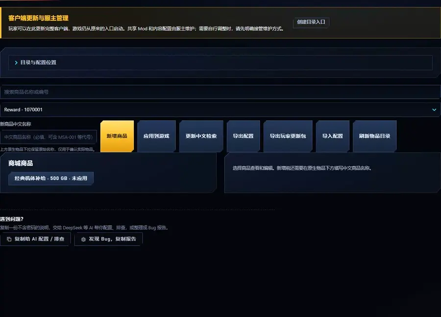
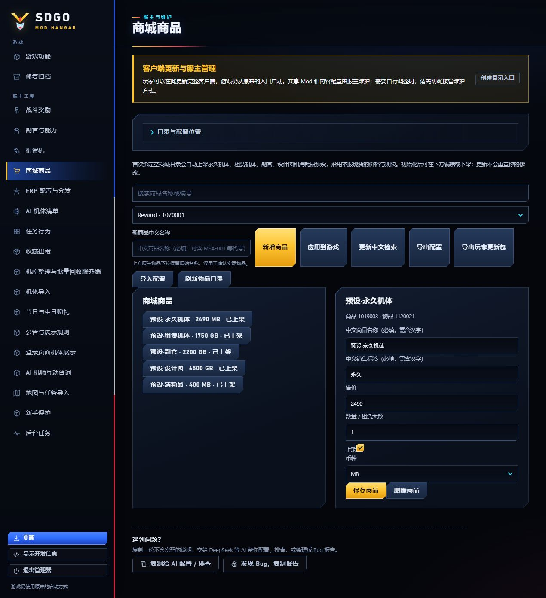
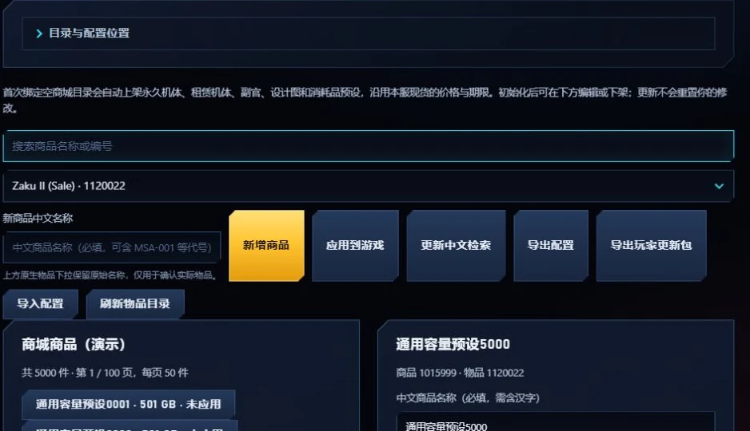

# 商城商品管理

[English](shop-catalog.md)

内置五个可编辑商品预设；首次绑定空工作区后自动上架，日后可改价、下架或新增商品。



服主在 SDGO Mod Manager 的「商城商品」面板中新增、查询、编辑、上架、下架和删除自己管理的商品。
玩家继续在游戏内原商城购买，不需要安装管理工具。商城中文选项与租赁标签由独立的[显示修复](shop-labels.zh-CN.md)负责。

## 安装后的默认预设



服务器组件安装好后，首次在 Manager 保存一个空商城工作区与 WorldServer 目录时，
会自动创建并上架五个预设：永久机体、租赁机体、副官、设计图、消耗品。
无需另外导入样例文件。预设从目标服已有的可见单物品商品选择来源，沿用实际价格、GB/MB 与期限或数量，
保留该现货自身的原生模板与购买／赠送条件，自动分配自己的商品编号；不修改来源商品，也不包含任何服主的私有素材或物品编号。
某类没有有效现货时，初始化会提示缺项，整组不写入商品数据库，不猜售价或补免费商品。

| 内置商品名称 | 从目标服选择的来源 |
| --- | --- |
| 预设·永久机体 | 已在售的永久机体，沿用售价、币种与永久有效期 |
| 预设·租赁机体 | 已在售的租赁机体，沿用售价、币种与租赁天数 |
| 预设·副官 | 已在售的副官，沿用售价、币种与数量／有效期 |
| 预设·设计图 | 已在售的设计图，沿用售价、币种与数量／有效期 |
| 预设·消耗品 | 已在售的其他道具，沿用售价、币种与数量／有效期 |

模组自带的是这五种选择规则和自动初始化功能；具体物品与价格由各服现货决定，
不是固定发行的五件素材，也不要求取得其他服主的自定义内容。

这些预设就是普通的可编辑商品：在本面板修改名称、价格、期限、上架状态，保存后应用即可。
玩家仍走原生购买流程；代币等其他道具可能还有一层“增加数量／时效延长”的确认，确认后才提交购买。
初始化版本随目录保存；升级、再次绑定或重新导入同目录配置会保留编辑、下架和删除结果。
已有商品的工作区保留原样，避免自动应用尚未发布的作者草稿。
初始化应用失败时保留已分配编号的草稿与记录，检查后使用现有“应用到游戏”继续，不自动重试购买或重建商品。
配置了客户端目录时，初始化同时更新它的显示标签与获得方式数据，按正常服主更新流程分发。

### 照着预设新增或编辑商品

1. 安装商城服务端组件，在 Manager「商城商品」中填写空商城工作区、`WorldServer` 目录，点击「保存位置设置」。
   数据库连接读取自己的 `WorldServer.ini`；成功后列表出现上述五个预设并显示已上架。
   若填写客户端目录，该客户端须已安装商城显示标签与商城汉化 Mod。
2. 选择任一预设，查看它的实际物品、价格、币种和数量／期限。要调整这件商品，直接修改并点击「保存商品」，再点「应用到游戏」。
3. 要卖另一件物品，在原生物品下拉框选择已登记的目标物品，填写中文商品名称，点击「新增商品」。
   按同类预设填写销售选项，检查价格、币种、期限和上架状态，保存后应用；编号由工具分配。
4. 将匹配的显示资源随服主提供的客户端包或更新分发。玩家更新并重新启动客户端后，打开原生商城即可查看并按设定购买。

上述步骤直接使用内置预设，不需要运行脚本或导入示例 ZIP。已有商品的工作区不会额外补上五个预设，
可直接按第 3 步新增商品；某类缺少现货来源时，先检查该服的物品登记和原生单物品模板。

`shop_catalog` 安装在 WorldServer（timestamp `548A86E3`、SizeOfImage `0010C000`），属于“联机与服主工具”分类，
只在 Full 包或显式选择商城功能时包含，未配置时默认关闭。`shop_labels` 属于基础修复，随 Base / Full 安装。

## 首次安装服务器组件

使用独立商城服务端安装包时，关闭目标 WorldServer，在解压包根目录运行安装器。
以下使用包内自带的空商品表示例，不需要先手写 `catalog.ini`：

```powershell
powershell -NoProfile -ExecutionPolicy Bypass -File .\Install.ps1 -Target "D:\Server\WorldServer" -ConfigFile .\payload\shop_catalog\catalog.example.ini
```

安装器把它写为目标的 `catalog.ini`，随后由 Manager 首次绑定生成默认预设。希望 WorldServer 继续运行时可加 `-DeferActivation`：
只添加尚不存在的 catalog 目录，不更新运行中的模块，DLL 在下次正常重启时加载，商品配置可以立即应用。

## 日常管理

列表每页显示 50 件商品，搜索覆盖整个工作区，选中的商品继续在右侧编辑。

1. 在「商城商品」面板设置现有商城配置目录、`WorldServer` 目录，以及可选的本机客户端目录（用于更新显示标签）。
   数据库连接沿用服主自己的宿主 INI，不在界面填写密码。
2. 在下拉框中选择原生物品，点击「新增商品」；商品编号自动分配。
3. 选中商品后设置商品名称、选项标签、售价、币种（GB / MB）、数量或租赁天数和是否上架，点击「保存商品」。
4. 新增、编辑、上架/下架和删除都先保存为草稿；点击「应用到游戏」并确认后才写入服务器，之后重新打开游戏商城查看。
5. 删除保留商品编号、购买历史和玩家已买物品；「恢复商品」可把删除的商品恢复后再编辑。

「导出配置 / 导入配置」处理可分发的商品 JSON，不含 IP、数据库密码或本机目录。导入同一 catalog 的配置时，
遗漏的旧商品转为已删除并保留编号；导入不能改写已有商品的身份。应用成功后生成的 UTF-16LE 显示标签会写入所选客户端，
随服主的客户端包或更新分发给玩家；未应用的草稿不会混入标签。商品配置只由 Manager 发布，WorldServer 启动时不会自动应用。

应用成功后，也会把实际可见的商城机体和设计图商品写入所选客户端的获得方式数据，区分购买与租用；下架后移除相应来源。将这些数据随客户端更新分发，启用[机体获得方式](acquisition-sources.zh-CN.md)的玩家即可在机体一览查看。该联动可选，未安装获得方式 Mod 不影响商城购买。

## 大目录与编号容量



商品配置和生成的显示配置分别按 **32 MiB 文件预算**校验、按实际条目分配内存，不共用一个 256 件配额。
玩家仍使用原商城分页、购买和赠送，不需要增加机库槽位。

新增时优先使用原有管理编号区；该区已满，继续查找同一原生商城页的空闲商品号、同一物品前缀的空闲 SKU。
原生、隐藏、已删除以及其他目录拥有的编号均保留。选择客户端目录后，也会预留该客户端中存在、但服务器当前未销售的原生商品号。
不要通过删账本、改商品身份或覆盖原生条目腾出位置。

客户端显示记录与其他原生表共享编号。注册前检查整批所需空位，跳过其他表已占用的记录，只创建本次需要的条目。
空间用尽时拒绝本次注册，不覆盖其他表或扩大到未知区域。商品页或 SKU 前缀用满时，只拒绝该编号域的新增；
其他页和前缀仍可使用。编号空间有限，文件预算不代表无限商品。

扩展目录需要配套 Manager、服务端 `shop_catalog` **0.4.0+**、客户端 `shop_localization` **0.4.0+** 和 `shop_labels` **0.2.0+**。
Manager 在应用扩展目录前检查所选组件，导出玩家更新时也检查客户端程序。未指定客户端时，只应用服务器；
玩家仍须取得服主提供的匹配客户端包或更新。预算、兼容性或编号冲突使应用失败时，整个商品事务回滚，其他已应用商品保留。

## 销售一台已登记的训练机

下例直接使用 Manager。开发者如需生成可交换的 JSON 草稿，另有可选的[四类物品、五份作者模板](../examples/shop/README.zh-CN.md)。
该工具生成的草稿默认未上架，与首次绑定自动上架的内置预设分别使用；普通安装无需执行它。

假设作者已经把虚构“训练测试机”及永久物品类别应用到同一数据库，客户端也有它的模型和图标。
在商城点“刷新物品目录”，从实际列表选择该类别，新建商品“训练机使用权”，标签“永久”，
设置 `1000 GB`、永久机体 `validity=1`，先保持未上架并保存。商品编号、SKU 与原生模板由工具分配，
不要把机体 ID 填成 `category_id`，也不要复制其他工作区的商品身份。

导出 JSON 后，可在本工作区将这件商品的 `price` 改为 `1200` 再导入，保留 `catalog_id`、`key`、
`product_id`、`item_id`、`template_id` 和 `category_id`。先确认仍是草稿，再上架并“应用到游戏”。
客户端显示资源另随服主更新分发。导入 JSON 不发货、不发机体，也不会将新模型导入游戏。

此 JSON 是同一商城身份下的配置交换，不是任意服务器的通用商品安装包。
目标工作区 `catalog_id` 不同、物品类别或模板不存在时，导入会拒绝；应在目标目录创建对应商品，
而不是删除身份字段、改账本或强行覆盖。完整 JSON 导入中遗漏的旧商品会下架并保留身份，
因此不要只留下准备修改的那一件商品。已导入的副官也先应用副官类别，再从商城创建未上架草稿。

## 规则与限制

“上架成功”至少要有服务端商品及子项读回，随后在匹配客户端实际看到列表和购买预览。
配置校验、数据库事务或图片预览通过不能单独证明这条原生链路。GameTest 的
`pages.shop.catalog` 现货场景打开原生购买／赠送预览后取消，并比较钱包和机库，**不购买、不发货**。
单独的 `OwnerPurchaseAssertions` 使用 `pages.shop.purchase` 执行一次原生确认，要求真实请求、原始回包处理完成与精确扣款；
库存到账仍须独立核对数据库前后差异，并用新登录确认持久化，不能只凭 ACK 或钱包宣称完整购买通过。
具体参数见[页面与商城检查](game-test.zh-CN.md)。不要把这类只读结果写成“完整购买已通过”。

- 普通商城币种编码为 **GB = 原生 1 / GP，MB = 原生 2 / GC**。售价必须为正整数（原生购买窗口会跳过零价选项）。
- 永久机体 validity=1；租赁为实际天数；其他物品遵循原生数量/有效期。机体必须可出击。
- 支持目标目录已登记且有原生单物品模板的类别，包括正确导入的机体、副官和设计图；
  不包含多物品礼包，也不能凭商城配置创造新机体资源。
- 商品发布只管理自己拥有的原生商品行，事务应用，不替换原生购买/发货过程，不修改账号、余额、仓库和历史。
  新增 SKU 使用现有单物品模板并保留稳定 option ID，未知或已占用的编号拒绝覆盖，失败回滚。
- 外部工具修改了配置后，Manager 会拒绝覆盖。

应用工具读取原生商城列的实际属性。数量、期限、价格或币种是计算列时，只写入其来源子项，
保留原生 UDF 与计算表达式，并在同一事务内核对最终商品值；失败不会以修改数据库架构的方式绕过。

## 卸载

在面板下架商品并应用，可只停止销售而保留模块。彻底卸载须先关闭目标 WorldServer：

```powershell
powershell -NoProfile -ExecutionPolicy Bypass -File .\Install.ps1 -Target "D:\Server\WorldServer" -Uninstall
```

卸载先下架本 catalog 的商品，再备份移出 Mod；数据库不可连接时保留模块供恢复。共享框架和其他模块保留。

## 中文名称与说明

新增商品必须填写中文名称，销售选项也必须有中文。旧配置缺中文时先补齐再修改或发布；已有数据不会被重置。
客户端的商品、说明与机体预览汉化由独立的 [商城汉化 Mod](shop-localization.zh-CN.md) 提供，配套内容随客户端更新分发。
「更新中文检索」单独更新受保护的检索过程和别名，不发布商品草稿或价格。

## 开发者说明

JSON 继续使用 `schema_version=1`，原生配置继续使用 `Schema=1`。商品号、六位 SKU 和账本选项号保持稳定，
下架遗漏条目只作用于当前 `catalog_id`。输入行使用目标库排序规则写入临时表，再复用受归属保护的事务写入，避免展开重复 SQL 和巨型 `NOT IN` 表达式。

商品号使用模板所在页的合法偏移 `1..9999`；SKU 保留模板前缀，使用五位非零后缀。
类型 `0x23` 显示记录仅在已支持的 `210001..260000` 区间查找全局空位，排除其他类型的占用。
原生列表响应仍是每页 8 件商品、24 个选项，不改变封包、计费和发货。
代码中的旧版 256 件兼容门禁、GameTest 单批断言的条数限制，均不是配套运行时的商品总数上限。
