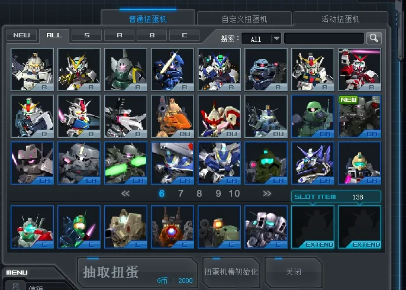

# Chinese native interface text

[简体中文](ui-localization.zh-CN.md) · [Back to the feature index](../README.md)

Displays reviewed Thai buttons and explanations, plus selected longer English system messages from the supported original client, in Chinese. This includes the draw, initialize, close and auto-start buttons in the native custom capsule configuration window. Those controls belong to the original client layout.

## Use

Players receive `ui_localization` through the server owner's client package or update. Enable **原生界面中文汉化** in SDGO Mod Manager and restart the game. Disabling it also requires a restart.

The native font, colors, positions and interactions are retained. The Mod replaces no images and edits no original resource archives. Simple English such as `EXIT`, `SEARCH` and `ALL`, model codes and decorative text remain unchanged. Unreviewed or unlisted text retains its source wording.

Unit names and shop descriptions use [shop localization](shop-localization.md). Authors supply custom unit, weapon and skill names and descriptions through their content packages, distributed with the custom units. Public localization Mods contain no dedicated translations for that content. Records and exact text claimed by a loaded content package bypass the stock dictionary; unresolved content ownership also preserves the source.

## Scope

Static phrases require an exact match at a verified layout-loading caller. System messages additionally require a matching record ID and source. Player names, chat, room titles and dynamic input do not pass through this static replacement. Unsupported client signatures refuse to load.

The current dictionary contains 187 static interface phrases and 43 system messages. Dictionary coverage does not imply that every legacy layout is used by the current game. Image buttons without confirmed use are left intact.

Manager exposes caller tracing as a developer diagnostic setting. It is off by default and unnecessary for normal use.
