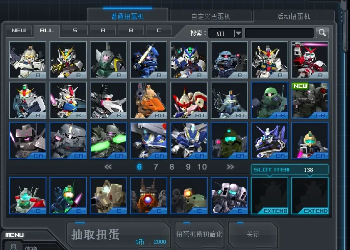

# 原生界面中文汉化

[English](ui-localization.md) · [返回功能目录](../README.zh-CN.md)

将受支持原客户端中的泰文／韩文按钮、活动获得说明和部分较长的英文系统提示显示为中文，包括自定义扭蛋机配置窗里的「抽取扭蛋」「扭蛋机初始化」「关闭」「自动开始」，以及整备室终极强化页面的「重置」。这些按钮来自原客户端布局。

## 使用

玩家通过服主提供的客户端包或更新取得 `ui_localization`。在 SDGO Mod Manager 中启用「原生界面中文汉化」后重启游戏；停用后同样需要重启。

保留原有字体、颜色、按钮位置和交互，不替换图片或修改原版资源归档。`EXIT`、`SEARCH`、`ALL` 等简单英语、型号代码和装饰文字保持原样。未审定或未收录的文字也保留原文。

机体名、商城说明由[商城汉化](shop-localization.zh-CN.md)负责。自定义机体、武器、技能的名称和说明由内容作者写入内容包，随自定义机体内容分发；公共汉化 Mod 不内置这些内容的专用翻译。已加载内容包拥有的记录或同文词条会跳过原版词典；内容归属暂时不能确认时也保留原文。

## 范围

只在已核对的静态布局入口替换完全匹配的短语；系统提示还要求记录编号和原文同时匹配。活动获得说明要求原版条目编号、机体编号和原文同时匹配，仅向原生显示调用返回文字副本。日期及历史活动含义保留，内容作者追加的获得说明保留原文。玩家姓名、聊天、房名和动态输入不经过静态布局替换。客户端签名不兼容时拒绝加载。

当前词表覆盖 201 条静态界面短语、43 条系统提示和 148 条原版活动获得说明。词表覆盖不代表所有旧布局都在当前玩法中使用；未确认使用的图片按钮不做涂改。

Manager 中的调用位置跟踪是开发者诊断开关，默认关闭，正常使用无需开启。
