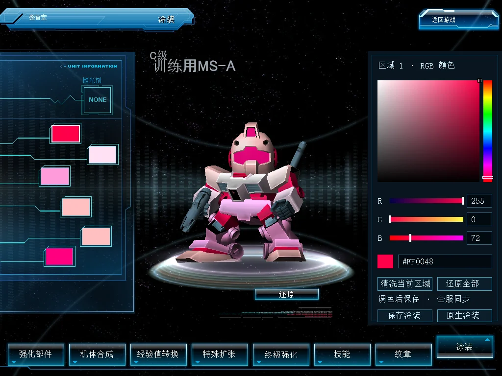
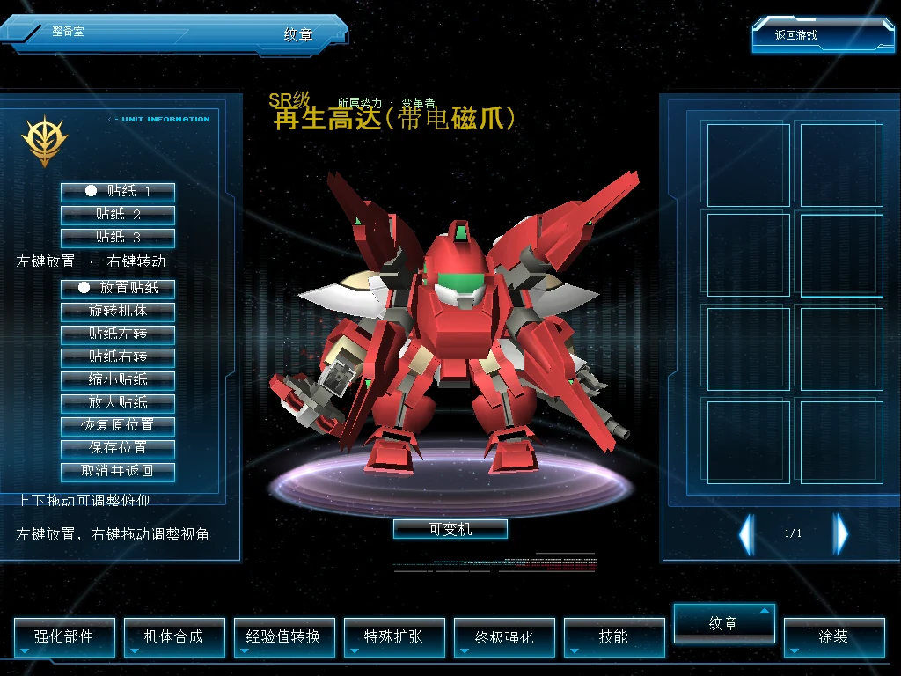

# Unit appearance (Beta)

[简体中文](unit-appearance.zh-CN.md) · [Feature index](../README.md)

**SDGO Mod Manager → 机体外观** (Unit appearance) provides independent RGB paint and free surface sticker switches. Editing stays in the native paint and emblem pages. Colors and placements belong to each owned unit and are shared with viewers using the companion module.

## Installation and settings

Select the Beta channel in Manager, install the client and World components and their communication dependencies, and enable Unit appearance. Select RGB paint and/or free stickers, save, and restart the corresponding programs when prompted. Communication uses the friend-unit-gift carrier; gifting itself can remain disabled.

Imports and updates through the companion Manager migrate the old RGB/sticker enablement to the corresponding switches and archive the old programs outside loading directories. Existing colors, placements and revisions retain their original records. Disabling a component stops its editing and display without deleting data; enabling it restores the saved appearance. Enable the corresponding component on both client and World to edit and save.

Do not manually install the legacy DLLs alongside this module. Explicit conflicts prevent duplicate loading. Viewers with RGB disabled see native palette colors; viewers with free stickers disabled see native fixed sticker positions.

## RGB paint

1. Open the native paint page, wait for server colors, and select a region swatch on the left.
2. Drag the hue strip, color square or R/G/B sliders. Channels range from 0 to 255; numeric fields apply with Enter, and the hex field accepts six digits such as `#FF0048`. Invalid input preserves the color; Esc cancels input.
3. “清洗当前区域” restores the selected region's original material; “还原全部” restores the last confirmed palette.
4. Select “保存涂装”, review, and confirm again. Success requires the server acknowledgement. Leaving discards unsaved edits; an uncertain save triggers a fresh read without automatically overwriting data.

“原生涂装” returns to native palette controls. Changing stock paint invalidates the previous RGB configuration for that unit. Colors apply in the lobby, room, battle and transformed models of the same unit. Separate instances of the same model keep separate records. Native transparency, cloaking, textures and gloss remain controlled by the original materials.

RGB mode owns clicks and drags on its controls and suspends mouse handling in the covered inventory, preventing accidental item drags. Gestures retain their release event outside the controls. Native inventory input resumes after switching to native paint and releasing the mouse. The preview area remains interactive. Client 0.1.1 is compatible with World 0.1.0.

## Free surface stickers

1. Equip stickers and finish the native save in the emblem page, then open “自由贴花位置”.
2. Select a slot and “放置贴纸”, then click or drag with the left button. Right-button dragging rotates horizontally and tilts vertically; “旋转机体” also supports left-button rotation.
3. Adjust sticker rotation and size. “恢复原位置” restores the selected slot's native fixed position.
4. Select “保存位置”, review, then “确认保存位置” and wait for the server acknowledgement. “取消并返回” discards unsaved edits.

Stickers attach to the selected model part. Moving joints require separate placement on each part. Replacing a stock sticker invalidates that slot's previous anchor. Incompatible model forms or geometry fall back to native placement. Cloaking, transparency, fading and other special rendering passes retain native sticker handling.

## Troubleshooting and AI handoff

Check both hosts' component switches, communication dependencies, host compatibility and restart prompts in Manager. For loading waits, inspect the room's BattleServer and [multiplayer loading synchronization](loading-sync-fix.md).

Use the feature's Copy for AI or bug-report entry. Include client/World versions, the affected page, reproduction steps and messages. State whether both components are enabled, whether the issue occurs only in rooms, and whether stickers or forms changed. Hide account details in screenshots; exclude credentials, databases and complete game assets.

## Developer notes

`unit_appearance_client` keeps RGB material and sticker projection components separate internally and installs hooks only for enabled components. `unit_appearance_server` prepares all enabled components before one authenticated extension registration, then dispatches the original commands according to their switches. Unassigned commands inside the combined range return an invalid-argument result. The existing `dbo.sdgo_mod_rgb_paint` and `dbo.sdgo_mod_surface_decal` tables, wire formats, saved bytes and revision checks remain intact. Native records remain authoritative for ownership, stock colors and equipped stickers.

Rooms bind complete unit identities through actual player slots, allowing fewer player slots than visual-pool entries, and apply appearance after asynchronous loading. RGB retains dormant transformed-model identities. Sticker anchors record part, geometry, triangle and barycentric coordinates; identity is never guessed from model type or sticker matches. Native controls are resolved only after page activation and dialog visibility.

Manager's `consolidates` contract maps legacy modules to registered boolean switches and requires explicit conflicts. Imports, programme updates and profile installs reuse their transactions and backups; reinstalling preserves the unified module's choices. Unshipped native probes check exact unit identity, server records, current-scene six-region materials and sustained sticker drawing. Captured frames still require inspection for occlusion and actual placement.
