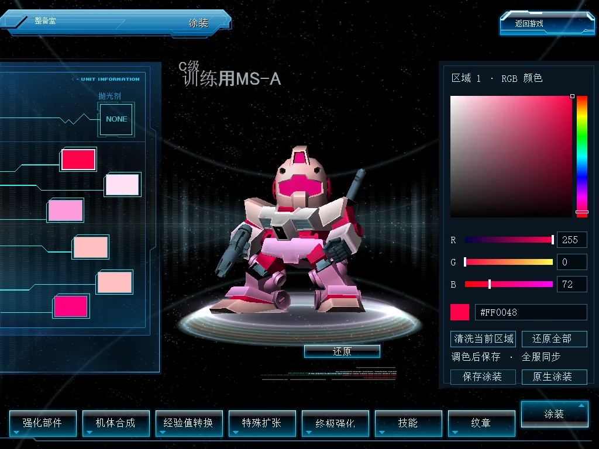
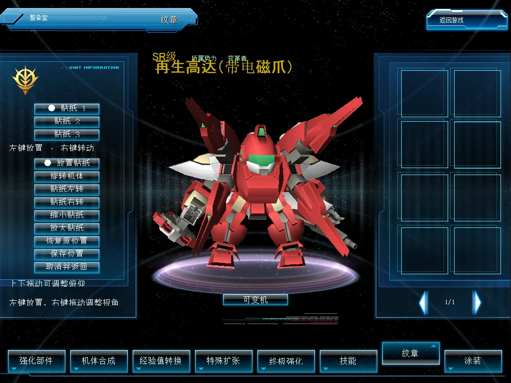

# Unit appearance

[简体中文](unit-appearance.zh-CN.md) · [Feature index](../README.md)

**SDGO Mod Manager → 机体外观** (Unit appearance) provides independent RGB paint and free surface sticker switches. Editing stays in the native paint and emblem pages. Colors and placements belong to each owned unit and are shared with viewers using the companion module.

Thanks to [Bilibili user (UID 6664566)](https://space.bilibili.com/6664566) for inspiring the custom unit appearance feature.

## Installation and settings

In Manager, install the client and World components and their communication dependencies, and enable Unit appearance. Select RGB paint and/or free stickers, save, and restart the corresponding programs when prompted. Communication uses the friend-unit-gift carrier; gifting itself can remain disabled.

Imports and updates through the companion Manager migrate the old RGB/sticker enablement to the corresponding switches and archive the old programs outside loading directories. Existing colors, placements and revisions retain their original records. Disabling a component stops its editing and display without deleting data; enabling it restores the saved appearance. Enable the corresponding component on both client and World to edit and save.

Do not manually install the legacy DLLs alongside this module. Explicit conflicts prevent duplicate loading. Viewers with RGB disabled see native palette colors; viewers with free stickers disabled see native fixed sticker positions.

## RGB paint

1. Select Paint in the factory to open the native palette. Click “RGB 取色” to enter RGB editing, wait for server colors, and select a region swatch on the left.
2. Drag the hue strip, color square or R/G/B sliders. Channels range from 0 to 255; numeric fields apply with Enter, and the hex field accepts six digits such as `#FF0048`. Invalid input preserves the color; Esc cancels input.
3. “清洗当前区域” restores the selected region's original material; “还原全部” restores the last confirmed palette.
4. Select “保存涂装”, review, and confirm again. Success requires the server acknowledgement. Leaving discards unsaved edits; an uncertain save triggers a fresh read without automatically overwriting data.

The RGB entry sits below the right inventory, with space around the pagination frame, and moves with the panel during page transitions. “原生涂装” returns to native palette controls. Reopening the paint page defaults to the native palette again; server color updates preserve the selected mode. Changing stock paint invalidates the previous RGB configuration for that unit. Colors apply in the lobby, room, battle and transformed models of the same unit. Separate instances of the same model keep separate records. Native transparency, cloaking, textures and gloss remain controlled by the original materials.

RGB mode owns clicks and drags on its controls and suspends mouse handling in the covered inventory, preventing accidental item drags. Gestures retain their release event outside the controls. Native inventory input resumes after switching to native paint and releasing the mouse. The preview area remains interactive. This input isolation coexists with OC.

## Free surface stickers

1. Open “编辑自由贴花” on the native emblem page. Layers, Properties and the owned-sticker library share one panel; the model preview remains interactive.
2. Select an eligible owned sticker and click the model to place it. Up to 20 independent layers are supported, separately from the three native equipment slots. Existing saved native-slot placements migrate to linked layers.
3. Scroll, page or drag the layer list, or use Top / Up / Down / Bottom. Higher rows cover lower ones. Duplicate creates a new layer; Delete changes the draft. Individual visibility and the native-slot display can be toggled.
4. Properties adjusts rotation, size, local scratched wear and scratch seed. Corner wrapping follows touching fixed armor surfaces, including separate parts with an unambiguous seam. Returning wear to 0% restores the original ink without changing its asset. Left-click places; right-drag rotates and tilts. Orbit mode also supports left-drag.
5. Request a save quote, review each sticker's required quantity and current stock, then confirm. Returning to editing costs nothing. Only the server acknowledgement completes the save. Cancel or leaving discards the draft.

In **Manager → Unit appearance (World)**, operators configure consumption and a 1–20 layer limit. By default, adding, duplicating or replacing a sticker costs one item per new layer. Transform, order, visibility and wear edits are free. Reusable mode still requires ownership, native equipment or a server unlock, plus native eligibility. Restart World after changing policy. Lower limits retain existing layers while preventing further increases above the limit.

Inventory deduction, design revision and the durable confirmation receipt commit together. Replaying the same confirmation token cannot charge twice. After interrupted communication, resolve that request before treating a draft as saved. Both appearance components require 0.2.0 or later; communication dependencies are `friend_unit_gift_client` 0.1.11 and `friend_unit_gift_server` 0.1.4 or later. Viewers also need the enabled companion; old clients display only the native three slots.

Wrapping starts at the hit surface and crosses only touching armor seams with a verified fixed relationship. Moving joints, air gaps and ambiguous seams use separate placements; duplicate a layer to decorate both sides. Native item replacements update linked layers and preserve independent layers. An incompatible form never borrows another geometry's anchor. Reflective armor is supported. Each projected material group follows its actual native opacity, including friendly-character fades and cloaking; hidden parts, zero opacity and special blend/depth passes remain hidden.

Owners can add images through [Custom sticker import](sticker-import.md). The imported first-placement size applies when creating a new layer; saved placements keep their edited size. The owner's matching client content provides the image to other viewers.

At game exit, process termination reclaims the sticker and wear-texture caches without calling graphics cleanup after driver worker threads have stopped. Cache eviction and explicit cleanup during normal operation still release textures.

## Troubleshooting and AI handoff

Placement mode uses left clicks or drags for positioning and the right button for orbiting. Orbit mode restores left-button rotation. This input ownership is maintained during model loading and native preview replacement. Failed placement distinguishes an unready model, a click outside the model viewport and a missed surface; the preview/save prompt means the draft accepted the position.

An empty layer list disables duplication, deletion, ordering and saving; Properties, Library, Add and Cancel remain clickable. If the editor opens but all of those buttons are unresponsive, update the unit appearance client and restart the game.

Check both hosts' component switches, communication dependencies, host compatibility and restart prompts in Manager. For loading waits, inspect the room's BattleServer and [multiplayer loading synchronization](loading-sync-fix.md).

Use the feature's Copy for AI or bug-report entry. Include client/World versions, the affected page, reproduction steps and messages. State whether both components are enabled, whether the issue occurs only in rooms, and whether stickers or forms changed. Hide account details in screenshots; exclude credentials, databases and complete game assets.

## Developer notes

Sticker-texture and wear-mask destructors check Windows `RtlDllShutdownInProgress`, resolved during module initialization. Process termination skips native texture destruction and D3D `Release`; ordinary object destruction and dynamic unload retain their cleanup paths. If the query is unavailable, destructors conservatively leave reclamation to process termination while explicit runtime cleanup remains available.

`unit_appearance_client` keeps RGB material and sticker projection components separate internally and installs hooks only for enabled components. `unit_appearance_server` prepares all enabled components before one authenticated extension registration, then dispatches the original commands according to their switches. Unassigned commands inside the combined range return an invalid-argument result. Existing RGB and legacy decal records and commands remain compatible. Additional tables store independent designs, sticker unlocks and idempotent commit receipts. Native records remain authoritative for ownership, stock colors and equipped stickers.

Rooms bind complete unit identities through actual player slots, allowing fewer player slots than visual-pool entries, and apply appearance after asynchronous loading. RGB retains dormant transformed-model identities. Sticker anchors record part, geometry, triangle and barycentric coordinates; identity is never guessed from model type or sticker matches. Native controls are resolved only after page activation and dialog visibility.

Cutscene RGB identity observation runs at the complete join of the optional alternate-model branch. Units without an alternate model retain the original actor return path. When the alternate model was styled, the observer recovers its verified actor, frame and palette context after native argument cleanup. A hook's overwritten instructions must not contain an interior entry from another native branch.

Battle sticker visibility checks the material groups covered by the projected triangles and follows each group's native opacity. The native cubemap flag denotes reflection; hidden parts and special blend/depth passes do not receive projections. Both native-sticker suppression and projected drawing use the same eligibility check. RGB inventory input intercepts the verified virtual update slot and forwards to the native update body, preserving OC's observer on that body.

Manager's `consolidates` contract maps legacy modules to registered boolean switches and requires explicit conflicts. Imports, programme updates and profile installs reuse their transactions and backups; reinstalling preserves the unified module's choices. Development-only native observers check exact unit identity, server records, current-scene six-region materials and sustained sticker drawing. Captured frames still require inspection for occlusion and actual placement.

The editor does not load fixed-width native button skins. Custom backgrounds and hit regions share the same layout. Window mouse messages use coordinates scaled to the window and panel position; a button activates only when pressed and released within the same enabled control. Releasing outside, losing focus or leaving the page cancels the click. Layer drags and sliders retain pointer capture; the native entry keeps its own skins and events.

### Independent decal protocol

Cross-part projection derives fixed groups from native parent links, the complete current clip binding and local tracks. One equal pose never establishes fixed ownership. Bone and animated-node boundaries remain separate. Export roundoff uses a fixed absolute tolerance; array and metadata stability still require bitwise checks. Derived vertices return to each part's own local coordinates. Every native draw rechecks ownership and bounds relative pose drift; binding changes, unknown data or excessive drift stop cross-part drawing while retaining the valid primary projection. Derived parts add neither layers nor item charges.

See `include/sdgo/layered_decal.h` and `layered_decal_wire.h` for the model and validation. Each stable layer ID carries a sticker identity, native/independent source, visibility, rigid-part/geometry/triangle anchor, barycentrics, size, rotation, wrapping, wear and seed. Array order is bottom-to-top; an index is never an inventory identity. Reserved native IDs must match actual equipped slots and cannot impersonate free independent layers.

Authenticated commands are `0x1022` GET, `0x1023` QUOTE, `0x1024` COMMIT and `0x1025` paged owned catalogue. Schema 3 uses a 40-byte header and 72 bytes per layer: 1480 bytes for twenty layers, and at most 1768 bytes for a full quote. The native fixed carrier size is unchanged. Canonicalize native float values before quoting; do not truncate or fragment. Quotes bind actor, unit, revision, canonical draft and policy to a short-lived token. Retries reuse that token.

Never index beyond the original three native decal materials. Independent textures use the native resource loader and bounded caches. Real consumer behavior, rendered assets and inventory readback remain separate acceptance requirements; mocked replies and placeholder artwork do not prove them.
