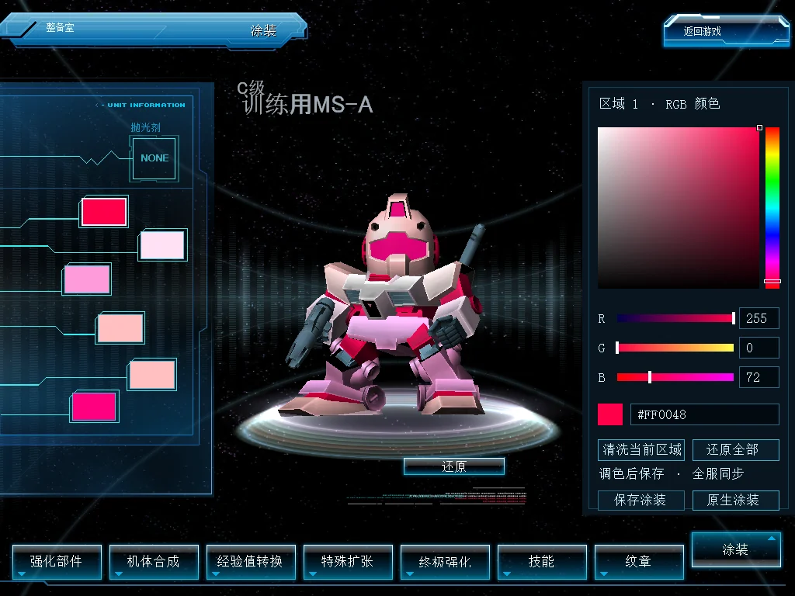
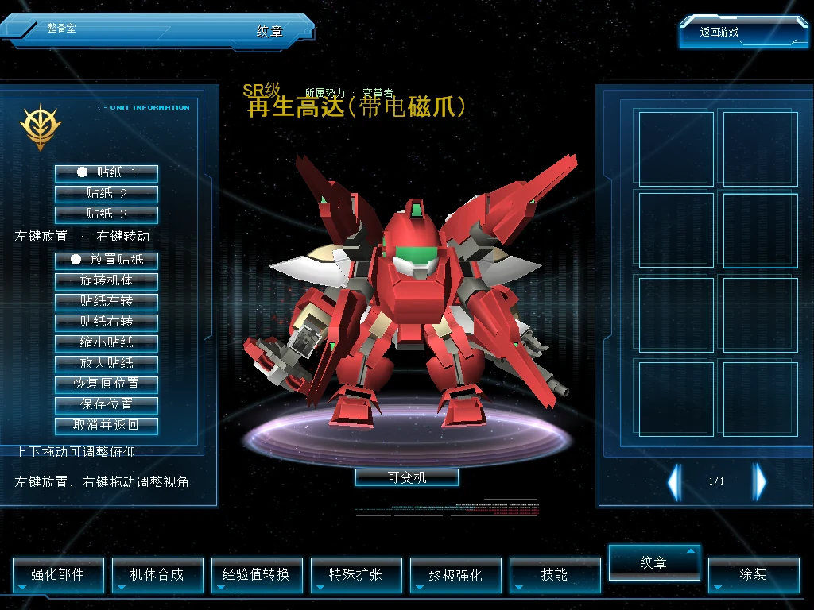

# 机体外观（Beta）

[English](unit-appearance.md) · [返回功能目录](../README.zh-CN.md)

RGB 涂装与自由贴花集中在 **SDGO Mod Manager → 机体外观**，两项功能可以分别开关。游戏内仍使用原生涂装页和纹章页，颜色与位置按具体机体保存，并供其他装有配套模块的玩家查看。

## 安装与设置

在 Manager 选择 Beta 渠道，安装“机体外观”客户端与 World 组件及其通信依赖。开启“启用机体外观”，再分别选择“启用 RGB 涂装”和“启用自由贴花”，保存后按提示重启相应程序。通信组件来自好友机体赠送模块，但不要求开放赠送玩法。

使用配套 Manager 导入或更新时，旧 RGB／自由贴花模块的启用状态会迁入对应开关，旧程序备份后退出加载目录。已有颜色、位置与保存版本继续使用原记录。关闭功能只停止其编辑与显示，不删除记录；重新开启后恢复。客户端与 World 的对应功能都需启用才能编辑保存。

不要同时手工安装旧 DLL。新组件声明与旧组件冲突，避免重复加载。未启用 RGB 的观看方显示原生色卡；未启用自由贴花的观看方显示原生固定位置。

## RGB 涂装

1. 打开机体的原生涂装页，等待服务器颜色读取完成，选择左侧区域色块。
2. 拖动色相条、取色方块或 R、G、B 滑条；数值为 0–255，也可输入数值后按 Enter，或输入六位十六进制颜色，例如 `#FF0048`。无效输入保留原色；Esc 取消输入。
3. “清洗当前区域”恢复该区域原始材质，“还原全部”恢复最近确认的颜色。
4. 点击“保存涂装”，核对预览后再次确认。收到服务器回包后才显示成功。离开页面放弃未保存草稿；保存超时先重新读取，不自动覆盖。

“原生涂装”返回原有色卡和操作。更改原生涂装会使该机体旧 RGB 配置失效，需要重新编辑。颜色用于大厅、房间、战斗及变形后的同一机体；同型号不同机体各自保存。原生透明、隐身、纹理和光泽仍由原材质控制。

RGB 模式会接管控件的点击与拖动，并暂停被遮挡道具栏的鼠标处理，避免拖出底下的道具。拖出控件范围后仍由当前操作接收松开事件；切回“原生涂装”并松开鼠标后恢复道具栏。预览区域仍可操作。客户端 0.1.1 兼容 World 0.1.0。

## 自由贴花

1. 在原生纹章页装好贴纸并完成原生保存，再打开“自由贴花位置”。
2. 选择贴纸槽位，切换“放置贴纸”，左键点击或拖动放置；右键左右拖动旋转机体、上下拖动调整俯仰。“旋转机体”模式也支持左键转动。
3. 用左右转与缩小／放大按钮调整贴纸。“恢复原位置”让当前槽位使用原生固定位置。
4. 点击“保存位置”，核对预览后“确认保存位置”；等待服务器确认。“取消并返回”放弃未保存调整。

贴花附着于命中的部件。活动关节两侧需要分别选位；更换原生贴纸会使该槽旧位置失效。模型形态或几何与锚点不匹配时使用原生位置。隐身、透明、淡入淡出等特殊绘制阶段使用原生贴纸处理。

## 排错与 AI 协助

在 Manager 检查双方的功能开关、通信依赖、宿主匹配及重启提示。卡在开局等待时检查该房间的 BattleServer 与[多人加载同步修复](loading-sync-fix.zh-CN.md)。

使用功能详情的“复制给 AI”或问题反馈，附上客户端／World 版本、出问题的页面、复现步骤及提示文字。指出是否同时启用两项功能、是否只在房间出现、是否更换贴纸或变形。截图隐藏账号信息，不提供密码、数据库或完整游戏资源。

## 开发者说明

`unit_appearance_client` 内部分开管理 RGB 材质与贴花投影，只有开启的组件安装原生钩子。`unit_appearance_server` 先准备所有启用组件，再一次性注册认证扩展范围，按独立开关分派原有命令。两项同开时范围内未分配的命令返回无效参数。数据库仍使用 `dbo.sdgo_mod_rgb_paint` 与 `dbo.sdgo_mod_surface_decal`，保留协议、数据字节和版本校验；机体归属、原生颜色基线与已装贴纸仍以原生记录为准。

房间通过真实玩家槽位绑定完整机体身份，允许玩家槽位少于渲染池容量；异步模型加载后应用外观。RGB 保留备用变形模型身份。贴花记录部件、几何、三角形及重心坐标，不按型号或贴纸猜测身份。原生页面只有激活且对话框可见后才解析编辑控件。

Manager 的 `consolidates` 声明把旧模块映射到已注册的布尔开关，要求显式冲突声明。导入、程序更新和配置档安装复用事务与备份；重复安装保留新模块的选择。未参与运行发布的原生探针检查精确机体、服务器记录、当前场景六区域材质和连续贴花绘制；最终画面仍需核对遮挡与实际位置。
