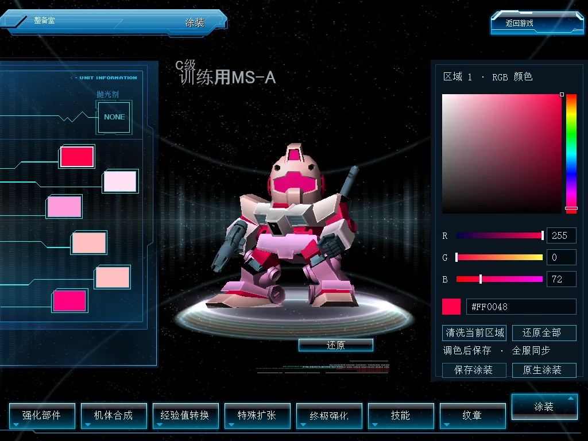
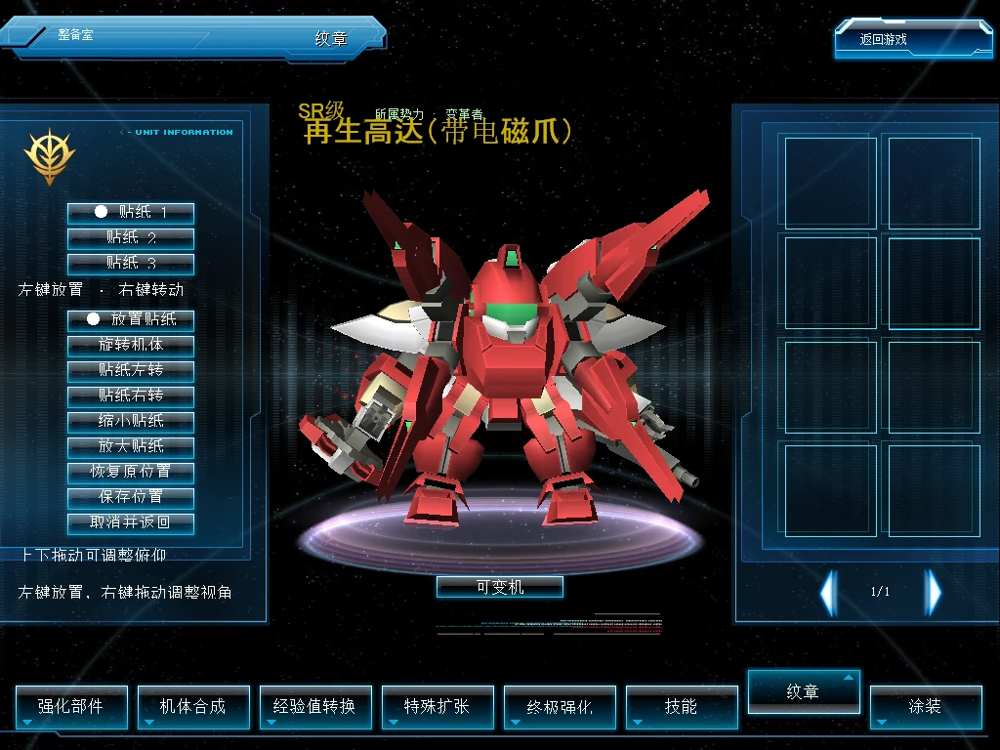

# 机体外观

[English](unit-appearance.md) · [返回功能目录](../README.zh-CN.md)

RGB 涂装与自由贴花集中在 **SDGO Mod Manager → 机体外观**，两项功能可以分别开关。游戏内仍使用原生涂装页和纹章页，颜色与位置按具体机体保存，并供其他装有配套模块的玩家查看。

自定义机体外观的创意参考了 [B 站用户（UID：6664566）](https://space.bilibili.com/6664566) 的思路，感谢启发。

## 安装与设置

在 Manager 安装“机体外观”客户端与 World 组件及其通信依赖。开启“启用机体外观”，再分别选择“启用 RGB 涂装”和“启用自由贴花”，保存后按提示重启相应程序。通信组件来自好友机体赠送模块，但不要求开放赠送玩法。

使用配套 Manager 导入或更新时，旧 RGB／自由贴花模块的启用状态会迁入对应开关，旧程序备份后退出加载目录。已有颜色、位置与保存版本继续使用原记录。关闭功能只停止其编辑与显示，不删除记录；重新开启后恢复。客户端与 World 的对应功能都需启用才能编辑保存。

不要同时手工安装旧 DLL。新组件声明与旧组件冲突，避免重复加载。未启用 RGB 的观看方显示原生色卡；未启用自由贴花的观看方显示原生固定位置。

## RGB 涂装

1. 在整备室点击“涂装”，默认显示原生色卡。点击“RGB 取色”进入 RGB 编辑，等待服务器颜色读取完成，再选择左侧区域色块。
2. 拖动色相条、取色方块或 R、G、B 滑条；数值为 0–255，也可输入数值后按 Enter，或输入六位十六进制颜色，例如 `#FF0048`。无效输入保留原色；Esc 取消输入。
3. “清洗当前区域”恢复该区域原始材质，“还原全部”恢复最近确认的颜色。
4. 点击“保存涂装”，核对预览后再次确认。收到服务器回包后才显示成功。离开页面放弃未保存草稿；保存超时先重新读取，不自动覆盖。

“RGB 取色”位于右侧道具栏下方，与分页边框留有间距；进出页面时，按钮随面板一起移动。“原生涂装”返回原有色卡和操作。离开后再次进入涂装页仍默认显示原生页面；服务器颜色更新不会自动切换模式。更改原生涂装会使该机体旧 RGB 配置失效，需要重新编辑。颜色用于大厅、房间、战斗及变形后的同一机体；同型号不同机体各自保存。原生透明、隐身、纹理和光泽仍由原材质控制。

RGB 模式会接管控件的点击与拖动，并暂停被遮挡道具栏的鼠标处理，避免拖出底下的道具。拖出控件范围后仍由当前操作接收松开事件；切回“原生涂装”并松开鼠标后恢复道具栏。预览区域仍可操作。上述输入隔离支持与 OC 同时使用。

## 自由贴花

1. 在机体的原生纹章页打开“编辑自由贴花”。“图层 / 属性 / 纹章库”在同一面板切换，模型预览保持可操作。
2. 在“纹章库”选择自己拥有且符合机体、等级和阵营限制的纹章，点击机体放置。最多 20 个独立图层，不受原生三个装备槽位限制。原有自由位置自动保留为关联原生槽位的图层。
3. 图层列表显示真实图标，可滚动、翻页、拖动排序，也可“置顶 / 上移 / 下移 / 置底”。上方图层覆盖下方；复制创建新图层，删除只影响草稿。可单独隐藏图层或切换原生三个槽位的显示。
4. “属性”调整旋转、尺寸、磨损与划痕样式。“贴合拐角”沿相接的固定装甲展开，包括接缝明确的不同部件。磨损局部刮掉图案，调回 0% 恢复原图，不修改原素材。左键放置，右键转动、俯仰；“调整视角”允许左键转动。
5. 选择“核对并保存”，服务端列出本次所需的纹章及库存。核对后点击“确认保存”；“返回编辑”不扣费。收到服务端确认才算保存成功。取消或离开页面放弃未保存草稿。

服主在 **Manager → 机体外观（World）** 设置库存规则：默认新增、复制或换用纹章时每层消耗一个；移动、旋转、缩放、排序、显隐和磨损调整不重复消耗。关闭“新增或换用贴花时消耗纹章库存”后仍需拥有、原生装备过或已在本服解锁该款，并满足使用条件。服主可将每台机体上限设为 1–20 层，修改后重启 World。降低上限保留既有图层，但不允许继续超限增加。

保存使用版本校验与同一事务完成库存扣除、外观保存和回执记录；重发同一确认凭据不会重复扣费。通信中断时先确认原请求结果，不把未确认的草稿当作已保存。客户端与 World 均需 0.2.0 或以上，并分别安装通信组件 `friend_unit_gift_client` 0.1.11、`friend_unit_gift_server` 0.1.4 或以上。观看方也需启用配套客户端；旧客户端仅能显示原生三个槽位。

贴花从命中的表面展开，只跨相接且能确认固定关系的装甲缝。活动关节、空气间隙或不明确的接缝分别放置，需要时复制图层装饰两侧。更换原生贴纸仅更新其关联图层，保留独立图层。另一形态的几何不匹配时不套用错误锚点。反射装甲可显示贴花；各材质组跟随原生实际透明度，包括友军淡出与隐身。隐藏部件、零透明度和特殊混合／深度绘制仍保持隐藏。

服主可通过[自定义贴纸导入](sticker-import.zh-CN.md)添加图片。导入时设置的首次放置尺寸用于新图层，已保存的贴花保留编辑后的大小。其他观看方通过服主提供的配套客户端内容取得图片。

退出游戏时，贴花原图和磨损纹理缓存由进程终止机制回收，避免在显卡驱动工作线程已经结束后再次释放资源。运行中的缓存淘汰与显式清理仍正常释放纹理。

## 排错与 AI 协助

放置模式使用左键点击或拖动定位，右键调整视角；切换到“调整视角”后左键恢复转动。模型加载或预览控件重建期间保持这项输入分工。未能放置时，面板区分模型未就绪、视口外点击和未命中表面；“预览中，核对后保存”表示草稿已接受位置。

空白图层列表只会禁用复制、删除、排序及保存；“属性”“纹章库”“添加”和“取消”仍可点击。若入口可打开而这些按钮均无响应，请更新机体外观客户端并重启游戏。

在 Manager 检查双方的功能开关、通信依赖、宿主匹配及重启提示。卡在开局等待时检查该房间的 BattleServer 与[多人加载同步修复](loading-sync-fix.zh-CN.md)。

使用功能详情的“复制给 AI”或问题反馈，附上客户端／World 版本、出问题的页面、复现步骤及提示文字。指出是否同时启用两项功能、是否只在房间出现、是否更换贴纸或变形。截图隐藏账号信息，不提供密码、数据库或完整游戏资源。

## 开发者说明

贴花纹理和磨损遮罩的析构先检查 Windows 的 `RtlDllShutdownInProgress`。查询函数在模块初始化时解析；进程终止时跳过原生纹理销毁和 D3D `Release`，正常对象析构和动态卸载仍走原有清理路径。无法取得查询函数时采用保守的终止回收策略，运行中的显式清理不受影响。

`unit_appearance_client` 内部分开管理 RGB 材质与贴花投影，只有开启的组件安装原生钩子。`unit_appearance_server` 先准备所有启用组件，再一次性注册认证扩展范围，按独立开关分派原有命令。两项同开时范围内未分配的命令返回无效参数。保留 `dbo.sdgo_mod_rgb_paint`、旧 `dbo.sdgo_mod_surface_decal` 记录和兼容命令；新增独立图层、库存解锁及幂等回执表。机体归属、原生颜色基线与已装贴纸仍以原生记录为准。

房间通过真实玩家槽位绑定完整机体身份，允许玩家槽位少于渲染池容量；异步模型加载后应用外观。RGB 保留备用变形模型身份。贴花记录部件、几何、三角形及重心坐标，不按型号或贴纸猜测身份。原生页面只有激活且对话框可见后才解析编辑控件。

过场 RGB 身份观察位于备用模型分支的完整汇合入口。没有备用模型的机体保持原生演员返回路径；完成备用模型涂装后，从已验证的演员、栈帧与色卡上下文恢复身份。挂钩覆盖的指令范围不能包含其他原生分支跳入的中间入口。

对战贴花仅检查投影三角形覆盖的材质组，并跟随各组的原生透明度。原生 cubemap 标记表示反射效果；隐藏部件、特殊混合和深度绘制不参与投影。原生贴纸抑制与投影绘制使用同一项可见性判断。RGB 道具输入通过已验证的虚表更新槽拦截，放行时仍调用原生更新函数，保留 OC 在该函数上的观察钩子。

Manager 的 `consolidates` 声明把旧模块映射到已注册的布尔开关，要求显式冲突声明。导入、程序更新和配置档安装复用事务与备份；重复安装保留新模块的选择。开发验收探针检查精确机体、服务器记录、当前场景六区域材质和连续贴花绘制；最终画面仍需核对遮挡与实际位置。

编辑面板不加载原生固定宽度按钮皮肤，按钮背景和命中区域使用同一布局。窗口鼠标消息按面板位置和窗口尺寸换算坐标；在同一可用按钮内按下并松开才执行操作，移出、失焦或切换页面取消点击。图层拖动和滑条继续捕获鼠标，原生入口保留自己的皮肤与事件。

### 独立贴花协议

跨部件投影从原生父节点、完整的当前动画绑定和局部轨道判定固定组，不能用一帧相同的矩阵推断固定关系。骨骼与活动节点保留各自边界；导出舍入只使用固定绝对容差，数组和元数据稳定性仍逐位核对。邻件投影拆回各部件自己的局部坐标，每次原生绘制重新核对关系，并限制相对姿态漂移。绑定变化、未知数据或超出位移界限时停止跨接，保留主部件的有效投影。派生邻件不增加图层数量或物品消耗。

通用模型和校验见 `include/sdgo/layered_decal.h`、`layered_decal_wire.h`。每层使用稳定 ID；数组从底向上排序，索引不是物品身份。最多 20 层，每层包含纹章 ID、来源、显隐、部件／几何／三角形锚点、重心坐标、尺寸、旋转、贴合方式、磨损和随机种子。原生来源使用保留 ID，并严格匹配三个实际装备槽位，不能伪装为免费独立图层。

认证通道命令为 `0x1022` 读取、`0x1023` 核对、`0x1024` 确认、`0x1025` 分页读取本人可用纹章。v3 数据是 40 字节头加每层 72 字节，20 层共 1480 字节；最大核对回包 1768 字节，完整保留原生固定消息载体大小。发送核对前将原生图形浮点值规范化；不拆包、不截断。核对返回绑定账号、机体、版本、草稿和规则的短期凭据，确认使用同一凭据重试。

原生三个材质槽位只按其原始范围访问。独立纹章通过原生资源系统加载纹理，并使用有界缓存；不把第四层及以后的编号传给没有边界检查的原生材质 getter。颜色、库存、资源和图层的实际消费仍由对应原生与 Mod 代码决定，测试回包或素材占位不能代替实际显示与库存验收。
